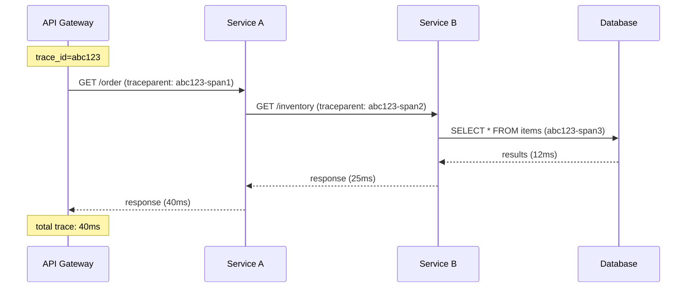
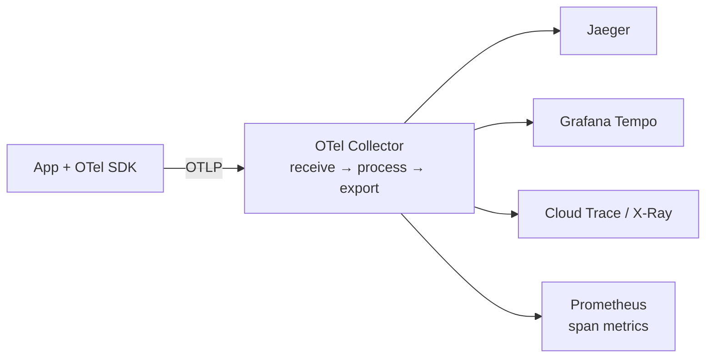
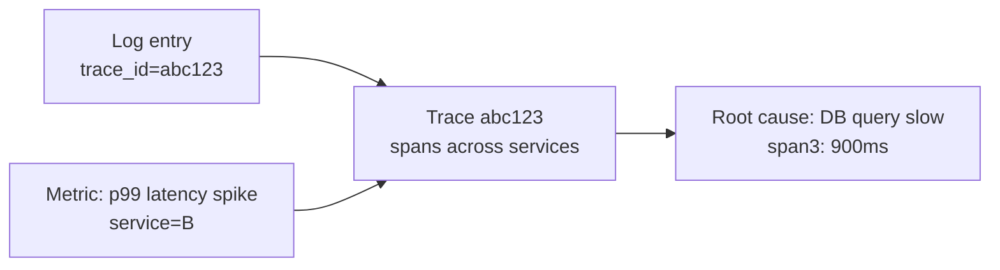

# 📘 Topic 50 — Distributed Tracing Basics

**Official Documentation Reference**
- Traces for K8s components: https://kubernetes.io/docs/concepts/cluster-administration/system-traces/
- OpenTelemetry: https://opentelemetry.io/docs/
- Jaeger: https://www.jaegertracing.io/docs/
- GKE Cloud Trace: https://cloud.google.com/trace/docs
- EKS X-Ray: https://docs.aws.amazon.com/xray/latest/devguide/xray-services-eks.html
- Grafana Tempo: https://grafana.com/docs/tempo/latest/

---

## 🔹 Definition
**Distributed tracing** follows a single request as it flows through multiple microservices, recording timing (spans) and metadata at each hop. A **trace** is a tree of **spans** connected by a shared trace ID — enabling you to see where latency lives and which service failed.

---

## 🔹 About

### Key concepts
| Concept | Meaning |
|---|---|
| **Trace** | End-to-end journey of one request |
| **Span** | One unit of work (one service call, one DB query) |
| **Trace ID** | Unique identifier linking all spans of a trace |
| **Span ID** | Unique identifier for one span |
| **Parent Span ID** | Links a span to its caller |
| **Context propagation** | Passing trace ID between services via HTTP headers (`traceparent`) |
| **Baggage** | Key-value pairs carried alongside trace context |

### Propagation headers
| Standard | Header |
|---|---|
| **W3C Trace Context** (recommended) | `traceparent`, `tracestate` |
| **B3 (Zipkin)** | `X-B3-TraceId`, `X-B3-SpanId`, `X-B3-Sampled` |
| **Jaeger** | `uber-trace-id` |

### Tracing backends
| Backend | Type | Best for |
|---|---|---|
| **Jaeger** | CNCF graduated | Self-hosted, rich UI |
| **Zipkin** | Open source | Lightweight |
| **Grafana Tempo** | Open source | Pairs with Loki + Grafana (no indexing, cheap) |
| **Cloud Trace (GCP)** | Managed | GKE native |
| **X-Ray (AWS)** | Managed | EKS/Lambda native |
| **Datadog APM / New Relic** | SaaS | Enterprise observability |

### OpenTelemetry (OTel)
The unified standard for instrumentation — **traces, metrics, and logs**. Components:
- **OTel SDK** — instrument app code (auto or manual).
- **OTel Collector** — receive, process, export telemetry data.
- **OTLP protocol** — standard export format (gRPC/HTTP).

### Instrumentation approaches
| Approach | How | Effort |
|---|---|---|
| **Auto-instrumentation** | OTel agent/SDK hooks into frameworks (Spring, Express, Django) | Low |
| **Manual instrumentation** | Code creates spans with `tracer.start_span()` | Medium |
| **Service mesh** | Istio/Linkerd sidecars auto-generate spans for L7 calls | None (mesh handles) |
| **eBPF-based** | Cilium Tetragon / Pixie captures kernel-level traces | None (kernel hooks) |

### Sampling
At scale, tracing 100% of requests is expensive. Sampling strategies:
- **Head-based**: decide at ingress (e.g., 10% of requests).
- **Tail-based**: collect all spans, then decide post-hoc (keep errors, slow requests).
- **Adaptive**: adjust rate based on traffic volume.

### Three pillars integration
| Pillar | How traces connect |
|---|---|
| **Logs** | Include `trace_id` in log fields → click from log to trace |
| **Metrics** | RED metrics (Rate, Error, Duration) derived from spans |
| **Traces** | The detailed path for one request |

---

## 🔹 How It Integrates
| Component | Interaction |
|---|---|
| Application | OTel SDK creates spans; propagates context |
| Service mesh | Sidecar auto-injects spans for inter-service calls |
| OTel Collector | Aggregates, samples, exports spans |
| Logging (Loki/CW) | `trace_id` field enables log-to-trace correlation |
| Prometheus | Span metrics (latency histograms) exported by OTel |

---

## 🏗️ Diagrams

### Trace through microservices


### OTel Collector architecture


### Three pillars correlation


---

## 💻 Real-World Examples

### Example 1 — OTel Collector Deployment
```yaml
apiVersion: apps/v1
kind: Deployment
metadata: { name: otel-collector, namespace: observability }
spec:
  replicas: 2
  selector: { matchLabels: { app: otel-collector } }
  template:
    metadata: { labels: { app: otel-collector } }
    spec:
      containers:
      - name: collector
        image: otel/opentelemetry-collector-contrib:0.100.0
        args: ["--config=/etc/otel/config.yaml"]
        ports:
        - { containerPort: 4317, name: otlp-grpc }
        - { containerPort: 4318, name: otlp-http }
        volumeMounts: [{ name: config, mountPath: /etc/otel }]
      volumes:
      - name: config
        configMap: { name: otel-config }
---
apiVersion: v1
kind: ConfigMap
metadata: { name: otel-config, namespace: observability }
data:
  config.yaml: |
    receivers:
      otlp:
        protocols:
          grpc: { endpoint: 0.0.0.0:4317 }
          http: { endpoint: 0.0.0.0:4318 }
    processors:
      batch: {}
      tail_sampling:
        policies: [{ name: errors, type: status_code, status_code: { status_codes: [ERROR] } }]
    exporters:
      otlp/tempo:
        endpoint: tempo.observability.svc:4317
        tls: { insecure: true }
    service:
      pipelines:
        traces:
          receivers: [otlp]
          processors: [batch, tail_sampling]
          exporters: [otlp/tempo]
```

### Example 2 — Python app with OTel auto-instrumentation
```bash
pip install opentelemetry-distro opentelemetry-exporter-otlp
opentelemetry-bootstrap -a install   # auto-detect frameworks
OTEL_SERVICE_NAME=order-svc \
OTEL_EXPORTER_OTLP_ENDPOINT=http://otel-collector.observability:4317 \
opentelemetry-instrument python app.py
```

### Example 3 — Kubernetes env vars for OTel
```yaml
env:
- { name: OTEL_SERVICE_NAME, value: order-svc }
- { name: OTEL_EXPORTER_OTLP_ENDPOINT, value: "http://otel-collector.observability:4317" }
- name: OTEL_RESOURCE_ATTRIBUTES
  value: "k8s.pod.name=$(POD_NAME),k8s.namespace.name=$(POD_NS)"
- name: POD_NAME
  valueFrom: { fieldRef: { fieldPath: metadata.name } }
- name: POD_NS
  valueFrom: { fieldRef: { fieldPath: metadata.namespace } }
```

### Example 4 — Jaeger quick install
```bash
kubectl apply -f https://github.com/jaegertracing/jaeger-operator/releases/download/v1.57.0/jaeger-operator.yaml -n observability
kubectl apply -f - <<EOF
apiVersion: jaegertracing.io/v1
kind: Jaeger
metadata: { name: jaeger, namespace: observability }
spec:
  strategy: allInOne
EOF
kubectl port-forward svc/jaeger-query 16686:16686 -n observability
```

### Example 5 — GKE Cloud Trace
```bash
# Auto-enabled on GKE. App uses OTel SDK with Google Cloud exporter:
pip install opentelemetry-exporter-gcp-trace
# Or configure OTel Collector with googlecloud exporter
```

### Example 6 — EKS X-Ray with ADOT
```bash
# Install AWS Distro for OpenTelemetry add-on
aws eks create-addon --cluster-name prod --addon-name adot
# ADOT Collector exports to X-Ray
```

---

## 💻 Related Commands

| Command | Purpose | Example |
|---|---|---|
| `kubectl port-forward svc/jaeger-query 16686:16686` | Open Jaeger UI | |
| `kubectl port-forward svc/tempo 3200:3200` | Tempo API | |
| `kubectl get pods -n observability` | Check collector/backend health | |
| `kubectl logs -n observability <collector-pod>` | Debug export errors | |

---

## 🚨 Scenarios

### Scenario 1 — Traces missing between two services
- **Cause**: context propagation broken — service B doesn't forward `traceparent` header.
- **Fix**: ensure all services instrument outgoing HTTP calls (OTel SDK auto-instruments most frameworks).

### Scenario 2 — Trace storage costs exploding
- **Cause**: sampling at 100%.
- **Fix**: use tail-based sampling (keep errors + slow traces only); or head-based at 10%.

### Scenario 3 — Can't correlate logs to traces
- **Cause**: app doesn't include `trace_id` in log output.
- **Fix**: configure OTel SDK to inject trace context into logging framework (MDC for Java, structlog for Python).

---

## ☁️ GKE Perspective
- **Cloud Trace** auto-collects traces from GKE with OTel SDK or Google client libraries.
- **Managed Prometheus** + **Grafana** + **Tempo**: full open-source stack on GKE.
- **Autopilot**: OTel Collector runs as a Deployment; no DaemonSet needed for tracing.

## 🟧 EKS Perspective
- **X-Ray**: native tracing service. ADOT Collector (EKS add-on) exports spans.
- **Amazon Managed Grafana + Tempo**: alternative open-source path.
- **Service map**: X-Ray auto-generates service dependency maps.

---

## 🧪 Labs

### Lab 50.1 — Jaeger all-in-one (Beginner, 45 min)
1. Install Jaeger (Example 4). 2. Deploy a Python app with OTel auto-instrumentation (Example 2). 3. Generate traffic. 4. Open Jaeger UI → find traces → inspect spans.

### Lab 50.2 — OTel Collector + Grafana Tempo (Intermediate, 60 min)
1. Install Tempo: `helm install tempo grafana/tempo -n observability`. 2. Deploy OTel Collector (Example 1). 3. Instrument 2 services. 4. Grafana → Explore → Tempo data source → search by trace ID.

### Lab 50.3 — Log-to-trace correlation (Advanced, 90 min)
1. App writes structured JSON logs with `trace_id` field. 2. Logs → Loki. 3. Traces → Tempo. 4. Grafana: click a log line → "View trace" → opens Tempo trace. 5. Click a trace span → "View logs" → opens Loki query filtered by trace_id.

---

## 🎯 Interview Deliverable Answer (60–90 s)
"**What**: Distributed tracing follows a request through multiple microservices by propagating a trace ID. Each service creates a span — together they form a trace tree showing exactly where time is spent.  
**Why**: Logs tell you what happened in one service. Metrics tell you something is slow. Traces tell you *where* in the call chain the slowness lives — was it the API, the auth service, or the database?  
**How**: I standardize on OpenTelemetry for instrumentation — auto-instrumentation where possible, manual spans for critical paths. The OTel Collector receives OTLP, batches, samples (tail-based for errors and slow traces), and exports to Grafana Tempo or Cloud Trace/X-Ray. I inject `trace_id` into structured logs so Grafana can link logs ↔ traces ↔ metrics in one click.  
**Example**: A payment endpoint had intermittent p99 spikes to 5 seconds. Metrics showed the spike but not the cause. A trace from Tempo revealed the bottleneck was a downstream fraud-check service that occasionally timed out. We added a circuit breaker + cached the result — p99 dropped to 200ms."

---

## ❓ Interview Questions

**Q1. What is a trace?** End-to-end journey of one request, composed of spans across services. **Q2. Trace ID vs Span ID?** Trace ID links all spans of one request. Span ID identifies one unit of work. **Q3. What is context propagation?** Passing trace ID between services — typically via `traceparent` header (W3C). **Q4. OpenTelemetry — what is it?** Unified standard for traces + metrics + logs. SDK + Collector + OTLP protocol. **Q5. Auto vs manual instrumentation?** Auto: agent hooks into frameworks, zero code. Manual: create spans in code for custom logic. **Q6. Head vs tail sampling?** Head: decide at ingress. Tail: collect all, decide later (keep errors/slow). **Q7. How does a service mesh help tracing?** Sidecar proxy auto-generates spans for all inter-service calls. **Q8. Log-trace correlation?** Include `trace_id` in log JSON → Grafana links log line to trace. **Q9. Cloud Trace vs Jaeger?** Cloud Trace: GCP managed, auto-collects. Jaeger: self-hosted, CNCF graduated, more control. **Q10. Why not trace 100% of requests?** Storage/cost. Use tail-based sampling to keep errors + slow traces.

