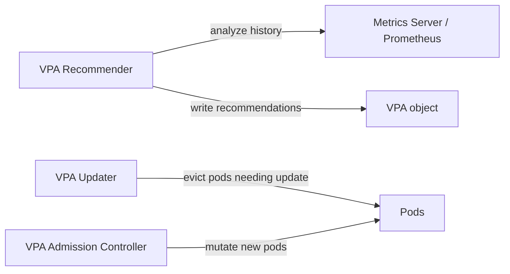
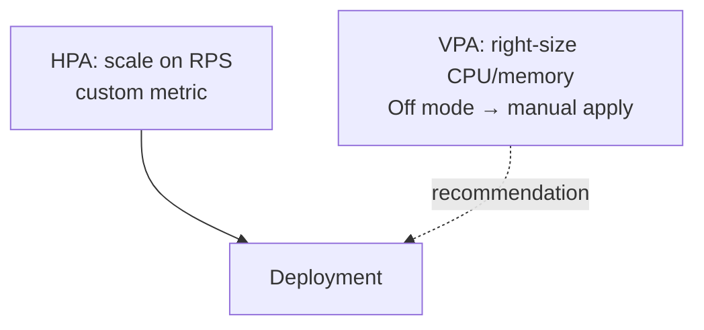

# 📘 Topic 52 — Vertical Pod Autoscaler (VPA)

**Official Documentation Reference**
- VPA: https://kubernetes.io/docs/concepts/workloads/autoscaling/vertical-pod-autoscale/
- VPA GitHub: https://github.com/kubernetes/autoscaler/tree/master/vertical-pod-autoscaler
- GKE VPA: https://cloud.google.com/kubernetes-engine/docs/concepts/verticalpodautoscaler

---

## 🔹 Definition
The **Vertical Pod Autoscaler (VPA)** automatically adjusts CPU and memory **requests** (and optionally limits) for containers based on historical usage — right-sizing pods without manual guesswork.

---

## 🔹 About

### Components
| Component | Role |
|---|---|
| **Recommender** | Analyzes metrics history → generates recommendations |
| **Updater** | Evicts pods that need updated requests (Auto mode) |
| **Admission Controller** | Mutates new pods with recommended requests at creation |

### Update modes
| Mode | Behavior | Use case |
|---|---|---|
| `Off` | Recommend only — no changes applied | Safest; review first |
| `Initial` | Apply recommendations only when pod starts (no evictions) | Non-disruptive |
| `Auto` | Apply on start + evict running pods to apply updates | Full automation |
| `Recreate` | Same as Auto (legacy name) | — |

### VPA output
```bash
kubectl describe vpa web-vpa
# Recommendation:
#   Container: web
#     Lower Bound:  cpu: 25m,  memory: 64Mi
#     Target:       cpu: 100m, memory: 128Mi
#     Upper Bound:  cpu: 500m, memory: 512Mi
#     Uncapped Target: cpu: 100m, memory: 128Mi
```

### VPA + HPA
- **Don't run both on CPU for the same Deployment** — HPA scales replicas based on `actual/request`; VPA changes `request`, which changes HPA's denominator.
- **Safe combination**: HPA on custom metric (RPS), VPA on CPU/memory. Or VPA in `Off` mode + manual apply.
- **Multidimensional Pod Autoscaler (MPA)** on GKE handles both.

### Resource policies
```yaml
spec:
  resourcePolicy:
    containerPolicies:
    - containerName: web
      minAllowed: { cpu: 50m, memory: 64Mi }
      maxAllowed: { cpu: 2, memory: 4Gi }
      controlledResources: [cpu, memory]
      controlledValues: RequestsAndLimits    # or RequestsOnly
```

---

## 🏗️ Diagrams

### VPA architecture


### VPA + HPA safe combo


---

## 💻 Real-World Examples

### Example 1 — VPA in Off mode (recommend only)
```yaml
apiVersion: autoscaling.k8s.io/v1
kind: VerticalPodAutoscaler
metadata: { name: web-vpa }
spec:
  targetRef: { apiVersion: apps/v1, kind: Deployment, name: web }
  updatePolicy: { updateMode: "Off" }
  resourcePolicy:
    containerPolicies:
    - containerName: web
      minAllowed: { cpu: 50m, memory: 64Mi }
      maxAllowed: { cpu: 4, memory: 8Gi }
```

### Example 2 — VPA in Auto mode
```yaml
spec:
  updatePolicy: { updateMode: "Auto" }
```

### Example 3 — Read recommendations
```bash
kubectl describe vpa web-vpa
kubectl get vpa web-vpa -o jsonpath='{.status.recommendation.containerRecommendations[0].target}'
```

---

## 💻 Related Commands

| Command | Purpose | Example |
|---|---|---|
| `kubectl get vpa` | List VPAs | `kubectl get vpa` |
| `kubectl describe vpa` | Recommendations + status | `kubectl describe vpa web-vpa` |
| `kubectl get vpa -o yaml` | Full output | `kubectl get vpa web-vpa -o yaml` |

---

## 🚨 Scenarios

### Scenario 1 — VPA evicts all pods at once
- **Cause**: Auto mode + no PDB.
- **Fix**: add PDB `minAvailable: 50%`. VPA respects PDB.

### Scenario 2 — VPA + HPA on CPU → infinite loop
- **Cause**: VPA raises request → HPA sees lower utilization → scales down → VPA adjusts → loop.
- **Fix**: use HPA on custom metric (not CPU); VPA on CPU/memory.

### Scenario 3 — VPA recommends too low
- **Cause**: insufficient history or workload is spiky.
- **Fix**: wait for more data; set `minAllowed` as a floor.

---

## ☁️ GKE Perspective
- VPA built-in on GKE: `gcloud container clusters update --enable-vertical-pod-autoscaling`.
- **Multidimensional Pod Autoscaler (MPA)**: GKE-specific — combines HPA + VPA safely.

## 🟧 EKS Perspective
- Install VPA manually: `kubectl apply -f https://github.com/kubernetes/autoscaler/releases/latest/download/vpa-v1-crd-gen.yaml`.
- Or use Helm chart.

---

## 🧪 Labs

### Lab 52.1 — VPA Off mode (Beginner, 30 min)
Deploy app with high requests. Apply VPA Off mode. Generate load. `kubectl describe vpa` → read recommendations. Manually apply recommended values.

### Lab 52.2 — VPA Auto mode with PDB (Intermediate, 45 min)
VPA Auto. Add PDB `minAvailable: 1`. Observe VPA evicting pods one at a time. Verify new pods have updated requests.

### Lab 52.3 — Right-sizing sprint (Advanced, 60 min)
Apply VPA Off to all Deployments. Wait 24h. Script: extract recommendations → compare to current requests → generate patches → apply in staging → validate.

---

## 🎯 Interview Deliverable Answer (60–90 s)
"**What**: VPA automatically right-sizes pod CPU and memory requests based on observed usage. It has three components: recommender (analyzes), updater (evicts for updates), admission controller (mutates new pods).  
**Why**: Teams over-request 3–5× on average. VPA eliminates guesswork — it uses historical data to set requests at the right level, improving bin-packing and reducing cost.  
**How**: I start with `Off` mode to gather recommendations without disruption. After reviewing Target vs current requests across all Deployments, I apply the recommendations manually or via a CI job. For non-critical services I use `Auto` mode with a PDB so evictions are safe. I never combine VPA on CPU with HPA on CPU — I use HPA on custom metrics instead.  
**Example**: A right-sizing sprint using VPA Off across 60 Deployments showed 70% were over-requesting CPU by 4×. Applying VPA recommendations freed enough capacity to remove 15 nodes — saving $6K/month."

---

## ❓ Interview Questions

**Q1. What does VPA do?** Adjusts pod CPU/memory requests based on usage history. **Q2. Three VPA components?** Recommender, Updater, Admission Controller. **Q3. Update modes?** Off, Initial, Auto. **Q4. VPA + HPA safe?** Not on the same metric (CPU). Safe: HPA on RPS + VPA on CPU/memory. **Q5. Lower/Target/Upper Bound?** Lower = minimum safe. Target = recommended. Upper = peak observed. **Q6. Does VPA restart pods?** Auto mode evicts pods to apply new requests. **Q7. How does VPA respect PDB?** Won't evict if it would violate PDB. **Q8. `controlledValues: RequestsOnly` — what?** VPA adjusts requests but leaves limits unchanged. **Q9. GKE MPA?** Multidimensional Pod Autoscaler — combines HPA + VPA safely. **Q10. When to use VPA vs HPA?** VPA: right-size individual pods. HPA: scale out/in based on load. Both serve different purposes.

