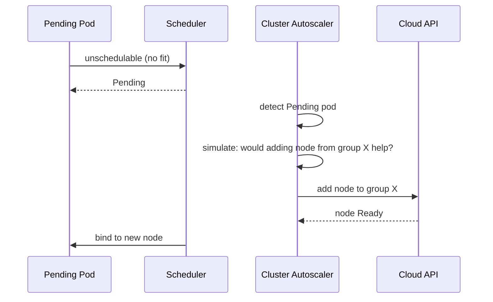
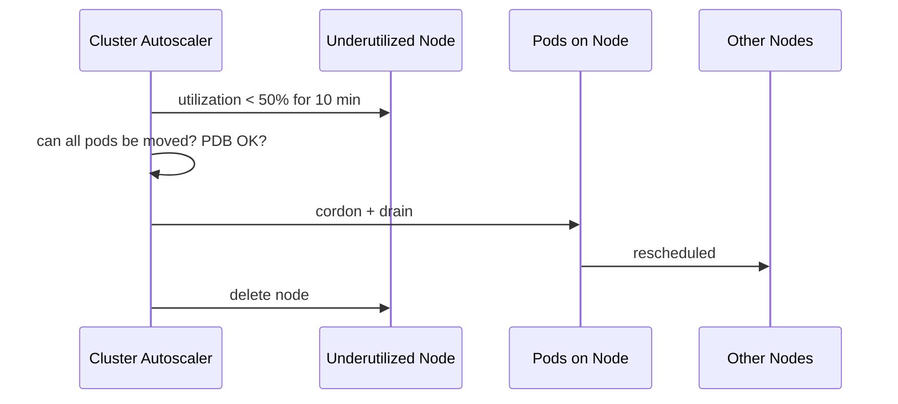

# 📘 Topic 53 — Cluster Autoscaler

**Official Documentation Reference**
- Node autoscaling concept: https://kubernetes.io/docs/concepts/cluster-administration/node-autoscaling/
- Cluster Autoscaler GitHub: https://github.com/kubernetes/autoscaler/tree/master/cluster-autoscaler
- GKE CA: https://cloud.google.com/kubernetes-engine/docs/concepts/cluster-autoscaler
- EKS CA: https://docs.aws.amazon.com/eks/latest/userguide/autoscaling.html

---

## 🔹 Definition
The **Cluster Autoscaler (CA)** automatically adjusts the number of **nodes** in a cluster — adding nodes when pods are Pending (unschedulable) and removing underutilized nodes when workloads can be consolidated.

---

## 🔹 About

### Scale-up trigger
Pod is Pending → scheduler can't find a fitting node → CA simulates if adding a node from a node group would help → provisions the node.

### Scale-down trigger
Node utilization < threshold (default 50%) for `--scale-down-unneeded-time` (default 10 min) AND all pods can be moved to other nodes AND no PDB violation.

### Expanders (how CA picks which node group to scale)
| Expander | Strategy |
|---|---|
| `random` | Random node group |
| `most-pods` | Group that fits most pending pods |
| `least-waste` | Group that wastes least resources |
| `priority` | User-defined priority per group |
| `price` | Cheapest (cloud pricing) |

### Key flags
| Flag | Default | Meaning |
|---|---|---|
| `--scale-down-utilization-threshold` | 0.5 | Node underutilized below this → candidate |
| `--scale-down-unneeded-time` | 10m | How long a node must be underutilized |
| `--max-graceful-termination-sec` | 600 | Time to drain a node |
| `--skip-nodes-with-system-pods` | true | Don't remove nodes with kube-system pods |
| `--skip-nodes-with-local-storage` | true | Don't remove nodes with emptyDir/hostPath |
| `--expander` | random | Expansion strategy |

### Annotations
- `cluster-autoscaler.kubernetes.io/safe-to-evict: "false"` → CA won't remove this node.
- `cluster-autoscaler.kubernetes.io/scale-down-disabled: "true"` → node exempt.

### CA does NOT
- Scale nodes for DaemonSet-only pods (they're expected on every node).
- Move pods between nodes for balancing (use Descheduler for that).
- Handle custom cloud instances (use Karpenter for that).

---

## 🏗️ Diagrams

### Scale-up flow


### Scale-down flow


---

## 💻 Real-World Examples

### Example 1 — GKE Cluster Autoscaler
```bash
gcloud container clusters update prod --region=asia-south1 \
  --enable-autoscaling --min-nodes=1 --max-nodes=10 \
  --node-pool=default-pool
```

### Example 2 — EKS Cluster Autoscaler
```bash
helm repo add autoscaler https://kubernetes.github.io/autoscaler
helm install cluster-autoscaler autoscaler/cluster-autoscaler \
  -n kube-system \
  --set autoDiscovery.clusterName=prod \
  --set awsRegion=ap-south-1 \
  --set extraArgs.scale-down-utilization-threshold=0.5 \
  --set extraArgs.expander=least-waste
```

### Example 3 — Prevent scale-down on a node
```bash
kubectl annotate node worker-3 cluster-autoscaler.kubernetes.io/scale-down-disabled="true"
```

---

## 💻 Related Commands

| Command | Purpose | Example |
|---|---|---|
| `kubectl get nodes` | Current node count | `kubectl get nodes` |
| `kubectl describe configmap cluster-autoscaler-status -n kube-system` | CA status + decisions | |
| `kubectl logs -n kube-system -l app.kubernetes.io/name=cluster-autoscaler` | CA logs | |
| `gcloud container clusters describe --format='value(autoscaling)'` | GKE CA config | |

---

## 🚨 Scenarios

### Scenario 1 — Pods Pending but CA doesn't add nodes
- **Cause**: max nodes reached; or node group doesn't match pod constraints (affinity/taints).
- **Fix**: increase max-nodes; add a node group matching pod requirements.

### Scenario 2 — CA removes a node during business hours
- **Cause**: utilization dropped below threshold.
- **Fix**: lower `scale-down-utilization-threshold`; or use PDB + `safe-to-evict: "false"` on critical pods.

### Scenario 3 — Scale-up takes 5 minutes
- **Cause**: cloud VM provisioning + image pull time.
- **Fix**: use overprovisioning pattern (placeholder pods preempt → instant scaling, CA backfills). Or Karpenter (faster node selection).

---

## ☁️ GKE Perspective
- **Autopilot**: CA is built-in and fully managed. You don't configure it.
- **Standard**: enable per node pool. Supports **Node Auto-Provisioning (NAP)** for auto-creating node pools.
- **Scale-down blocking**: DaemonSets, PDB, local storage.

## 🟧 EKS Perspective
- CA runs as a Deployment with IRSA.
- Auto-discovery: tags on ASG `k8s.io/cluster-autoscaler/enabled=true` + `k8s.io/cluster-autoscaler/<cluster-name>=owned`.
- **Karpenter** is the recommended alternative — faster, more flexible.

---

## 🧪 Labs

### Lab 53.1 — CA scale-up (Beginner, 30 min)
Set max-nodes=3, deploy pods requesting more CPU than 1 node has → CA adds nodes.

### Lab 53.2 — CA scale-down (Intermediate, 30 min)
Scale deployment to 1 replica. Wait 10 min. Observe CA removes underutilized node.

### Lab 53.3 — Overprovisioning pattern (Advanced, 60 min)
Deploy placeholder pods (priority=-1). Deploy real pod → preempts placeholder → instant start. CA backfills placeholder's node in background.

---

## 🎯 Interview Deliverable Answer (60–90 s)
"**What**: Cluster Autoscaler adds nodes when pods can't schedule (Pending) and removes nodes when they're underutilized (< 50% for 10 min, all pods movable, PDB respected).  
**Why**: Without it, you either over-provision (waste money) or under-provision (Pending pods, degraded service).  
**How**: On GKE I enable CA per node pool with min/max. On EKS I deploy CA via Helm with auto-discovery and `least-waste` expander. I tune scale-down to be conservative (10 min + PDB) and use the overprovisioning pattern for instant pod placement while CA provisions nodes in the background.  
**Example**: During a traffic spike, HPA scaled our API from 5 to 40 pods. CA added 7 nodes in under 4 minutes. After traffic subsided, CA removed the extra nodes over 30 minutes — saving ~$50/day."

---

## ❓ Interview Questions

**Q1. How does CA know to add nodes?** Pods in Pending state that can't schedule. **Q2. How does CA know to remove nodes?** Utilization below threshold, all pods reschedulable, no PDB violation. **Q3. What are expanders?** Strategies for choosing which node group to scale: random, most-pods, least-waste, priority, price. **Q4. CA vs Karpenter?** CA works with pre-defined node groups (ASGs). Karpenter provisions any instance type per pod requirements — more flexible. **Q5. What does `safe-to-evict: false` do?** Prevents CA from removing the node. **Q6. Does CA balance nodes?** No — it only adds/removes. Use Descheduler for rebalancing. **Q7. CA on Autopilot?** Fully managed, no config needed. **Q8. Scale-up latency?** 2–5 min (VM provisioning + image pull). Mitigate with overprovisioning. **Q9. Does CA handle DaemonSets?** Ignores DS pods for scale-up decisions; skips nodes with system DS pods for scale-down. **Q10. What if max-nodes is reached?** Pods stay Pending. Alert on this.

