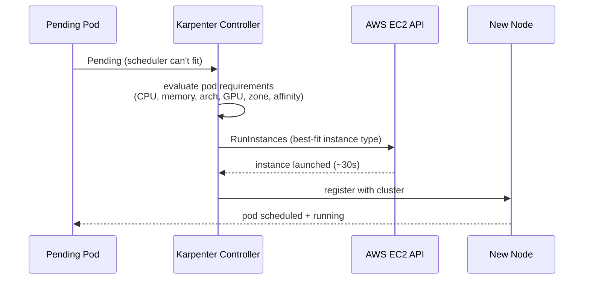
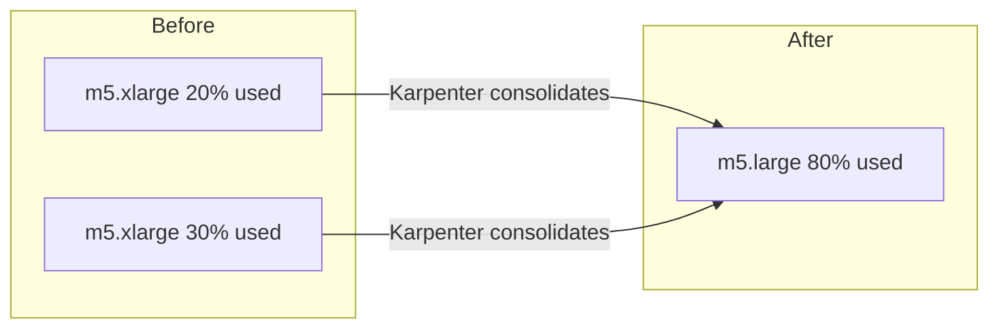
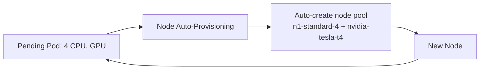

# 📘 Topic 54 — Karpenter (EKS) and Node Auto-Provisioning (GKE)

**Official Documentation Reference**
- Karpenter: https://karpenter.sh/docs/
- GKE NAP: https://cloud.google.com/kubernetes-engine/docs/concepts/node-auto-provisioning
- EKS Karpenter: https://docs.aws.amazon.com/eks/latest/best-practices/karpenter.html

---

## 🔹 Definition
**Karpenter** (EKS) and **Node Auto-Provisioning (NAP)** (GKE) are next-generation node autoscalers that provision right-sized, right-type nodes on demand — without pre-defined node groups. They select instance types, zones, and purchase options (Spot/on-demand) per pending pod's requirements.

---

## 🔹 About

### Karpenter vs Cluster Autoscaler
| Feature | Cluster Autoscaler | Karpenter |
|---|---|---|
| Node selection | Pre-defined ASG/node group | Any instance type per pod |
| Speed | 2–5 min (scale ASG) | 30–90 s (direct EC2 API) |
| Spot handling | Limited | Built-in interruption handling + consolidation |
| Consolidation | No (only scale down) | Replaces underutilized nodes with smaller ones |
| Multi-arch | Requires separate node groups | Selects arm64/amd64 based on pod |
| Cloud | Any (GKE, EKS, AKS) | Primarily AWS EKS (GKE has NAP) |

### Karpenter objects (v1 API, 2024+)
| Object | Purpose |
|---|---|
| **NodePool** | Defines constraints: instance types, zones, capacity type (spot/on-demand), taints, limits |
| **EC2NodeClass** | AWS-specific: AMI, subnets, security groups, user data, block device mappings |
| **NodeClaim** | Internal: represents a single provisioned node |

### GKE NAP
- **What**: GKE automatically creates and deletes node pools based on pod requirements.
- **How**: enable with `--enable-autoprovisioning --min-cpu=1 --max-cpu=100 --min-memory=1 --max-memory=400`.
- **Supports**: GPU auto-provisioning, Spot VMs, custom machine families.
- **Limitation**: less flexible than Karpenter (can't mix arbitrary instance types per pod).

### Karpenter consolidation
Karpenter continuously watches for underutilized nodes and replaces them with cheaper/smaller ones:
- **Deletion**: removes empty nodes.
- **Replacement**: replaces a node with a smaller instance if pods fit.
- **Policy**: `consolidationPolicy: WhenEmptyOrUnderutilized` or `WhenEmpty`.
- **Budget**: `disruption.budgets` control how many nodes can be disrupted at once.

### Spot/preemptible handling
- **Karpenter**: detects Spot interruption (2 min warning), cordons node, drains pods.
- **NAP**: GKE handles preemptible VM eviction; pods rescheduled automatically.

---

## 🏗️ Diagrams

### Karpenter provisioning flow


### Karpenter consolidation


### GKE NAP


---

## 💻 Real-World Examples

### Example 1 — Karpenter NodePool + EC2NodeClass
```yaml
apiVersion: karpenter.sh/v1
kind: NodePool
metadata: { name: default }
spec:
  template:
    spec:
      requirements:
      - { key: karpenter.sh/capacity-type, operator: In, values: [spot, on-demand] }
      - { key: kubernetes.io/arch, operator: In, values: [amd64] }
      - { key: node.kubernetes.io/instance-type, operator: In, values: [m5.large, m5.xlarge, m6i.large, c5.large] }
      - { key: topology.kubernetes.io/zone, operator: In, values: [ap-south-1a, ap-south-1b] }
      nodeClassRef: { group: karpenter.k8s.aws, kind: EC2NodeClass, name: default }
  limits:
    cpu: 100
    memory: 400Gi
  disruption:
    consolidationPolicy: WhenEmptyOrUnderutilized
    consolidateAfter: 60s
    budgets:
    - nodes: "20%"
---
apiVersion: karpenter.k8s.aws/v1
kind: EC2NodeClass
metadata: { name: default }
spec:
  amiSelectorTerms: [{ alias: al2023@latest }]
  subnetSelectorTerms: [{ tags: { karpenter.sh/discovery: prod } }]
  securityGroupSelectorTerms: [{ tags: { karpenter.sh/discovery: prod } }]
  role: KarpenterNodeRole-prod
```

### Example 2 — GKE NAP
```bash
gcloud container clusters update prod --region=asia-south1 \
  --enable-autoprovisioning \
  --min-cpu=2 --max-cpu=200 \
  --min-memory=4 --max-memory=800 \
  --autoprovisioning-scopes=https://www.googleapis.com/auth/cloud-platform
```

### Example 3 — Karpenter install on EKS
```bash
helm install karpenter oci://public.ecr.aws/karpenter/karpenter \
  --version 1.0.0 \
  --namespace kube-system \
  --set clusterName=prod \
  --set clusterEndpoint=$(aws eks describe-cluster --name prod --query "cluster.endpoint" --output text)
```

---

## 💻 Related Commands

| Command | Purpose | Example |
|---|---|---|
| `kubectl get nodepools` | List Karpenter NodePools | `kubectl get nodepools` |
| `kubectl get nodeclaims` | Active node claims | `kubectl get nodeclaims` |
| `kubectl describe nodepool default` | Pool config + status | |
| `kubectl get nodes -L karpenter.sh/capacity-type` | Spot vs on-demand | |
| `kubectl logs -n kube-system -l app.kubernetes.io/name=karpenter` | Controller logs | |
| `gcloud container operations list` | GKE NAP operations | |

---

## 🚨 Scenarios

### Scenario 1 — Karpenter picks too-expensive instance
- **Cause**: no instance type constraints in NodePool.
- **Fix**: add `node.kubernetes.io/instance-type In [m5.large, c5.large, ...]`.

### Scenario 2 — Spot interruption during deploy
- **Cause**: Spot node reclaimed by AWS.
- **Fix**: Karpenter handles gracefully — cordons, drains, provisions replacement. Add PDB for safety.

### Scenario 3 — NAP creates wrong machine type
- **Cause**: NAP picks based on pod requests; if requests are tiny, it picks small VMs.
- **Fix**: set `min-cpu` / `min-memory` on NAP; or add resource floors via LimitRange.

### Scenario 4 — Karpenter consolidation disrupts long-running job
- **Fix**: annotate job pods `karpenter.sh/do-not-disrupt: "true"`. Or set `disruption.budgets` to limit concurrent disruptions.

---

## ☁️ GKE Perspective
- **NAP** is the GKE equivalent of Karpenter. Managed by Google; fewer knobs.
- **Autopilot** = NAP on steroids — you don't even see nodes.
- NAP supports GPU node pools, Spot VMs, custom machine families.
- For richer node selection, some teams install Karpenter on GKE Standard (community-supported, less mature than on EKS).

## 🟧 EKS Perspective
- **Karpenter is the recommended node autoscaler for EKS** (AWS official).
- Replaces Cluster Autoscaler for most use cases.
- Supports: Spot + on-demand mixing, arm64/amd64, GPU, EFA, capacity reservations.
- **EKS Auto Mode** (2024+): managed Karpenter — AWS runs the controller.

---

## 🧪 Labs

### Lab 54.1 — Karpenter basics on EKS (Intermediate, 60 min)
1. Install Karpenter (Example 3). 2. Apply NodePool + EC2NodeClass (Example 1). 3. Deploy pods requesting 4 CPU → Karpenter provisions node in ~60s. 4. Scale down → Karpenter consolidates.

### Lab 54.2 — Spot + on-demand mix (Advanced, 60 min)
1. NodePool with `capacity-type: In [spot, on-demand]`. 2. Deploy 10 replicas. 3. `kubectl get nodes -L karpenter.sh/capacity-type` → mix of spot and on-demand. 4. Simulate Spot interruption → Karpenter replaces.

### Lab 54.3 — GKE NAP with GPU (Advanced, 60 min)
1. Enable NAP with GPU support. 2. Deploy ML pod requesting `nvidia.com/gpu: 1`. 3. NAP creates GPU node pool automatically. 4. Pod runs. 5. Delete pod → NAP scales down GPU pool.

---

## 🎯 Interview Deliverable Answer (60–90 s)
"**What**: Karpenter (EKS) and NAP (GKE) are next-gen node autoscalers that provision right-sized nodes per pod — no pre-defined node groups. Karpenter selects from a pool of instance types, zones, and Spot/on-demand based on each pending pod's requirements, and consolidates underutilized nodes by replacing them with smaller ones.  
**Why**: Cluster Autoscaler is limited to scaling pre-defined ASGs — you must guess which instance types to pre-configure. Karpenter eliminates that guesswork, provisions in ~60 seconds (vs 3–5 min), and saves money through intelligent consolidation and Spot mixing.  
**How**: I define a NodePool with broad instance type families (m5/m6i/c5), allow Spot + on-demand, set CPU/memory limits, and enable consolidation. Karpenter picks the cheapest instance that fits. I protect long-running jobs with `do-not-disrupt` annotations and set disruption budgets. On GKE I use NAP or Autopilot.  
**Example**: Migrating from Cluster Autoscaler to Karpenter on a 200-pod EKS cluster reduced node count by 30% (better bin-packing), cut provisioning time from 4 minutes to 45 seconds, and saved $15K/month through Spot + consolidation."

---

## ❓ Interview Questions

**Q1. Karpenter vs CA?** Karpenter: any instance type, faster, consolidation. CA: pre-defined ASGs, slower, wider cloud support. **Q2. NodePool vs EC2NodeClass?** NodePool: scheduling constraints. EC2NodeClass: AWS infra (AMI, subnets, SGs). **Q3. What is consolidation?** Karpenter replaces underutilized nodes with smaller/cheaper ones. **Q4. How does Karpenter handle Spot?** Detects 2-min interruption warning, cordons, drains, provisions replacement. **Q5. What is GKE NAP?** Node Auto-Provisioning: auto-creates node pools based on pod requirements. **Q6. Karpenter speed?** ~30–90 seconds (direct EC2 API vs ASG scaling). **Q7. `do-not-disrupt` annotation?** Prevents Karpenter from consolidating/disrupting that node. **Q8. EKS Auto Mode?** AWS-managed Karpenter. **Q9. GKE Autopilot vs NAP?** Autopilot = nodes fully hidden. NAP = auto-creates node pools you can see. **Q10. How to limit Karpenter spending?** `limits: {cpu: 100, memory: 400Gi}` on NodePool caps total provisioned resources.

