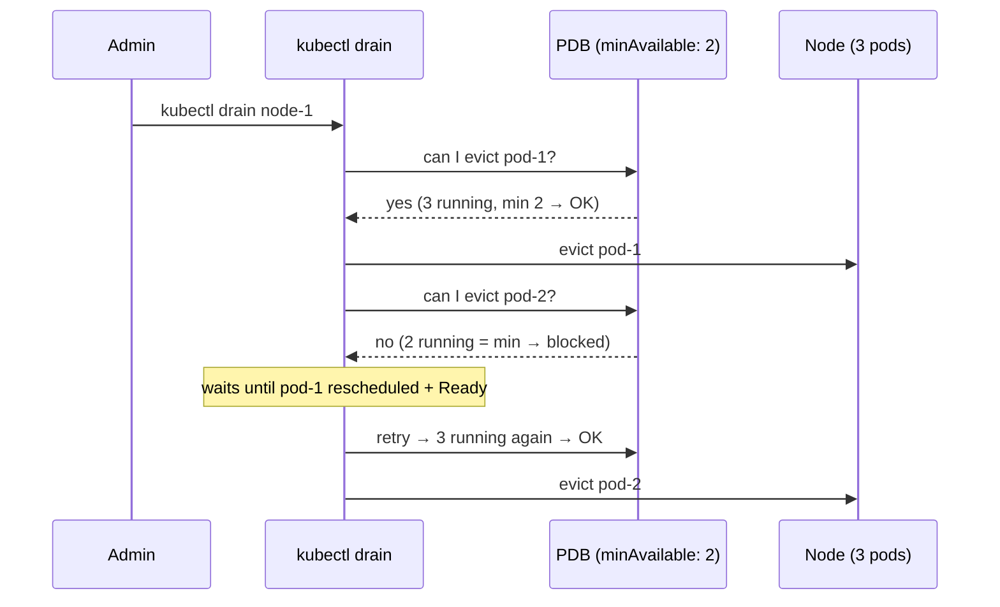
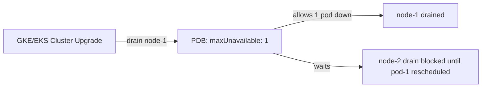

# 📘 Topic 55 — Pod Disruption Budgets (PDB)

**Official Documentation Reference**
- Disruptions: https://kubernetes.io/docs/concepts/workloads/pods/disruptions/
- PDB: https://kubernetes.io/docs/tasks/run-application/configure-pdb/
- GKE PDB: https://cloud.google.com/kubernetes-engine/docs/concepts/pod-disruption-budgets
- EKS PDB: https://docs.aws.amazon.com/eks/latest/best-practices/reliability.html

---

## 🔹 Definition
A **PodDisruptionBudget (PDB)** limits the number of pods of a replicated application that can be **voluntarily disrupted** at the same time — ensuring availability during node drains, cluster upgrades, and autoscaler scale-downs.

---

## 🔹 About

### Voluntary vs involuntary disruptions
| Type | Examples | PDB applies? |
|---|---|---|
| **Voluntary** | `kubectl drain`, cluster upgrade, CA scale-down, Karpenter consolidation, VPA eviction | ✅ Yes |
| **Involuntary** | Node crash, kernel panic, OOMKill, hardware failure | ❌ No |

### PDB spec
```yaml
apiVersion: policy/v1
kind: PodDisruptionBudget
metadata: { name: web-pdb }
spec:
  selector: { matchLabels: { app: web } }
  minAvailable: 2        # OR maxUnavailable: 1 (use one, not both)
```

| Field | Meaning |
|---|---|
| `minAvailable` | Minimum pods that must remain running (absolute or %) |
| `maxUnavailable` | Maximum pods that can be down (absolute or %) |
| `selector` | Which pods this PDB protects |
| `unhealthyPodEvictionPolicy` | `IfHealthy` (default) or `AlwaysAllow` (K8s 1.31+ stable) |

### Rules
- Only ONE of `minAvailable` or `maxUnavailable`.
- `minAvailable: 100%` = no voluntary disruption allowed (blocks drains/upgrades — dangerous!).
- `maxUnavailable: 0` = same as above — blocks everything.
- PDB applies to pods matching the selector, regardless of controller.
- Multiple PDBs can cover the same pods — all must allow.

### `unhealthyPodEvictionPolicy: AlwaysAllow`
By default, PDB counts unhealthy pods as "available" to protect them from eviction during investigations. `AlwaysAllow` lets unhealthy pods be evicted even when PDB is at its limit — prevents stuck drains when pods are already failing.

### PDB + kubectl drain
`kubectl drain` respects PDB. If evicting a pod would violate PDB, drain waits (up to `--timeout`). `--disable-eviction` bypasses PDB (dangerous).

---

## 🏗️ Diagrams

### PDB during node drain


### PDB with cluster upgrade


---

## 💻 Real-World Examples

### Example 1 — PDB with minAvailable
```yaml
apiVersion: policy/v1
kind: PodDisruptionBudget
metadata: { name: api-pdb }
spec:
  minAvailable: 2
  selector: { matchLabels: { app: api } }
```

### Example 2 — PDB with maxUnavailable percentage
```yaml
apiVersion: policy/v1
kind: PodDisruptionBudget
metadata: { name: web-pdb }
spec:
  maxUnavailable: "25%"
  selector: { matchLabels: { app: web } }
```

### Example 3 — PDB with unhealthyPodEvictionPolicy
```yaml
spec:
  maxUnavailable: 1
  unhealthyPodEvictionPolicy: AlwaysAllow
  selector: { matchLabels: { app: web } }
```

### Example 4 — Imperative
```bash
kubectl create pdb web-pdb --selector=app=web --min-available=2
kubectl get pdb
kubectl describe pdb web-pdb
```

---

## 💻 Related Commands

| Command | Purpose | Example |
|---|---|---|
| `kubectl get pdb` | List PDBs | `kubectl get pdb -A` |
| `kubectl describe pdb` | Status + allowed disruptions | `kubectl describe pdb api-pdb` |
| `kubectl create pdb` | Imperative creation | `kubectl create pdb p --selector=app=web --min-available=2` |
| `kubectl drain` | Drain node (respects PDB) | `kubectl drain node-1 --ignore-daemonsets --delete-emptydir-data` |
| `kubectl drain` | `--disable-eviction` | Bypass PDB (dangerous) | `kubectl drain node-1 --disable-eviction` |

---

## 🚨 Scenarios

### Scenario 1 — Drain blocked indefinitely
- **Cause**: PDB `minAvailable: 100%` or only 2 replicas with `minAvailable: 2`.
- **Fix**: lower `minAvailable` to `replicas - 1`; or increase replicas first.

### Scenario 2 — Cluster upgrade stuck
- **Cause**: PDB too tight; upgraded node can't drain.
- **Fix**: same as above. GKE shows upgrade status; EKS shows node group update stuck.

### Scenario 3 — PDB + single replica
- **Cause**: `minAvailable: 1` with 1 replica → drain can't evict the only pod.
- **Fix**: increase replicas to ≥ 2 before applying PDB.

### Scenario 4 — Unhealthy pod blocking drain
- **Cause**: default `unhealthyPodEvictionPolicy: IfHealthy` counts unhealthy pods as needing protection.
- **Fix**: set `AlwaysAllow` so unhealthy pods can be evicted.

---

## ☁️ GKE Perspective
- GKE respects PDB during node upgrades and node pool resize.
- **Autopilot** enforces PDB for node maintenance.
- PDB too strict → upgrade times out; GKE retries but eventually fails.

## 🟧 EKS Perspective
- EKS managed node group upgrades respect PDB during rolling replacement.
- Karpenter respects PDB during consolidation and Spot replacement.
- `kubectl drain` (manual patching) respects PDB.

---

## 🧪 Labs

### Lab 55.1 — PDB basics (Beginner, 20 min)
1. Deploy 3-replica Deployment + PDB `minAvailable: 2`.
2. `kubectl drain node-1 --ignore-daemonsets` → one pod evicted; second blocked.
3. `kubectl uncordon node-1`.

### Lab 55.2 — PDB blocks upgrade (Intermediate, 30 min)
1. Set `minAvailable: 100%`. Try `kubectl drain` → blocked forever.
2. Fix to `maxUnavailable: 1`. Retry → succeeds.

### Lab 55.3 — unhealthyPodEvictionPolicy (Advanced, 30 min)
1. Create PDB `maxUnavailable: 1, unhealthyPodEvictionPolicy: AlwaysAllow`.
2. Make one pod unhealthy (fail readiness).
3. Drain → unhealthy pod evicted despite being "needed".

---

## 🎯 Interview Deliverable Answer (60–90 s)
"**What**: A PodDisruptionBudget limits how many pods of a replicated workload can be voluntarily disrupted at once — protecting availability during drains, upgrades, and autoscaler consolidation.  
**Why**: Without PDB, a `kubectl drain` or cluster upgrade can take down all replicas simultaneously. PDB guarantees N pods stay running throughout.  
**How**: For every production Deployment with ≥ 2 replicas, I create a PDB with `maxUnavailable: 1` (or 25% for large fleets). I pair it with replicas ≥ 3 so drain is never blocked. I set `unhealthyPodEvictionPolicy: AlwaysAllow` to prevent stuck drains when pods are already failing. I never set `minAvailable: 100%` — that blocks all maintenance.  
**Example**: During a GKE cluster upgrade, our PDB `maxUnavailable: 1` ensured only one API pod was down at a time across 12 replicas. The upgrade took 45 minutes instead of 5, but zero requests were dropped."

---

## ❓ Interview Questions

**Q1. What is a PDB?** Limits voluntary disruption of pods — ensures minimum availability. **Q2. Voluntary vs involuntary?** Voluntary: drain, upgrade, autoscaler. Involuntary: node crash, OOM. PDB only affects voluntary. **Q3. `minAvailable` vs `maxUnavailable`?** Two ways to express the same thing. Use one. **Q4. PDB `minAvailable: 100%` — problem?** Blocks all drains and upgrades — never use in production. **Q5. Does PDB protect against OOMKill?** No — that's involuntary. **Q6. PDB + single replica?** PDB can't protect — drain can't evict the only pod. Increase replicas first. **Q7. `unhealthyPodEvictionPolicy: AlwaysAllow`?** Allows eviction of unhealthy pods even when PDB is at limit — prevents stuck drains. **Q8. Does Karpenter respect PDB?** Yes — disruption budgets in NodePool + K8s PDB. **Q9. How does drain interact with PDB?** Drain sends eviction API calls; PDB admission rejects if it would violate the budget. **Q10. PDB with StatefulSet?** Works — but ordered scale-down semantics apply; PDB limits how many can be down.

