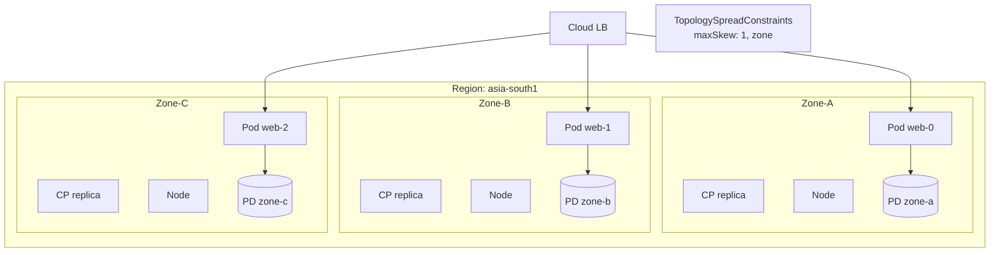
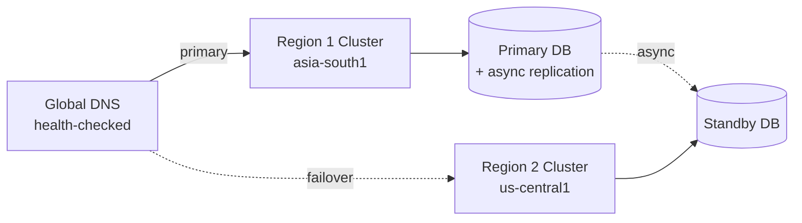
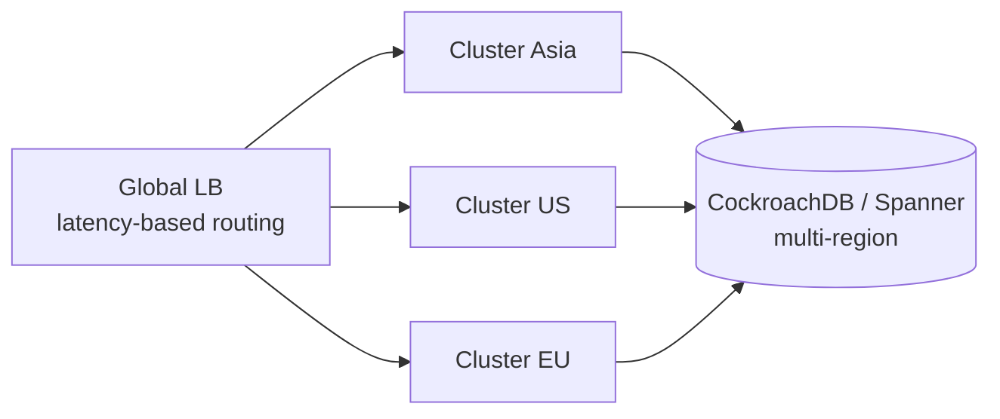

# 📘 Topic 56 — Multi-Zone / Multi-Region HA

**Official Documentation Reference**
- Running in multiple zones: https://kubernetes.io/docs/setup/best-practices/multiple-zones/
- Topology spread: https://kubernetes.io/docs/concepts/scheduling-eviction/topology-spread-constraints/
- GKE regional clusters: https://cloud.google.com/kubernetes-engine/docs/concepts/regional-clusters
- GKE multi-cluster: https://cloud.google.com/kubernetes-engine/docs/concepts/multi-cluster-services
- EKS multi-AZ: https://docs.aws.amazon.com/eks/latest/best-practices/reliability.html

---

## 🔹 Definition
**Multi-zone HA** distributes control-plane and worker nodes across availability zones within one region. **Multi-region HA** replicates entire clusters across geographic regions for disaster recovery and global latency optimization.

---

## 🔹 About

### Multi-zone (within a region)
| Component | Multi-zone behavior |
|---|---|
| Control plane | GKE regional: 3 CP replicas across 3 zones. EKS: managed, multi-AZ by default. |
| Nodes | Node pools spread across zones (GKE regional auto, EKS ASG/Karpenter multi-AZ) |
| Pods | `topologySpreadConstraints` with `topology.kubernetes.io/zone` |
| Storage | Zonal PD/EBS = pinned to one zone. Regional PD (GKE) = cross-zone. EFS (EKS) = cross-AZ. |
| Services | kube-proxy/eBPF routes to pods in any zone |
| LoadBalancer | Cloud LB distributes across zones |

### Multi-region (across regions)
| Pattern | How |
|---|---|
| **Active-passive** | Primary cluster serves traffic; standby cluster for DR failover |
| **Active-active** | Both clusters serve traffic; global LB routes by latency |
| **Federation** | KubeFed or Fleet manages resources across clusters |
| **GitOps multi-cluster** | ArgoCD ApplicationSet deploys to multiple clusters |

### Tools for multi-cluster
| Tool | Cloud | Purpose |
|---|---|---|
| **GKE Fleet / MCS** | GCP | Multi-cluster Services, Fleet-level policies |
| **EKS Anywhere + Connector** | AWS | Hybrid multi-cluster management |
| **ArgoCD ApplicationSet** | Any | GitOps deploy to N clusters |
| **Cilium ClusterMesh** | Any | Cross-cluster pod-to-pod networking |
| **Submariner** | Any | Cross-cluster L3 connectivity |
| **Liqo** | Any | Virtual node — schedule pods across clusters |

### Zone failure design
1. **Pods**: `topologySpreadConstraints maxSkew: 1` across zones.
2. **Storage**: regional PD (GKE) or app-level replication (Patroni, Strimzi) on EKS.
3. **PDB**: `maxUnavailable: 1` — drain one zone at a time.
4. **LB**: cloud LB auto-routes away from unhealthy zone.
5. **DNS**: health-checked DNS (Route 53, Cloud DNS) for failover.

### Region failure design
1. **Second cluster** in another region (standby or active).
2. **Data replication**: async DB replication, GCS/S3 cross-region, Velero backups.
3. **Global LB**: Google Cloud Global LB or AWS Global Accelerator.
4. **DNS failover**: health-checked routing policies.
5. **GitOps**: same manifests deployed to both clusters via ArgoCD.

### RPO / RTO targets
| Strategy | RPO | RTO |
|---|---|---|
| Multi-zone (single region) | 0 (synchronous PD) | Minutes |
| Active-passive (multi-region) | Minutes (async replication) | 10–30 min (manual/auto failover) |
| Active-active (multi-region) | Near-zero | Near-zero |

---

## 🏗️ Diagrams

### Multi-zone architecture


### Multi-region active-passive


### Multi-region active-active


---

## 💻 Real-World Examples

### Example 1 — GKE regional cluster
```bash
gcloud container clusters create prod \
  --region=asia-south1 \
  --num-nodes=2           # 2 nodes per zone × 3 zones = 6 nodes
```

### Example 2 — EKS multi-AZ managed NG
```bash
eksctl create cluster --name prod --region ap-south-1 --zones ap-south-1a,ap-south-1b,ap-south-1c
```

### Example 3 — Deployment with zone spread
```yaml
spec:
  replicas: 6
  template:
    spec:
      topologySpreadConstraints:
      - maxSkew: 1
        topologyKey: topology.kubernetes.io/zone
        whenUnsatisfiable: DoNotSchedule
        labelSelector: { matchLabels: { app: web } }
```

### Example 4 — GKE Multi-Cluster Services
```bash
gcloud container fleet memberships register cluster-asia --gke-cluster=asia-south1/prod
gcloud container fleet multi-cluster-services enable
# Export a Service across clusters
kubectl apply -f - <<EOF
apiVersion: net.gke.io/v1
kind: ServiceExport
metadata: { name: web, namespace: prod }
EOF
```

### Example 5 — ArgoCD multi-cluster
```yaml
apiVersion: argoproj.io/v1alpha1
kind: ApplicationSet
metadata: { name: web }
spec:
  generators:
  - clusters:
      selector: { matchLabels: { env: prod } }
  template:
    spec:
      source: { repoURL: https://github.com/org/k8s-manifests, path: prod }
      destination: { server: '{{server}}', namespace: prod }
```

### Example 6 — Velero cross-region DR
```bash
# Backup in region 1
velero backup create full --include-namespaces=prod --snapshot-volumes

# Restore in region 2 cluster
velero restore create --from-backup full
```

---

## 💻 Related Commands

| Command | Purpose | Example |
|---|---|---|
| `kubectl get nodes -L topology.kubernetes.io/zone` | See zone spread | |
| `kubectl get pods -o wide` | Pod-to-node-to-zone mapping | |
| `gcloud container clusters describe --format='value(locations)'` | GKE zones | |
| `aws eks describe-cluster --query 'cluster.resourcesVpcConfig.subnetIds'` | EKS subnets (AZs) | |
| `velero backup create` | Cross-region backup | |

---

## 🚨 Scenarios

### Scenario 1 — Zone failure: pods Pending (zonal PD)
- **Cause**: PD stuck in failed zone; pod can't reschedule without its volume.
- **Fix**: use regional PD (GKE) or app-level replication. For DR: restore from VolumeSnapshot in healthy zone.

### Scenario 2 — All pods in one zone despite 3-zone cluster
- **Cause**: no TopologySpreadConstraints.
- **Fix**: add TSC `maxSkew: 1` across zones.

### Scenario 3 — Region outage: no failover
- **Cause**: single-region cluster; no DR plan.
- **Fix**: deploy standby cluster in second region; set up DNS failover + data replication.

### Scenario 4 — Cross-region latency for DB writes
- **Cause**: synchronous replication across regions = high latency.
- **Fix**: async replication (accept RPO > 0); or use globally distributed DB (CockroachDB, Spanner).

---

## ☁️ GKE Perspective
- **Regional cluster**: 3 CP replicas across zones, auto-zone-spread for node pools.
- **Regional PD**: synchronous cross-zone replication — survives single-zone failure.
- **Multi-cluster Gateway**: global HTTP LB routing across GKE clusters.
- **Fleet**: centralized management of multiple GKE clusters.
- **Backup for GKE**: cross-region restore supported.

## 🟧 EKS Perspective
- **Control plane**: always multi-AZ (AWS-managed).
- **Managed NG**: spread across specified AZs.
- **EBS**: zonal — app-level replication for HA databases.
- **EFS**: multi-AZ — good for shared data.
- **Global Accelerator**: anycast IP routing to nearest healthy EKS cluster.
- **Velero**: cross-region backup/restore with EBS snapshots.

---

## 🧪 Labs

### Lab 56.1 — Multi-zone spread (Beginner, 30 min)
Deploy on Kind with fake zone labels. Apply TSC. Verify even spread with `kubectl get pods -o wide`.

### Lab 56.2 — Simulate zone failure on GKE (Intermediate, 60 min)
1. Regional GKE cluster. Deploy 6 replicas with TSC.
2. Cordon all nodes in one zone: `kubectl cordon <nodes-in-zone-b>`.
3. Observe pods rescheduling to remaining zones. Service stays up.
4. Uncordon.

### Lab 56.3 — Cross-region DR with Velero (Advanced, 120 min)
1. Cluster in region 1 with app + PVCs.
2. Install Velero with S3 backend.
3. `velero backup create full --snapshot-volumes`.
4. Create cluster in region 2.
5. `velero restore create --from-backup full`.
6. Verify app + data restored.

---

## 🎯 Interview Deliverable Answer (60–90 s)
"**What**: Multi-zone HA spreads pods and nodes across availability zones within a region. Multi-region HA replicates entire clusters across regions for disaster recovery.  
**Why**: A single zone can fail — hardware, power, network. Multi-zone with TSC `maxSkew: 1` ensures losing one zone degrades capacity to 66%, not 0%. Multi-region protects against regional outages and can reduce global latency.  
**How**: On GKE I use regional clusters (3-zone CP + nodes) with regional PD for stateful workloads. On EKS the control plane is multi-AZ by default; I spread nodes and use TSC. For multi-region I deploy a second cluster via ArgoCD, async-replicate the database, and use DNS health checks for failover. Velero provides application-level backup/restore across regions.  
**Example**: When a GKE zone went down during peak hours, our API stayed at 66% capacity (4/6 replicas in 2 surviving zones). PDB prevented more than 1 pod being disrupted during rebalancing. We recovered to 100% in 3 minutes when the zone came back. Zero customer impact."

---

## ❓ Interview Questions

**Q1. Multi-zone vs multi-region?** Zone: within one region, low latency, no data replication needed (regional PD). Region: across geography, higher latency, needs data sync. **Q2. How do you spread pods across zones?** TSC: `topologyKey: topology.kubernetes.io/zone, maxSkew: 1`. **Q3. Zonal PD problem?** Pod stuck Pending if zone fails — PD can't move. Fix: regional PD or app replication. **Q4. Regional PD on GKE?** Synchronous replication across 2 zones. Survives single-zone failure. **Q5. EKS equivalent of regional PD?** No direct equivalent. Use app-level replication (Patroni) or EFS (for RWX). **Q6. Active-passive vs active-active?** Passive: standby cluster, failover DNS. Active: both serve, global LB. **Q7. How to do multi-region GitOps?** ArgoCD ApplicationSet with cluster generator — same manifests to N clusters. **Q8. What is GKE Fleet?** Centralized management of multiple GKE clusters — policies, config, services. **Q9. RPO/RTO for multi-zone?** RPO ≈ 0 (sync PD), RTO ≈ minutes (pod reschedule). **Q10. Cross-region DB replication — sync or async?** Async (RPO > 0) for performance. Sync (RPO = 0) only with geo-distributed DBs (Spanner, CockroachDB).

