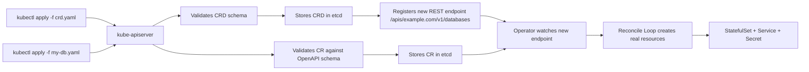

## 📘 Topic 57 — Custom Resource Definitions (CRDs)

**Official Documentation References**
- https://kubernetes.io/docs/concepts/extend-kubernetes/api-extension/custom-resources/
- https://kubernetes.io/docs/tasks/extend-kubernetes/custom-resources/custom-resource-definitions/
- https://kubernetes.io/docs/reference/generated/kubernetes-api/v1.31/#customresourcedefinition-v1-apiextensions-k8s-io

### 📘 Definition
A Custom Resource Definition (CRD) is a Kubernetes API object that lets you register a brand-new resource type with the Kubernetes API server so that `kubectl` and controllers can treat your object just like a built-in one.

### 📖 About
Kubernetes ships with resources like `Pod`, `Deployment`, and `Service`. A CRD is how you tell the cluster "please also accept a new kind of object called `Database`, or `Certificate`, or `KafkaTopic`."

**Why CRDs exist**
- Kubernetes is designed to be extensible without recompiling the API server.
- Teams need to model higher-level, domain-specific concepts (a full database, a certificate, a backup job) as first-class objects.
- CRDs make those objects storable in `etcd`, watchable, describable, RBAC-controllable, and reconcilable — all for free.

**What problem it solves**
- Before CRDs, you'd either fork Kubernetes (expensive) or run out-of-band tools. CRDs turn any concept into a declarative API object that the cluster natively understands.
- CRDs pair with a **controller** (the "operator pattern") to give behavior. A CRD alone is just schema and storage.

**Key sub-concepts**
- **Scope**: `Namespaced` or `Cluster`.
- **Versions**: A CRD can serve multiple versions (`v1alpha1`, `v1beta1`, `v1`) with conversion webhooks.
- **Schema validation**: OpenAPI v3 schema enforces structure at admission.
- **Subresources**: `status` and `scale` subresources unlock rich behavior (status updates without touching spec, HPA integration).
- **Categories & short names**: e.g. `kubectl get all` catch-alls and `kubectl get db` shortcuts.
- **Printer columns**: extra columns shown in `kubectl get`.

### 🔗 How It Integrates With Other Kubernetes Components

| Component | Integration |
|-----------|-------------|
| kube-apiserver | Registers new REST endpoints under `/apis/<group>/<version>/<plural>` |
| etcd | Stores custom resource instances just like built-ins |
| kubectl | Auto-discovers the new resource via OpenAPI and lets you `get/apply/delete` |
| RBAC | Roles can grant verbs on the new resource (`kafkatopics.messaging.example.com`) |
| Admission controllers | Validating/mutating webhooks fire on custom resources |
| Controller-manager / Operators | A custom controller watches the CR and reconciles it |
| Metrics server / HPA | If `scale` subresource is defined, HPA can autoscale the CR |
| Audit logs | CRs appear in audit logs like any other object |

### 🏗️ Architecture / Flow Diagram

**Diagram 1 — CRD registration + custom resource lifecycle**



**Diagram 2 — Request lifecycle for a custom resource**

```
User -> kubectl -> API Server -> Admission (Mutating -> Validation) -> etcd
                                      |
                                      +--> OpenAPI schema check
                                      +--> Conversion webhook (if multi-version)
                                      +--> Custom validating webhook (optional)
etcd change -> API Server watch -> Operator controller -> creates Pods/Services
```

### 💻 Real-World Examples

**Example 1 — Simple CRD for a `Website` resource**

```yaml
apiVersion: apiextensions.k8s.io/v1
kind: CustomResourceDefinition
metadata:
  name: websites.web.example.com
spec:
  group: web.example.com
  scope: Namespaced
  names:
    plural: websites
    singular: website
    kind: Website
    shortNames: ["web"]
    categories: ["all"]
  versions:
    - name: v1
      served: true
      storage: true
      schema:
        openAPIV3Schema:
          type: object
          properties:
            spec:
              type: object
              required: ["gitRepo", "replicas"]
              properties:
                gitRepo:
                  type: string
                replicas:
                  type: integer
                  minimum: 1
                  maximum: 20
            status:
              type: object
              properties:
                url:
                  type: string
      subresources:
        status: {}
      additionalPrinterColumns:
        - name: Replicas
          type: integer
          jsonPath: .spec.replicas
        - name: URL
          type: string
          jsonPath: .status.url
```

Corresponding custom resource:

```yaml
apiVersion: web.example.com/v1
kind: Website
metadata:
  name: my-blog
spec:
  gitRepo: https://github.com/me/blog.git
  replicas: 3
```

**Example 2 — Multi-version CRD with conversion**

```yaml
apiVersion: apiextensions.k8s.io/v1
kind: CustomResourceDefinition
metadata:
  name: backups.data.example.com
spec:
  group: data.example.com
  scope: Namespaced
  names:
    plural: backups
    singular: backup
    kind: Backup
  conversion:
    strategy: Webhook
    webhook:
      clientConfig:
        service:
          namespace: default
          name: backup-conversion-webhook
          path: /convert
        caBundle: <base64-CA>
      conversionReviewVersions: ["v1"]
  versions:
    - name: v1alpha1
      served: true
      storage: false
      schema:
        openAPIV3Schema:
          type: object
          properties:
            spec:
              type: object
              properties:
                target: { type: string }
    - name: v1
      served: true
      storage: true
      schema:
        openAPIV3Schema:
          type: object
          properties:
            spec:
              type: object
              required: ["target", "schedule"]
              properties:
                target: { type: string }
                schedule: { type: string }
```

### 💻 Related Commands

| Command | Flag | Purpose | Example |
|--------|------|---------|---------|
| `kubectl get crd` | – | List all CRDs | `kubectl get crd` |
| `kubectl get crd` | `-o yaml` | Show full CRD spec | `kubectl get crd websites.web.example.com -o yaml` |
| `kubectl explain` | – | Show CR schema | `kubectl explain website.spec` |
| `kubectl api-resources` | `--api-group=` | List CRDs in a group | `kubectl api-resources --api-group=web.example.com` |
| `kubectl apply` | `-f` | Register a CRD | `kubectl apply -f crd.yaml` |
| `kubectl delete crd` | – | Remove CRD **and** all its instances | `kubectl delete crd websites.web.example.com` |
| `kubectl get` | `<plural>` | List custom objects | `kubectl get websites` |
| `kubectl describe` | – | Show details of a CR | `kubectl describe website my-blog` |
| `kubectl patch` | `--subresource=status` | Update status subresource | `kubectl patch website my-blog --subresource=status --type=merge -p '{"status":{"url":"..."}}'` |
| `kubectl convert` | – | Convert between CRD versions | `kubectl convert -f old.yaml --output-version=data.example.com/v1` |

### 🚨 Scenarios

**Scenario 1 — CRD deletion accidentally wipes production data**
- **Problem**: An engineer runs `kubectl delete crd databases.example.com`; all `Database` objects are removed and the operator deletes the underlying StatefulSets.
- **Resolution**:
  1. Before deleting a CRD, always run `kubectl get <plural> -A` to see instances.
  2. Add `metadata.finalizers` and set `spec.preserveUnknownFields=false`.
  3. Restrict CRD deletion via RBAC to a small `sre` group.
  4. Recover from etcd snapshot or from operator-managed backup.

**Scenario 2 — CR is stuck in `Terminating`**
- **Problem**: A finalizer on the CR never gets removed because the operator crashed.
- **Resolution**:
  1. `kubectl get website my-blog -o json | jq .metadata.finalizers` to inspect.
  2. Restart the operator: `kubectl rollout restart deploy/website-operator`.
  3. If broken permanently, patch to remove the finalizer:
     `kubectl patch website my-blog -p '{"metadata":{"finalizers":[]}}' --type=merge`
  4. Investigate why the operator failed to remove it (bad code, missing RBAC).

**Scenario 3 — CRD version bump breaks existing clients**
- **Problem**: Team promotes `v1beta1` to `v1` and drops `v1beta1`, breaking CI pipelines still applying old YAML.
- **Resolution**:
  1. Keep old version `served: true` for at least one release cycle.
  2. Provide a conversion webhook so both versions read/write the same data.
  3. Update CI YAML gradually; monitor apiserver `apiserver_requested_deprecated_apis` metric.

### ☁️ GCP GKE Perspective
- GKE fully supports CRDs; nothing GKE-specific for the CRD API itself.
- **GKE-installed CRDs** you'll routinely see: `BackendConfig`, `FrontendConfig`, `ManagedCertificate`, `ServiceExport`, `ServiceImport`, `GCPBackupPlan` (Backup for GKE).
- **Config Connector** (KCC) is GCP's product that adds CRDs for GCP resources (BigQuery, Pub/Sub, CloudSQL) — manage GCP with `kubectl`.
- **Autopilot**: CRDs work identically, but you cannot install DaemonSet-based operators in some system namespaces; use `kube-system` alternatives Google provides.
- Command:
  `gcloud container clusters describe <cluster> --region=<region> --format="value(currentMasterVersion)"` — confirm apiVersion of installed CRDs is served on the cluster version.

### 🟧 AWS EKS Perspective
- EKS supports CRDs identically to upstream.
- **EKS-installed CRDs** you'll see: `ENIConfig` (VPC CNI), `SecurityGroupPolicy`, `IngressClassParams` (AWS Load Balancer Controller), `TargetGroupBinding`.
- **ACK (AWS Controllers for Kubernetes)** installs CRDs for AWS services (S3, SNS, DynamoDB) letting you manage AWS from `kubectl`.
- **Fargate**: CRDs work fine, but operator Pods that must run as DaemonSets won't run on Fargate — put them on managed node groups.
- Command:
  `eksctl utils update-cluster-logging --enable-types=api,audit --cluster=<name>` — enable audit logs to trace CRD/CR changes.

### 🧪 Hands-On Lab Exercises

---

**🧪 Lab 57-A — Create Your First CRD (Beginner)**
- **Objective**: Register a `Website` CRD and create instances.
- **Prerequisites**: Local Minikube/Kind cluster, `kubectl` v1.28+.
- **Environment Setup**:
  ```bash
  minikube start --kubernetes-version=v1.31.0
  kubectl cluster-info
  ```
- **Step-by-Step**:
  1. Save the CRD YAML from *Example 1* above as `website-crd.yaml`.
  2. `kubectl apply -f website-crd.yaml`
     Expected: `customresourcedefinition.apiextensions.k8s.io/websites.web.example.com created`
  3. `kubectl get crd | grep websites`
  4. `kubectl explain website.spec` — confirms schema is loaded.
  5. Create an instance file `my-blog.yaml` (from the example) and apply.
  6. `kubectl get websites -o wide` — see the printer columns.
- **Verification**:
  ```bash
  kubectl get websites
  kubectl describe website my-blog
  kubectl get website my-blog -o yaml
  ```
- **Expected Output**: `my-blog` appears with 3 replicas.
- **Cleanup**:
  ```bash
  kubectl delete website my-blog
  kubectl delete crd websites.web.example.com
  ```
- **Troubleshooting Tips**:
  - "no matches for kind Website" → CRD not applied, or apiVersion mismatch.
  - Validation errors → check `openAPIV3Schema` block.
- **Bonus Challenge**: Add a status subresource update using `kubectl patch --subresource=status`.
- **Lab Workflow Diagram**:
  ```mermaid
  flowchart LR
      A[Write CRD YAML] --> B[kubectl apply CRD] --> C[Verify api-resources]
      C --> D[Write CR YAML] --> E[kubectl apply CR] --> F[kubectl get websites]
  ```

---

**🧪 Lab 57-B — Multi-version CRD with Deprecation (Intermediate)**
- **Objective**: Serve `v1alpha1` and `v1` of a CRD; mark `v1alpha1` deprecated.
- **Prerequisites**: Kind cluster.
- **Steps**:
  1. Create CRD with both versions, storage on `v1`.
  2. Add `deprecated: true` and `deprecationWarning` on `v1alpha1`.
  3. Apply a `v1alpha1` CR and observe the deprecation warning.
  4. `kubectl get backup.v1alpha1.data.example.com -o yaml` — see conversion.
- **Verification**: kubectl prints the deprecation warning on every apply.
- **Cleanup**: `kubectl delete crd backups.data.example.com`
- **Bonus**: Add a webhook conversion server (Go/Python).

---

**🧪 Lab 57-C — Enforcing Validation with OpenAPI (Advanced)**
- **Objective**: Prevent invalid CRs via `x-kubernetes-validations` (CEL) rules.
- **Prerequisites**: Cluster v1.29+ (CEL GA).
- **Steps**:
  1. Add to schema:
     ```yaml
     x-kubernetes-validations:
       - rule: "self.replicas <= 10 || self.tier == 'enterprise'"
         message: "More than 10 replicas requires enterprise tier"
     ```
  2. Apply valid + invalid CRs; observe admission rejection.
- **Cleanup**: Delete CRD.
- **Bonus**: Add `messageExpression` for dynamic error messages.

### 🎯 Interview Deliverable Answer (60–90s)
> "A Custom Resource Definition, or CRD, is how you teach the Kubernetes API server about a brand-new resource type — for example, a `Database` or a `KafkaTopic`. You describe the resource with an OpenAPI schema; once the CRD is applied, kubectl, RBAC, admission controllers, and etcd all treat the new resource exactly like a built-in. The **why** is extensibility: Kubernetes was built to be extended without forking. The **how** is: apply the CRD, then apply instances of the new resource. Behavior comes from pairing the CRD with a controller — that's the Operator Pattern. On GKE we see this with `BackendConfig` and Config Connector, on EKS with `TargetGroupBinding` and ACK. In one of my projects, I authored a CRD for tenant provisioning; my controller reconciled it into a Namespace, a ResourceQuota, and a NetworkPolicy — giving platform users a self-service API in a single YAML."

### ❓ Interview Questions

**Basic (0–1 yr)**
1. **Q**: What is a CRD?
   **A**: A CRD registers a new resource type with the Kubernetes API server, giving it storage, discovery, and RBAC without changing the API server code.

2. **Q**: How is a CRD different from a Custom Resource (CR)?
   **A**: A CRD is the *schema* (like a class definition). A CR is an *instance* of that schema (like an object of that class).

3. **Q**: Do you need a controller for a CRD to work?
   **A**: No — a CRD alone gives you storage and API endpoints. A controller is needed to *act* on the CR (create Pods, etc.). Without one, the CR is just data in etcd.

**Intermediate (2 yr)**
4. **Q**: How do you validate the fields of a custom resource?
   **A**: Add `openAPIV3Schema` with types, `required`, `minimum`, `pattern`, and (v1.29+) `x-kubernetes-validations` CEL rules. Validation runs at admission time.

5. **Q**: What is the `status` subresource and why is it important?
   **A**: It splits `/status` from `/spec` so controllers can update status without racing with user edits to spec. It also enables generation tracking (`metadata.generation` vs `status.observedGeneration`).

6. **Q**: How does multi-version CRD conversion work?
   **A**: Set multiple `versions`. One is `storage: true`. A conversion webhook (or the simpler `None` strategy) converts requests between served versions and the stored version on read/write.

**Advanced (3–4 yr)**
7. **Q**: What happens when you delete a CRD?
   **A**: All CR instances are also deleted. If they have finalizers, delete blocks until finalizers are removed. RBAC and audit records remain until manually cleaned.

8. **Q**: How do finalizers interact with CRs?
   **A**: A finalizer string on `metadata.finalizers` blocks actual deletion until removed. Controllers use finalizers to run cleanup (e.g., release cloud resources) before Kubernetes garbage-collects the object.

9. **Q**: How do you scale a custom resource with HPA?
   **A**: Define a `scale` subresource on the CRD pointing to `spec.replicas` and `status.replicas`. Then HPA can target the CR via `scaleTargetRef`.

**Scenario-based**
10. **Q**: Your CR is stuck in `Terminating` for hours — how do you debug?
    **A**: Check finalizers, controller logs, and controller RBAC. Restart the controller. As last resort, patch to remove the finalizer.

**GKE-specific**
11. **Q**: What are `BackendConfig` and `FrontendConfig` on GKE?
    **A**: GKE-provided CRDs that let you attach GCP Load Balancer settings (CDN, IAP, SSL policy, timeouts) to a `Service` or `Ingress` declaratively.

**EKS-specific**
12. **Q**: What is `TargetGroupBinding` and when do you use it?
    **A**: A CRD from AWS Load Balancer Controller that binds an existing AWS Target Group to a Kubernetes Service — useful when the TG is managed by Terraform or shared across clusters.

**Hands-on / Lab-based**
13. **Q**: Walk me through creating a CRD and validating a bad input is rejected.
    **A**: (Reference Lab 57-A/C) Apply CRD → kubectl explain → apply valid CR → apply CR violating a CEL rule → observe admission error message.

---

