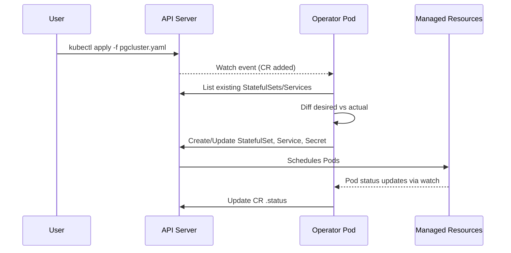

## 📘 Topic 58 — Operators and the Operator Pattern

**Official Documentation References**
- https://kubernetes.io/docs/concepts/extend-kubernetes/operator/
- https://operatorframework.io/
- https://book.kubebuilder.io/

### 📘 Definition
An **Operator** is a Kubernetes controller that packages the operational knowledge (deploy, upgrade, backup, failover) for a specific application, using CRDs to expose that knowledge as a Kubernetes-native API.

### 📖 About
Kubernetes ships with built-in controllers (Deployment, StatefulSet) that reconcile generic workloads. But stateful apps (PostgreSQL, Kafka, Elasticsearch) have domain-specific operational steps that generic controllers can't express — like "when a primary fails, promote a replica and update DNS."

**Why Operators exist**
- Encode day-2 operations (backup, restore, upgrade, scaling, failover) as code.
- Provide a single YAML API for complex systems (`kind: PostgresCluster`).
- Eliminate runbooks and human toil.

**How they work — the reconciliation loop**
1. Watch: subscribe to CR changes via the API server watch.
2. Diff: compare desired state (CR spec) with actual state (real resources).
3. Reconcile: create/update/delete resources to close the gap.
4. Update status: write observed state into `status`.
5. Requeue on error.

**Operator maturity model (Capability Levels)**
| Level | Meaning |
|-------|---------|
| 1 | Basic install |
| 2 | Seamless upgrades |
| 3 | Full lifecycle (backup, restore) |
| 4 | Deep insights (metrics, alerts) |
| 5 | Auto-pilot (tuning, scaling, self-healing) |

**Common frameworks**
- **Kubebuilder** — Go, most idiomatic, controller-runtime based.
- **Operator SDK** — wraps Kubebuilder + Ansible + Helm operators.
- **KUDO** — declarative operators.
- **Metacontroller** — write in any language via webhooks.

### 🔗 How It Integrates With Other Components

| Component | Integration |
|-----------|-------------|
| CRDs | Define the operator's API surface |
| API Server | Serves the CR endpoints; operator watches via list/watch |
| Controllers | Operator itself IS a controller |
| RBAC | Operator runs under a ServiceAccount with tight Role/ClusterRole |
| Webhooks | Optional mutating/validating webhooks for the CR |
| Metrics | Operators expose Prometheus metrics on `/metrics` |
| Leader Election | HA operators use lease-based election |
| OLM (OperatorLifecycleManager) | Optional package/install/upgrade layer (used on OpenShift) |

### 🏗️ Architecture Diagrams

**Diagram 1 — Operator reconcile loop**



**Diagram 2 — Operator components**

```
+---------------------------------------------------+
| Operator Pod                                      |
|                                                   |
|  [Manager] -> [Controller: PostgresCluster]       |
|      |            |                               |
|      |            +--> Reconciler.Reconcile()     |
|      |                    |                       |
|      |                    +-> client.Get(CR)      |
|      |                    +-> client.Create(SS)   |
|      |                    +-> client.Update(Svc)  |
|      |                    +-> client.Status.Update|
|      |                                            |
|      +-> Webhook Server (optional)                |
|      +-> Metrics Server (/metrics)                |
|      +-> Leader Election Lease                    |
+---------------------------------------------------+
```

### 💻 Real-World Examples

**Example 1 — Postgres Operator custom resource (Zalando)**

```yaml
apiVersion: acid.zalan.do/v1
kind: postgresql
metadata:
  name: acid-minimal-cluster
  namespace: default
spec:
  teamId: "acid"
  volume:
    size: 10Gi
  numberOfInstances: 3
  users:
    zalando:
      - superuser
      - createdb
  databases:
    foo: zalando
  postgresql:
    version: "16"
```

The operator creates: a StatefulSet, headless Service, PDB, Secret with credentials, and a ConfigMap.

**Example 2 — Minimal reconciler pseudocode (Kubebuilder / Go)**

```go
func (r *WebsiteReconciler) Reconcile(ctx context.Context, req ctrl.Request) (ctrl.Result, error) {
    var site webv1.Website
    if err := r.Get(ctx, req.NamespacedName, &site); err != nil {
        return ctrl.Result{}, client.IgnoreNotFound(err)
    }

    // Desired Deployment
    dep := buildDeployment(&site)
    if err := ctrl.SetControllerReference(&site, dep, r.Scheme); err != nil {
        return ctrl.Result{}, err
    }

    // Create or update
    var existing appsv1.Deployment
    if err := r.Get(ctx, client.ObjectKeyFromObject(dep), &existing); err != nil {
        if apierrors.IsNotFound(err) {
            return ctrl.Result{}, r.Create(ctx, dep)
        }
        return ctrl.Result{}, err
    }
    existing.Spec = dep.Spec
    if err := r.Update(ctx, &existing); err != nil {
        return ctrl.Result{}, err
    }

    // Update status
    site.Status.URL = fmt.Sprintf("http://%s.svc", site.Name)
    return ctrl.Result{RequeueAfter: 30 * time.Second}, r.Status().Update(ctx, &site)
}
```

### 💻 Related Commands

| Command | Flag | Purpose | Example |
|---------|------|---------|---------|
| `operator-sdk init` | `--domain=` | Bootstrap operator project | `operator-sdk init --domain=example.com --repo=github.com/me/op` |
| `operator-sdk create api` | `--group --version --kind` | Scaffold a CRD + controller | `operator-sdk create api --group=web --version=v1 --kind=Website` |
| `kubebuilder init` | `--domain=` | Same, Kubebuilder | `kubebuilder init --domain=example.com` |
| `make manifests` | – | Regenerate CRD/RBAC YAML | `make manifests` |
| `make install` | – | Apply CRDs to cluster | `make install` |
| `make run` | – | Run controller locally against cluster | `make run` |
| `make docker-build docker-push` | `IMG=` | Build/push operator image | `make docker-build IMG=me/op:v1` |
| `make deploy` | `IMG=` | Deploy operator to cluster | `make deploy IMG=me/op:v1` |
| `kubectl logs` | `-f` | Tail operator logs | `kubectl logs -n op-system deploy/op-controller-manager -f` |
| `kubectl get pods -n <op-ns>` | – | Verify operator running | `kubectl get pods -n postgres-operator` |

### 🚨 Scenarios

**Scenario 1 — Operator hot loop / thrash**
- **Problem**: Operator writes status → status write triggers watch → reconcile → status write → infinite loop consuming CPU.
- **Resolution**:
  1. Compare `status.observedGeneration` with `metadata.generation`; only reconcile when spec changes.
  2. Use `Result{RequeueAfter: X}` rather than immediate requeue.
  3. Predicate-filter watch events to ignore status-only changes.

**Scenario 2 — Two operator replicas fighting**
- **Problem**: Both replicas reconcile, causing duplicate resources and flapping status.
- **Resolution**:
  1. Enable **leader election** (`--leader-elect=true`, uses a Lease object).
  2. Only the leader runs the reconciler; the other stands by.
  3. Verify with `kubectl get lease -n <op-ns>`.

**Scenario 3 — Operator upgrade breaks CRD schema**
- **Problem**: v2 operator requires new required field; existing CRs fail validation → outages.
- **Resolution**:
  1. Ship a conversion webhook or make new field optional.
  2. Use `served`/`storage` versioning strategy.
  3. Ship a migration Job that updates CRs before switching operator version.

### ☁️ GCP GKE Perspective
- Use the **Google Cloud Marketplace for Kubernetes** to install curated Operators.
- **Config Connector** IS an operator that reconciles GCP resources.
- Best practice: run operators on a **dedicated node pool** with taints so tenant workloads don't preempt them.
- **Workload Identity** integration: assign the operator's ServiceAccount to a GCP IAM identity so the operator can call GCP APIs (e.g., create a Filestore).
- Command: `gcloud container fleet config-management enable` to run a fleet-wide operator (Config Sync).

### 🟧 AWS EKS Perspective
- **ACK (AWS Controllers for Kubernetes)** = per-service operators (S3, RDS, SNS).
- **AWS Load Balancer Controller** is an operator that watches Ingress + Service and provisions ALB/NLB.
- Best practice: give operator pod an **IRSA-bound ServiceAccount** to call AWS APIs.
- On **Fargate**, operators run fine but leader-election Lease must have low renewal deadline (Fargate has cold-starts).
- Command: `eksctl create iamserviceaccount --name=op-sa --namespace=op --attach-policy-arn=...` for IRSA.

### 🧪 Hands-On Lab Exercises

---

**🧪 Lab 58-A — Install & Use the Zalando Postgres Operator (Beginner)**
- **Objective**: Deploy a Postgres cluster via an operator.
- **Prerequisites**: Kind/Minikube, kubectl, Helm.
- **Environment**:
  ```bash
  kind create cluster --name op-lab
  helm repo add postgres-operator-charts https://opensource.zalando.com/postgres-operator/charts/postgres-operator
  helm install postgres-operator postgres-operator-charts/postgres-operator
  ```
- **Steps**:
  1. `kubectl get pods -l app.kubernetes.io/name=postgres-operator`
  2. `kubectl apply -f pgcluster.yaml` (Example 1)
  3. `kubectl get postgresql`
  4. `kubectl get pods -l cluster-name=acid-minimal-cluster`
- **Verification**:
  ```bash
  kubectl exec -it acid-minimal-cluster-0 -- psql -U postgres -c '\l'
  ```
- **Cleanup**: `kubectl delete postgresql acid-minimal-cluster && helm uninstall postgres-operator`
- **Troubleshooting**: If Pods stuck Pending → check PVC/StorageClass.
- **Bonus**: Scale from 3 → 5 replicas and watch operator reconcile.

---

**🧪 Lab 58-B — Build a "Hello Operator" with Kubebuilder (Intermediate)**
- **Objective**: Scaffold a `Website` operator that creates a Deployment + Service.
- **Prerequisites**: Go 1.22+, kubebuilder v3.14+, Docker, Kind.
- **Steps**:
  1. `mkdir website-op && cd website-op && kubebuilder init --domain=example.com --repo=github.com/me/website-op`
  2. `kubebuilder create api --group=web --version=v1 --kind=Website`
  3. Edit `api/v1/website_types.go` — add `GitRepo` and `Replicas` fields.
  4. Edit `internal/controller/website_controller.go` — add reconcile logic (Example 2).
  5. `make manifests && make install`
  6. `make run` (runs controller against cluster)
  7. In another terminal: `kubectl apply -f config/samples/web_v1_website.yaml`
  8. `kubectl get deployments`
- **Verification**: Deployment `my-blog` exists with 3 replicas.
- **Cleanup**: `kubectl delete website my-blog && make uninstall`
- **Bonus**: Add owner references so the Deployment is garbage-collected when the CR is deleted.

---

**🧪 Lab 58-C — Package Operator with OLM & Ship a v2 Upgrade (Advanced)**
- **Objective**: Bundle the operator, publish to a catalog, install via Subscription, and upgrade to v2.
- **Prerequisites**: OLM installed (`operator-sdk olm install`), image registry.
- **Steps**:
  1. `make bundle IMG=me/op:v1 VERSION=1.0.0`
  2. `make bundle-build bundle-push`
  3. Create CatalogSource + Subscription.
  4. Update code → v2 → repeat bundle steps with `VERSION=2.0.0` and `--channels=stable`.
  5. Trigger upgrade via `kubectl patch subscription`.
- **Verification**: Operator Pod uses v2 image, CRD conversion webhook active.
- **Cleanup**: `operator-sdk cleanup my-op`.
- **Bonus**: Write conversion tests using envtest.

### 🎯 Interview Deliverable Answer (60–90s)
> "An Operator is a Kubernetes controller plus one or more CRDs that codify the operational knowledge for a specific application. The **what** is: I get a Kubernetes-native API — say `kind: PostgresCluster` — and the operator's reconciliation loop keeps the real Postgres cluster matching that spec, handling installs, upgrades, failover, and backups. The **why** is toil elimination — runbooks become code. The **how** is a control loop: watch, diff, act, update status, repeat. On EKS I've used ACK to manage RDS from Kubernetes and the AWS Load Balancer Controller for Ingress; on GKE, Config Connector plays a similar role. I built one myself with Kubebuilder — it exposed a `Tenant` CRD that provisioned a namespace, quota, and network policy in one shot, cutting onboarding from a runbook to a single YAML."

### ❓ Interview Questions

**Basic**
1. **Q**: What is an Operator?
   **A**: A controller that uses CRDs to manage a specific application's lifecycle inside Kubernetes.

2. **Q**: Difference between a Controller and an Operator?
   **A**: All operators are controllers; not all controllers are operators. Operators are domain-specific (Postgres, Kafka) and typically ship with CRDs.

**Intermediate**
3. **Q**: Explain the reconcile loop.
   **A**: Get desired state (CR), compare to actual, take action to close the gap, update status, requeue on error.

4. **Q**: What is leader election and why?
   **A**: Uses a Lease object so only one replica reconciles; prevents duplicate actions in HA setups.

5. **Q**: How do you prevent hot-loops?
   **A**: Compare `observedGeneration` to `generation`; use `RequeueAfter`; filter watch predicates.

**Advanced**
6. **Q**: What are Operator capability levels?
   **A**: 1 (install), 2 (seamless upgrade), 3 (full lifecycle), 4 (deep insights), 5 (auto-pilot).

7. **Q**: How would you test an operator?
   **A**: Unit-test the reconciler function; integration-test with `envtest` (fake apiserver); e2e-test with Kind.

**Scenario**
8. **Q**: Two operator pods are running and creating duplicate resources — what's wrong?
   **A**: Leader election disabled. Enable `--leader-elect=true` and verify with `kubectl get lease`.

**GKE**
9. **Q**: How does Config Connector integrate with Workload Identity?
   **A**: The Config Connector service account is bound to a GCP IAM SA via Workload Identity; the operator calls GCP APIs as that identity.

**EKS**
10. **Q**: How do you give an operator AWS API access on EKS?
    **A**: IRSA — create an IAM role with trust policy for the OIDC provider, annotate the ServiceAccount, mount the projected token.

**Lab-based**
11. **Q**: Walk me through building an operator with Kubebuilder.
    **A**: (Lab 58-B) init → create api → edit types → edit controller → make manifests/install/run → apply CR → verify.

---

