## 📘 Topic 59 — Helm (Charts, Templating, Releases)

**Official Documentation References**
- https://helm.sh/docs/
- https://helm.sh/docs/topics/charts/
- https://helm.sh/docs/chart_template_guide/
- https://helm.sh/docs/topics/architecture/

### 📘 Definition
Helm is the package manager for Kubernetes; it bundles YAML manifests into reusable, versioned units called **charts** and installs them as **releases** with templated, parameterized values.

### 📖 About
Managing hundreds of YAML files across environments (dev/stage/prod) creates duplication and drift. Helm solves this by treating a set of manifests as a chart, letting you template values, version the chart, and install/upgrade/rollback deterministically.

**Core concepts**
- **Chart** — a directory of templates + `Chart.yaml` + `values.yaml`.
- **Release** — an installed instance of a chart (name + namespace).
- **Repository** — HTTP server (or OCI registry) hosting charts.
- **Values** — parameters supplied at install time.
- **Template** — Go text/template YAML rendered with values, Sprig functions, and Helm-specific helpers.
- **Hooks** — templates that run at pre-install / post-install / pre-upgrade / etc.
- **Release history** — Helm stores each revision in a Secret in the release's namespace.

**Chart structure**
```
mychart/
├── Chart.yaml
├── values.yaml
├── charts/                # sub-charts
├── templates/
│   ├── _helpers.tpl
│   ├── deployment.yaml
│   ├── service.yaml
│   ├── NOTES.txt
│   └── tests/
└── crds/                  # applied before templates, never upgraded
```

**Why Helm exists**
- DRY across environments.
- Version-controlled application delivery.
- Shareable community catalogs (Bitnami, Artifact Hub).
- Atomic install/upgrade/rollback.

**Helm 3 vs Helm 2**
Helm 3 removed Tiller (server component); releases are stored as Secrets, and RBAC is enforced via the user's kubeconfig.

### 🔗 How It Integrates With Other Components

| Component | Integration |
|-----------|-------------|
| kubectl / kubeconfig | Helm uses the current context |
| API Server | Applies rendered YAML |
| Secrets | Release history storage (default) |
| RBAC | User running helm must have permissions for the objects |
| OCI registries | Helm 3.8+ pushes/pulls charts as OCI artifacts |
| CI/CD | `helm upgrade --install` is the standard pipeline step |
| ArgoCD / Flux | Both consume Helm charts natively |
| CRDs | Placed in `crds/` and applied first (not templated) |

### 🏗️ Architecture / Flow Diagram

**Diagram 1 — helm install flow**

```mermaid
flowchart LR
    A[helm install myapp ./chart] --> B[Load Chart.yaml + values.yaml]
    B --> C[Merge with --values / --set overrides]
    C --> D[Render templates via Go text/template + Sprig]
    D --> E[Validate rendered YAML against OpenAPI]
    E --> F[Apply CRDs from crds/ first]
    F --> G[Apply manifests in dependency order]
    G --> H[Store release manifest in Secret sh.helm.release.v1.myapp.v1]
    H --> I[Run post-install hooks]
```



**Diagram 2 — Release history / rollback**

```
helm install foo ./chart      -> revision 1  (Secret: sh.helm.release.v1.foo.v1)
helm upgrade foo ./chart      -> revision 2  (Secret: sh.helm.release.v1.foo.v2)
helm upgrade foo ./chart      -> revision 3  (Secret: sh.helm.release.v1.foo.v3)
helm rollback foo 1           -> revision 4  (copy of revision 1, marked deployed)
```

### 💻 Real-World Examples

**Example 1 — A minimal chart**

`Chart.yaml`:
```yaml
apiVersion: v2
name: hello
description: A minimal Helm chart
type: application
version: 0.1.0
appVersion: "1.0.0"
```

`values.yaml`:
```yaml
replicaCount: 2
image:
  repository: nginx
  tag: "1.27"
service:
  type: ClusterIP
  port: 80
```

`templates/_helpers.tpl`:
```yaml
{{- define "hello.name" -}}
{{- default .Chart.Name .Values.nameOverride | trunc 63 | trimSuffix "-" -}}
{{- end -}}
```

`templates/deployment.yaml`:
```yaml
apiVersion: apps/v1
kind: Deployment
metadata:
  name: {{ include "hello.name" . }}
spec:
  replicas: {{ .Values.replicaCount }}
  selector:
    matchLabels:
      app: {{ include "hello.name" . }}
  template:
    metadata:
      labels:
        app: {{ include "hello.name" . }}
    spec:
      containers:
        - name: web
          image: "{{ .Values.image.repository }}:{{ .Values.image.tag }}"
          ports:
            - containerPort: 80
```

`templates/service.yaml`:
```yaml
apiVersion: v1
kind: Service
metadata:
  name: {{ include "hello.name" . }}
spec:
  type: {{ .Values.service.type }}
  selector:
    app: {{ include "hello.name" . }}
  ports:
    - port: {{ .Values.service.port }}
      targetPort: 80
```

Install:
```bash
helm install hello ./hello --set replicaCount=5
```

**Example 2 — Environment-specific values**

`values-prod.yaml`:
```yaml
replicaCount: 10
image:
  tag: "1.27.1"
service:
  type: LoadBalancer
resources:
  requests: { cpu: "500m", memory: "512Mi" }
  limits:   { cpu: "1",   memory: "1Gi" }
```

```bash
helm upgrade --install hello ./hello \
  -f values.yaml -f values-prod.yaml \
  --namespace prod --create-namespace --atomic --timeout=5m
```

### 💻 Related Commands

| Command | Flag | Purpose | Example |
|---------|------|---------|---------|
| `helm create` | – | Scaffold new chart | `helm create mychart` |
| `helm lint` | – | Validate chart syntax | `helm lint ./mychart` |
| `helm template` | `--debug` | Render without installing | `helm template rel ./mychart --debug` |
| `helm install` | `--values -f` | Extra values file | `helm install app ./chart -f prod.yaml` |
| `helm install` | `--set` | Override single value | `helm install app ./chart --set replicaCount=3` |
| `helm install` | `--dry-run` | Simulate install | `helm install app ./chart --dry-run` |
| `helm install` | `--atomic` | Rollback on failure | `helm install app ./chart --atomic` |
| `helm install` | `--wait --timeout` | Wait for readiness | `helm install app ./chart --wait --timeout=10m` |
| `helm upgrade` | `--install` | Install if missing | `helm upgrade --install app ./chart` |
| `helm rollback` | `<REL> <REV>` | Roll back to revision | `helm rollback app 3` |
| `helm history` | – | Show revisions | `helm history app` |
| `helm uninstall` | `--keep-history` | Delete release | `helm uninstall app --keep-history` |
| `helm list` | `-A` | All namespaces | `helm list -A` |
| `helm repo add` | – | Add chart repo | `helm repo add bitnami https://charts.bitnami.com/bitnami` |
| `helm repo update` | – | Refresh index | `helm repo update` |
| `helm search repo` | – | Search charts | `helm search repo nginx` |
| `helm pull` | `--untar` | Download chart | `helm pull bitnami/nginx --untar` |
| `helm dependency update` | – | Refresh sub-charts | `helm dependency update` |
| `helm push` | – | Push to OCI registry | `helm push mychart-0.1.0.tgz oci://registry.example.com/charts` |
| `helm get manifest` | – | Show rendered manifest | `helm get manifest app` |
| `helm get values` | `--all` | Show effective values | `helm get values app --all` |
| `helm test` | – | Run chart tests | `helm test app` |

### 🚨 Scenarios

**Scenario 1 — Failed upgrade leaves release in `pending-upgrade`**
- **Problem**: `helm upgrade` fails mid-flight; subsequent runs error with "another operation in progress."
- **Resolution**:
  1. `helm history app` — identify the stuck revision.
  2. `helm rollback app <last-good>` — force back to previous.
  3. If rollback fails, delete the stuck release Secret manually: `kubectl delete secret sh.helm.release.v1.app.v<N>` and retry.
  4. Always use `--atomic` in CI to auto-rollback on failure.

**Scenario 2 — CRD updates not applied on upgrade**
- **Problem**: Chart in `crds/` gets installed once and never updated (by design).
- **Resolution**:
  1. Move CRDs to `templates/` with `helm.sh/hook: crd-install` (deprecated) or manage CRDs separately via a dedicated chart.
  2. Best practice: apply CRDs out-of-band with `kubectl apply --server-side -f crds/`.

**Scenario 3 — Secret leaks in Helm values in Git**
- **Problem**: `values.yaml` with plaintext secrets committed to Git.
- **Resolution**:
  1. Move secrets to Kubernetes `Secret` referenced by `secretKeyRef` in templates.
  2. Use `helm-secrets` plugin + SOPS or Sealed Secrets or External Secrets Operator.
  3. On GKE, use Secret Manager + `ExternalSecret`; on EKS, use AWS Secrets Manager + `SecretStore`.

### ☁️ GCP GKE Perspective
- Helm works identically on GKE Standard & Autopilot.
- **Google Cloud Marketplace** publishes Helm-compatible apps.
- Store charts in **Artifact Registry OCI** (`helm push` supported).
- Autopilot note: hooks that use `hostPath` or privileged containers will be rejected — refactor chart.
- Command:
  ```bash
  gcloud auth configure-docker <region>-docker.pkg.dev
  helm registry login <region>-docker.pkg.dev
  helm push mychart-0.1.0.tgz oci://<region>-docker.pkg.dev/<project>/charts
  ```

### 🟧 AWS EKS Perspective
- Store charts in **ECR OCI** (helm 3.8+).
  ```bash
  aws ecr get-login-password | helm registry login --username AWS --password-stdin <acct>.dkr.ecr.<region>.amazonaws.com
  helm push mychart-0.1.0.tgz oci://<acct>.dkr.ecr.<region>.amazonaws.com/charts
  ```
- Common EKS Helm installs: `aws-load-balancer-controller`, `cluster-autoscaler`, `external-dns`, `metrics-server`, `karpenter`.
- On Fargate, Helm hooks (Jobs) must target a Fargate profile-matching namespace.

### 🧪 Hands-On Lab Exercises

---

**🧪 Lab 59-A — Package Your First Chart (Beginner)**
- **Objective**: Create, lint, install, upgrade, rollback.
- **Prerequisites**: Minikube, `helm` v3.14+.
- **Steps**:
  1. `helm create demo`
  2. Edit `values.yaml`: set `replicaCount: 2`.
  3. `helm lint ./demo`
  4. `helm template test ./demo | less`
  5. `helm install demo ./demo`
  6. `kubectl get pods -l app.kubernetes.io/instance=demo`
  7. Edit `values.yaml` → `replicaCount: 4`
  8. `helm upgrade demo ./demo`
  9. `helm history demo`
  10. `helm rollback demo 1`
- **Verification**: `kubectl get deploy demo-demo -w`
- **Cleanup**: `helm uninstall demo`
- **Bonus**: Add a NOTES.txt with a helpful post-install message.

---

**🧪 Lab 59-B — Multi-env Deployment with Values Files (Intermediate)**
- **Objective**: Same chart, three environments.
- **Prerequisites**: Kind cluster, 3 namespaces.
- **Steps**:
  1. Create `values-dev.yaml`, `values-stage.yaml`, `values-prod.yaml`.
  2. Install to 3 namespaces:
     ```bash
     for env in dev stage prod; do
       helm upgrade --install app ./demo -f values-${env}.yaml \
         --namespace ${env} --create-namespace --atomic
     done
     ```
  3. Compare with `helm get values app -n dev`.
- **Verification**: Each ns has different replica count.
- **Bonus**: Add ImagePullSecrets only for prod via conditional template.

---

**🧪 Lab 59-C — Helm + OCI Registry + CI (Advanced)**
- **Objective**: Push chart to OCI and install from it.
- **Prerequisites**: ECR or GAR registry, credentials.
- **Steps**:
  1. `helm package ./demo`
  2. `helm push demo-0.1.0.tgz oci://<registry>/charts`
  3. In another cluster: `helm install demo oci://<registry>/charts/demo --version 0.1.0`
- **Verification**: Release installed from OCI.
- **Bonus**: Wire into GitHub Actions on push to `main`.

### 🎯 Interview Deliverable Answer (60–90s)
> "Helm is the package manager for Kubernetes. It bundles YAML manifests into a versioned, parameterized package called a chart, and installs each instance as a release. **Why**: managing hundreds of raw YAMLs across dev/stage/prod becomes copy-paste hell; Helm lets me template with values, upgrade atomically, and roll back if something breaks. **How**: `helm install` merges values, renders Go templates, applies the result, and stores the release history as a Kubernetes Secret. I use `--atomic --wait` in CI so failed upgrades auto-revert. On EKS I push charts to ECR as OCI artifacts and pull them from ArgoCD; on GKE I use Artifact Registry. In one project we cut onboarding a new microservice from days to minutes by parameterizing a single 'workload' chart every team could inherit."

### ❓ Interview Questions

**Basic**
1. **Q**: What is a Helm chart?
   **A**: A packaged collection of templates + values that describes a Kubernetes application.

2. **Q**: Difference between chart and release?
   **A**: Chart is the package; release is an installed instance of that chart with specific values.

**Intermediate**
3. **Q**: How do you override values?
   **A**: `--set` for single values, `-f/--values` for files (multiple, right-most wins).

4. **Q**: Where does Helm 3 store release state?
   **A**: In a Secret named `sh.helm.release.v1.<release>.v<revision>` in the release's namespace.

5. **Q**: What does `--atomic` do?
   **A**: On failure, automatically rolls back to the prior revision.

**Advanced**
6. **Q**: How do you handle CRDs in a chart?
   **A**: Place them in `crds/` for install-only. For upgrades, manage CRDs separately via `kubectl apply --server-side` or a dedicated ops chart.

7. **Q**: Helm 2 vs Helm 3 major differences?
   **A**: No Tiller in v3, Secret-based storage, RBAC via kubeconfig, OCI registry support, three-way strategic merge → JSON merge patch during upgrade.

**Scenario**
8. **Q**: Release stuck in `pending-upgrade` — how to fix?
   **A**: Roll back to last good revision; if the state Secret is corrupt, delete it and retry.

**GKE-specific**
9. **Q**: How do you host Helm charts on GCP?
   **A**: Push as OCI artifacts to Artifact Registry; authenticate with `gcloud auth configure-docker` then `helm registry login`.

**EKS-specific**
10. **Q**: How do you deploy AWS Load Balancer Controller?
    **A**: Add the eks-charts Helm repo, create IRSA-bound ServiceAccount, `helm install aws-load-balancer-controller eks/aws-load-balancer-controller --set clusterName=<name>`.

**Lab-based**
11. **Q**: Walk me through parameterizing a chart for three environments.
    **A**: (Lab 59-B) Create `values-<env>.yaml` per environment, run `helm upgrade --install` with layered `-f` flags per namespace.

---

