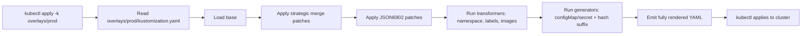

## 📘 Topic 60 — Kustomize

**Official Documentation References**
- https://kubernetes.io/docs/tasks/manage-kubernetes-objects/kustomization/
- https://kubectl.docs.kubernetes.io/references/kustomize/
- https://kustomize.io/

### 📘 Definition
Kustomize is a template-free, YAML-native customization tool built into `kubectl` (`-k`) that composes and overlays vanilla Kubernetes manifests using a `kustomization.yaml` file.

### 📖 About
Where Helm uses Go templates and values files, Kustomize uses **base + overlay** layering. Bases are plain, valid Kubernetes YAML; overlays patch or transform them for each environment. Nothing is templated — every file remains a legal manifest.

**Why Kustomize exists**
- Some teams find Go templating fragile and error-prone.
- Kustomize preserves YAML validity; you can `kubectl apply -f` any base directly.
- Purely declarative composition.

**Core concepts**
- **Base** — a directory with a `kustomization.yaml` referencing resources.
- **Overlay** — a directory that references a base and adds patches.
- **Patches** — strategic merge patches or JSON6902 patches.
- **Generators** — `configMapGenerator`, `secretGenerator` produce hashed ConfigMaps/Secrets.
- **Transformers** — namespace, name prefix/suffix, labels, annotations, images, replicas.
- **Components** — reusable slices of customization (v1beta1+).

**Kustomize vs Helm**
| Aspect | Helm | Kustomize |
|--------|------|-----------|
| Templating | Go templates | None (pure YAML) |
| Packaging | `.tgz` chart | Directory tree |
| Distribution | Repos / OCI | Git / OCI |
| Rollback | Built-in | External (Git) |
| Learning curve | Steeper | Gentler |
| Composability | Sub-charts | Bases + overlays + components |

### 🔗 How It Integrates With Other Components

| Component | Integration |
|-----------|-------------|
| kubectl | `kubectl apply -k <dir>` renders + applies |
| ArgoCD / Flux | Native Kustomize support (Application spec has `kustomize:` block) |
| Helm | Kustomize can post-render Helm output |
| CRDs | Fully supported; use `configurations:` to teach Kustomize about custom name refs |
| CI | `kustomize build` → apply / dry-run |

### 🏗️ Architecture / Flow Diagram

**Diagram 1 — base + overlays**

```
base/
├── kustomization.yaml
├── deployment.yaml
├── service.yaml
overlays/
├── dev/kustomization.yaml   -> ../../base + replicas=1 + image tag dev
├── stage/kustomization.yaml -> ../../base + replicas=3 + tag stage
└── prod/kustomization.yaml  -> ../../base + replicas=10 + tag prod
```

**Diagram 2 — build pipeline**



### 💻 Real-World Examples

**Example 1 — Base + prod overlay**

`base/deployment.yaml`:
```yaml
apiVersion: apps/v1
kind: Deployment
metadata:
  name: web
spec:
  replicas: 1
  selector: { matchLabels: { app: web } }
  template:
    metadata: { labels: { app: web } }
    spec:
      containers:
        - name: web
          image: nginx:1.27
          ports: [{ containerPort: 80 }]
```

`base/service.yaml`:
```yaml
apiVersion: v1
kind: Service
metadata: { name: web }
spec:
  selector: { app: web }
  ports: [{ port: 80, targetPort: 80 }]
```

`base/kustomization.yaml`:
```yaml
apiVersion: kustomize.config.k8s.io/v1beta1
kind: Kustomization
resources:
  - deployment.yaml
  - service.yaml
commonLabels:
  app.kubernetes.io/part-of: shop
```

`overlays/prod/kustomization.yaml`:
```yaml
apiVersion: kustomize.config.k8s.io/v1beta1
kind: Kustomization
namespace: prod
namePrefix: prod-
resources:
  - ../../base
images:
  - name: nginx
    newTag: "1.27.1"
replicas:
  - name: web
    count: 10
patches:
  - target: { kind: Deployment, name: web }
    patch: |-
      - op: add
        path: /spec/template/spec/containers/0/resources
        value:
          requests: { cpu: "500m", memory: "512Mi" }
          limits:   { cpu: "1",   memory: "1Gi" }
configMapGenerator:
  - name: web-config
    literals:
      - LOG_LEVEL=INFO
      - REGION=us-east-1
```

Apply:
```bash
kubectl apply -k overlays/prod
```

**Example 2 — Kustomize as post-renderer for Helm**

`kustomization.yaml`:
```yaml
apiVersion: kustomize.config.k8s.io/v1beta1
kind: Kustomization
resources:
  - all.yaml    # helm template output
patches:
  - target: { kind: Deployment, name: nginx }
    patch: |-
      - op: replace
        path: /spec/template/spec/containers/0/imagePullPolicy
        value: Always
```

Script `post-renderer.sh`:
```bash
#!/usr/bin/env bash
cat > all.yaml
kustomize build .
```

Then:
```bash
helm install my-nginx bitnami/nginx --post-renderer ./post-renderer.sh
```

### 💻 Related Commands

| Command | Flag | Purpose | Example |
|---------|------|---------|---------|
| `kubectl apply` | `-k` | Apply a kustomization dir | `kubectl apply -k overlays/prod` |
| `kubectl kustomize` | – | Render only | `kubectl kustomize overlays/prod` |
| `kustomize build` | – | Render (standalone binary) | `kustomize build overlays/prod` |
| `kustomize edit set image` | – | Update image in kustomization.yaml | `kustomize edit set image nginx=nginx:1.27.2` |
| `kustomize edit set replicas` | – | Update replica count | `kustomize edit set replicas web=5` |
| `kustomize edit add resource` | – | Append resource file | `kustomize edit add resource pdb.yaml` |
| `kustomize create` | `--resources` | Bootstrap kustomization.yaml | `kustomize create --resources deploy.yaml,svc.yaml` |
| `kustomize edit set namespace` | – | Set target namespace | `kustomize edit set namespace prod` |
| `kubectl delete` | `-k` | Delete resources from a kustomization | `kubectl delete -k overlays/prod` |

### 🚨 Scenarios

**Scenario 1 — Rolling out a hotfix image tag safely**
- **Problem**: Prod bug requires image bump from `1.27` → `1.27.1` immediately.
- **Resolution**:
  1. `cd overlays/prod && kustomize edit set image nginx=nginx:1.27.1`
  2. `git diff` shows only `kustomization.yaml` changed.
  3. Commit + PR + CI applies via `kubectl apply -k overlays/prod`.
  4. Argo/Flux auto-syncs. Rollback = revert commit.

**Scenario 2 — Generator name changes break references**
- **Problem**: `configMapGenerator` adds a hash suffix (`web-config-abc123`); a Deployment referencing `web-config` fails.
- **Resolution**:
  1. Kustomize auto-updates references *if* you set the name via `envFrom.configMapRef.name`.
  2. Alternatively set `generatorOptions.disableNameSuffixHash: true` (loses immutability benefit).

**Scenario 3 — Two overlays merge-conflict on the same field**
- **Problem**: A `component` overlay and an env overlay both patch container image.
- **Resolution**:
  1. Order matters — later patches win. Reorganize.
  2. Use JSON6902 with distinct paths.
  3. Use `patchesStrategicMerge` on separate containers.

### ☁️ GCP GKE Perspective
- GKE **Config Sync** (Anthos) uses Kustomize + Git to reconcile fleet-wide config.
- GKE ships with `kubectl` that has Kustomize built-in (v1.14+).
- Best pattern: base + per-cluster overlay (`overlays/prod-us`, `overlays/prod-eu`) driven by Config Sync.

### 🟧 AWS EKS Perspective
- AWS CDK for Kubernetes (cdk8s) can emit manifests consumed by Kustomize overlays.
- Common pattern: base workload + IRSA overlay adding `eks.amazonaws.com/role-arn` annotation via patch.
- Flux on EKS commonly renders Kustomize; no EKS-specific requirement beyond IAM/OIDC for the controller.

### 🧪 Hands-On Lab Exercises

---

**🧪 Lab 60-A — Your First Base + Overlays (Beginner)**
- **Objective**: Build base with dev/prod overlays.
- **Prerequisites**: `kubectl` v1.28+ (Kustomize built-in) or `kustomize` v5+, Minikube.
- **Steps**:
  1. Create `base/` with the files from Example 1.
  2. Create `overlays/dev/kustomization.yaml`:
     ```yaml
     resources: [../../base]
     namespace: dev
     replicas: [{ name: web, count: 1 }]
     ```
  3. Create `overlays/prod/` (Example 1).
  4. `kubectl kustomize overlays/dev`
  5. `kubectl create ns dev prod`
  6. `kubectl apply -k overlays/dev` and `kubectl apply -k overlays/prod`
- **Verification**: Different replica counts per ns.
- **Cleanup**: `kubectl delete -k overlays/dev && kubectl delete -k overlays/prod`
- **Bonus**: Add a `commonLabels` in base and confirm it appears in every resource.

---

**🧪 Lab 60-B — Components & Multi-team Composition (Intermediate)**
- **Objective**: Extract a "monitoring sidecar" into a reusable Component.
- **Prerequisites**: Kustomize v4+.
- **Steps**:
  1. Create `components/monitoring/kustomization.yaml` with `kind: Component`.
  2. Add sidecar patch injecting a Prometheus exporter.
  3. In `overlays/prod` add: `components: [../../components/monitoring]`
  4. Build & inspect.
- **Verification**: Only prod has the sidecar.
- **Bonus**: Add a `security` component adding a `securityContext` and use it in both dev & prod.

---

**🧪 Lab 60-C — Kustomize + ArgoCD Sync (Advanced)**
- **Objective**: ArgoCD auto-syncs an overlay from Git.
- **Prerequisites**: ArgoCD installed on GKE/EKS/Kind.
- **Steps**:
  1. Push base+overlays to Git.
  2. Create `Application` CR pointing to `overlays/prod` with `kustomize: {}`.
  3. Change image tag; commit; ArgoCD syncs automatically.
- **Verification**: Rollout observed in ArgoCD UI.
- **Bonus**: Use `kustomize.namePrefix` from ArgoCD ApplicationSet template.

### 🎯 Interview Deliverable Answer (60–90s)
> "Kustomize is Kubernetes' native, template-free way to customize manifests. Instead of Go templates, you keep a plain YAML **base** that's a valid manifest on its own, and layer **overlays** for each environment that patch fields — namespace, replica count, image tag, labels — without touching the base. **Why**: templating is fragile; Kustomize preserves YAML validity end-to-end, and CI diffs are readable. **How**: `kubectl apply -k` renders and applies the overlay. On GKE, Config Sync uses Kustomize to fleet-manage clusters; on EKS, Flux consumes overlays from Git. I use it heavily with ArgoCD — one base, three overlays (dev, stage, prod), promotion is just `kustomize edit set image` and a Git push."

### ❓ Interview Questions

**Basic**
1. **Q**: What is Kustomize?
   **A**: A template-free customization tool built into kubectl that composes vanilla YAML using bases and overlays.

2. **Q**: Helm vs Kustomize?
   **A**: Helm templates + packages; Kustomize overlays + patches. Helm has releases/rollback; Kustomize relies on Git.

**Intermediate**
3. **Q**: What's the difference between `patchesStrategicMerge` and JSON6902?
   **A**: Strategic merge deep-merges YAML the same way `kubectl apply` does; JSON6902 uses precise ops (add/remove/replace) on specific paths.

4. **Q**: Why does `configMapGenerator` add a hash suffix?
   **A**: To make ConfigMaps immutable and trigger Pod rollouts when the data changes.

**Advanced**
5. **Q**: What is a Kustomize Component?
   **A**: A reusable customization slice (`kind: Component`) that can be included in any overlay to add optional features.

6. **Q**: How does Kustomize handle CRDs?
   **A**: Via the `configurations:` field pointing to a config that teaches Kustomize the ref paths inside custom resources.

**Scenario**
7. **Q**: Two overlays patch the same field — which wins?
   **A**: The one applied later in the resource list; reorder or split with distinct JSON6902 paths.

**GKE-specific**
8. **Q**: What is Anthos Config Sync?
   **A**: A GKE-native GitOps agent that syncs Kustomize/YAML from a Git repo to a fleet of clusters.

**EKS-specific**
9. **Q**: How would you inject an IRSA annotation across all overlays?
   **A**: Create a base ServiceAccount patched per overlay with the environment-specific IAM role ARN.

**Lab-based**
10. **Q**: Walk me through promoting an image tag from dev → prod.
    **A**: (Lab 60-A) `kustomize edit set image` in the prod overlay, commit, PR, apply / GitOps sync.

---

