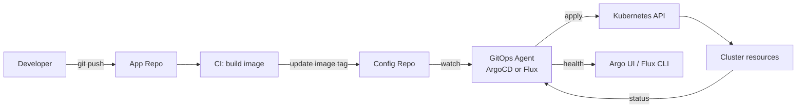

## 📘 Topic 61 — GitOps (ArgoCD, Flux)

**Official Documentation References**
- https://opengitops.dev/
- https://argo-cd.readthedocs.io/en/stable/
- https://fluxcd.io/flux/
- https://kubernetes.io/docs/concepts/cluster-administration/manage-deployment/

### 📘 Definition
GitOps is an operating model where Git is the single source of truth for declarative infrastructure, and a controller in the cluster continuously reconciles the live state to match the Git-stored desired state.

### 📖 About
Traditional CI/CD pushes to clusters from outside. GitOps flips this: the cluster **pulls** desired state from Git, so the cluster is always convergent, self-healing, and auditable.

**Four GitOps principles (OpenGitOps)**
1. **Declarative** — everything as code.
2. **Versioned & Immutable** — Git history is the audit log.
3. **Pulled Automatically** — agents fetch approved changes.
4. **Continuously Reconciled** — drift is detected and corrected.

**Why GitOps**
- Auditability: every change is a Git commit.
- Reversibility: revert = rollback.
- Multi-cluster consistency at scale.
- Reduced blast radius: no cluster credentials in CI runners.
- Secure by default: cluster only needs pull access to Git.

**ArgoCD vs Flux**

| Feature | ArgoCD | Flux |
|---------|--------|------|
| UI | Rich web UI | CLI-first, community UIs |
| App model | `Application` CRD | `Kustomization` + `HelmRelease` CRDs |
| Multi-tenancy | `AppProject` | Namespaced by default |
| Progressive delivery | Argo Rollouts | Flagger |
| Notifications | Argo Notifications | Notification Controller |
| ApplicationSet | Yes (templated multi-app) | Similar via `Kustomization` templating |
| SSO | OIDC, SAML, Dex | Via Kubernetes RBAC |
| CNCF status | Graduated | Graduated |

### 🔗 How It Integrates With Other Components

| Component | Integration |
|-----------|-------------|
| Git provider | Source of truth |
| Kustomize / Helm | Rendering engines |
| Kubernetes API | Reconcile target |
| RBAC | Agent gets a ServiceAccount with cluster-admin (scoped) |
| Secrets management | ExternalSecrets, Sealed Secrets, SOPS integration |
| CI (GitHub Actions, GitLab) | Build image → PR to config repo |
| Notifications | Slack, Teams, email on sync events |
| Prometheus | Sync metrics |
| SSO | ArgoCD via OIDC/SAML |

### 🏗️ Architecture / Flow Diagram

**Diagram 1 — Classic GitOps flow**



**Diagram 2 — Multi-cluster fan-out with ApplicationSet**

```
                +--------------------------+
                |  Config Git Repo (mono)   |
                +-----+---------+----------+
                      |         |
        +------------+          +-------------+
        |                                     |
    ApplicationSet                      ApplicationSet
    (generator: List of clusters)       (generator: Git)
        |                                     |
   +----+----+----+                     +----+----+
   |    |    |    |                     |    |    |
 EKS  GKE  Kind ...                    dev  stg  prod
```

### 💻 Real-World Examples

**Example 1 — ArgoCD `Application` for a Helm chart**

```yaml
apiVersion: argoproj.io/v1alpha1
kind: Application
metadata:
  name: shop-prod
  namespace: argocd
spec:
  project: default
  source:
    repoURL: https://github.com/acme/shop-config
    targetRevision: main
    path: charts/shop
    helm:
      valueFiles:
        - values-prod.yaml
  destination:
    server: https://kubernetes.default.svc
    namespace: shop-prod
  syncPolicy:
    automated:
      prune: true
      selfHeal: true
    syncOptions:
      - CreateNamespace=true
      - ServerSideApply=true
    retry:
      limit: 5
      backoff:
        duration: 5s
        factor: 2
        maxDuration: 3m
```

**Example 2 — Flux `Kustomization` + `HelmRelease`**

`GitRepository`:
```yaml
apiVersion: source.toolkit.fluxcd.io/v1
kind: GitRepository
metadata:
  name: shop-config
  namespace: flux-system
spec:
  interval: 1m
  url: https://github.com/acme/shop-config
  ref: { branch: main }
```

`Kustomization`:
```yaml
apiVersion: kustomize.toolkit.fluxcd.io/v1
kind: Kustomization
metadata:
  name: shop-prod
  namespace: flux-system
spec:
  interval: 5m
  path: ./overlays/prod
  prune: true
  sourceRef:
    kind: GitRepository
    name: shop-config
  targetNamespace: shop-prod
  wait: true
  timeout: 5m
```

### 💻 Related Commands

**ArgoCD**

| Command | Flag | Purpose | Example |
|---------|------|---------|---------|
| `argocd login` | `--sso` | Log into ArgoCD | `argocd login argocd.example.com --sso` |
| `argocd app list` | – | List apps | `argocd app list` |
| `argocd app get` | – | App details | `argocd app get shop-prod` |
| `argocd app sync` | `--prune --force` | Force sync | `argocd app sync shop-prod --prune` |
| `argocd app rollback` | `<APP> <HISTORY-ID>` | Roll back | `argocd app rollback shop-prod 3` |
| `argocd app diff` | – | Live vs Git diff | `argocd app diff shop-prod` |
| `argocd app history` | – | Sync history | `argocd app history shop-prod` |
| `argocd repo add` | `--username --password` | Register repo | `argocd repo add https://... --username x --password y` |
| `argocd proj create` | – | Create AppProject | `argocd proj create shop --dest ... --src ...` |
| `argocd cluster add` | – | Register external cluster | `argocd cluster add prod-context` |

**Flux**

| Command | Flag | Purpose | Example |
|---------|------|---------|---------|
| `flux bootstrap github` | `--owner --repository` | Install Flux + push manifests to Git | `flux bootstrap github --owner=acme --repository=fleet` |
| `flux create source git` | `--url --branch` | Add GitRepository | `flux create source git shop --url=https://... --branch=main` |
| `flux create kustomization` | `--source --path` | Add Kustomization | `flux create kustomization shop --source=shop --path=./overlays/prod` |
| `flux reconcile ks` | `--with-source` | Force reconcile | `flux reconcile ks shop --with-source` |
| `flux suspend ks` | – | Pause reconciliation | `flux suspend ks shop` |
| `flux resume ks` | – | Resume | `flux resume ks shop` |
| `flux get kustomizations` | – | Status | `flux get kustomizations` |
| `flux logs` | `-f` | Controller logs | `flux logs -f` |

### 🚨 Scenarios

**Scenario 1 — Drift from manual `kubectl edit`**
- **Problem**: An engineer edits a Deployment directly; ArgoCD/Flux keeps reverting it (or shows OutOfSync).
- **Resolution**:
  1. **This is the point** of GitOps — drift is detected and healed.
  2. Educate: change must go through Git PR.
  3. Enforce with RBAC: only ArgoCD SA has write access to that namespace.
  4. Enable `selfHeal: true` (ArgoCD) or leave `Kustomization.prune: true` (Flux) to auto-revert.

**Scenario 2 — Secret rotation in a GitOps world**
- **Problem**: You can't commit plaintext secrets to Git.
- **Resolution**:
  1. Use **Sealed Secrets** (Bitnami) — encrypt with cluster public key.
  2. Or **External Secrets Operator** — pull from GCP Secret Manager / AWS Secrets Manager on reconcile.
  3. Or **SOPS + age/KMS** — encrypt files, decrypt in agent.
  4. Never store plaintext; RBAC-restrict who can create Secrets outside GitOps.

**Scenario 3 — Rolling out to 50 clusters**
- **Problem**: Copy-pasting Applications for 50 clusters is unmanageable.
- **Resolution**:
  1. ArgoCD **ApplicationSet** with `List`, `Git`, or `Cluster` generator.
  2. Flux with a matrix of `Kustomizations` templated via `postBuild.substituteFrom`.
  3. Fleet management: Argo `ClusterGenerator` + labels per cluster.

### ☁️ GCP GKE Perspective
- **Anthos Config Management / Config Sync** is Google's first-party GitOps agent (uses Kustomize + Helm).
- **Backup for GKE** integrates with GitOps for full disaster recovery.
- Use **Workload Identity** so ArgoCD/Flux calls GCP APIs (e.g., pull from Artifact Registry) without keys.
- Command:
  ```bash
  gcloud beta container fleet config-management apply \
    --membership=<cluster> --config=config-management.yaml
  ```

### 🟧 AWS EKS Perspective
- Both ArgoCD and Flux are popular on EKS; no first-party GitOps product from AWS.
- Use **IRSA** for the ArgoCD repo-server or Flux source-controller to pull from CodeCommit / ECR privately.
- Common stack: ArgoCD + Sealed Secrets + AWS Load Balancer Controller for the ArgoCD UI.
- Command:
  ```bash
  helm install argocd argo/argo-cd -n argocd --create-namespace \
    --set server.serviceAccount.annotations."eks\.amazonaws\.com/role-arn"=arn:aws:iam::...:role/argocd
  ```

### 🧪 Hands-On Lab Exercises

---

**🧪 Lab 61-A — Install ArgoCD and Deploy Your First App (Beginner)**
- **Objective**: End-to-end GitOps on a Kind cluster.
- **Prerequisites**: Kind, kubectl, GitHub account.
- **Steps**:
  1. `kind create cluster --name gitops`
  2. `kubectl create ns argocd`
  3. `kubectl apply -n argocd -f https://raw.githubusercontent.com/argoproj/argo-cd/stable/manifests/install.yaml`
  4. `kubectl -n argocd port-forward svc/argocd-server 8080:443`
  5. Fetch initial password:
     `kubectl -n argocd get secret argocd-initial-admin-secret -o jsonpath='{.data.password}' | base64 -d`
  6. Fork https://github.com/argoproj/argocd-example-apps
  7. Create Application pointing to `guestbook/`.
  8. Push a change and watch auto-sync.
- **Verification**: UI shows `Synced` + `Healthy`; guestbook pods running.
- **Cleanup**: `kind delete cluster --name gitops`
- **Bonus**: Turn on `selfHeal` and manually edit a Deployment — watch it revert.

---

**🧪 Lab 61-B — Flux Bootstrap on EKS (Intermediate)**
- **Objective**: Bootstrap Flux with `flux bootstrap github`.
- **Prerequisites**: EKS cluster, GitHub PAT with `repo` scope, `flux` CLI.
- **Steps**:
  1. Export `GITHUB_TOKEN=<pat>` and `GITHUB_USER=<user>`.
  2. `flux bootstrap github --owner=$GITHUB_USER --repository=fleet --branch=main --path=clusters/prod --personal`
  3. Add a `GitRepository` + `Kustomization` under `clusters/prod/`.
  4. Commit; Flux reconciles.
- **Verification**: `flux get kustomizations` shows Ready.
- **Cleanup**: `flux uninstall --namespace=flux-system`
- **Bonus**: Add a `HelmRelease` for ingress-nginx.

---

**🧪 Lab 61-C — Progressive Delivery with Argo Rollouts (Advanced)**
- **Objective**: Canary a Deployment via Argo Rollouts + ArgoCD.
- **Prerequisites**: ArgoCD, Argo Rollouts controller, Prometheus.
- **Steps**:
  1. Install Argo Rollouts: `kubectl apply -k github.com/argoproj/argo-rollouts/manifests/crds`
  2. Convert Deployment to `Rollout` with canary steps: 20% → analysis → 40% → 100%.
  3. Configure `AnalysisTemplate` querying Prometheus success rate.
  4. Push image change; watch progressive rollout in Rollouts UI.
- **Verification**: On success → full promotion; on failure → auto-abort.
- **Bonus**: Add Slack notifications for rollout events.

### 🎯 Interview Deliverable Answer (60–90s)
> "GitOps makes Git the single source of truth for what's in the cluster, and a controller — ArgoCD or Flux — continuously pulls that state and reconciles it. **What**: declarative + versioned + pulled + continuously reconciled. **Why**: every change is a Git commit, so we get audit history, easy rollback via revert, and no cluster credentials in CI runners. **How**: developer PRs a manifest change, CI updates the image tag in the config repo, ArgoCD sees the change and applies it; drift is auto-healed. On EKS I run ArgoCD with an IRSA-bound ServiceAccount so it can pull from ECR; on GKE, Config Sync does the same. In one program we scaled to 30 clusters using an ArgoCD `ApplicationSet` — one YAML defined the app for every cluster and every env, so onboarding a new region was a two-line commit."

### ❓ Interview Questions

**Basic**
1. **Q**: What is GitOps?
   **A**: An operating model where Git is the single source of truth and an in-cluster controller continuously reconciles state.

2. **Q**: Push vs pull CD — which is GitOps?
   **A**: Pull — the cluster pulls from Git; CI never touches the cluster directly.

**Intermediate**
3. **Q**: ArgoCD `Application` vs `ApplicationSet`?
   **A**: `Application` is one app on one cluster; `ApplicationSet` templates many Applications from generators (list, cluster, git).

4. **Q**: What does `selfHeal: true` do?
   **A**: ArgoCD reverts any manual changes so cluster state always matches Git.

5. **Q**: Difference between ArgoCD and Flux?
   **A**: ArgoCD has a rich UI and app-centric model; Flux is CRD-driven with a lighter footprint. Both are CNCF Graduated.

**Advanced**
6. **Q**: How do you manage secrets in GitOps?
   **A**: Sealed Secrets, External Secrets Operator, or SOPS — never store plaintext in Git.

7. **Q**: What is progressive delivery?
   **A**: Gradual rollout (canary/blue-green) with automated analysis (Argo Rollouts / Flagger) that promotes or aborts based on metrics.

**Scenario**
8. **Q**: Someone bypassed GitOps with `kubectl edit`. How to prevent it?
   **A**: Enable `selfHeal`, restrict namespace RBAC so only the GitOps SA can write, add admission policies (Kyverno/OPA) to reject non-GitOps changes.

**GKE-specific**
9. **Q**: What is Config Sync?
   **A**: GCP's Anthos GitOps agent that syncs Kustomize/Helm from Git to fleets of GKE clusters.

**EKS-specific**
10. **Q**: How does ArgoCD authenticate to ECR on EKS?
    **A**: IRSA on the argocd-repo-server ServiceAccount + `AmazonEC2ContainerRegistryReadOnly` IAM policy.

**Lab-based**
11. **Q**: Walk me through installing ArgoCD and connecting a Git repo.
    **A**: (Lab 61-A) Install manifest, port-forward UI, fetch initial admin password, create Application pointing at repo/path, watch sync.

---

