## 📘 Topic 62 — Admission Controllers (Mutating & Validating)

**Official Documentation References**
- https://kubernetes.io/docs/reference/access-authn-authz/admission-controllers/
- https://kubernetes.io/docs/reference/access-authn-authz/extensible-admission-controllers/
- https://kubernetes.io/docs/reference/access-authn-authz/validating-admission-policy/
- https://open-policy-agent.github.io/gatekeeper/
- https://kyverno.io/docs/

### 📘 Definition
An admission controller is a piece of code in (or plugged into) the Kubernetes API server that intercepts requests **after** authentication and authorization but **before** the object is persisted to etcd, and can mutate or reject the request.

### 📖 About
Admission is the last line of defense (and shaping) for API objects. It runs *inside* the API request path, so it can enforce policy in real time — no reconciliation lag.

**Two categories**
1. **Mutating** admission controllers — modify the object (e.g., inject a sidecar, set default fields).
2. **Validating** admission controllers — accept or reject the request (e.g., "no `latest` tags allowed").

**Built-in admission plugins (compiled into kube-apiserver)** — a few key ones:
- `NamespaceLifecycle` — blocks writes to terminating namespaces.
- `LimitRanger` — applies default limits.
- `ServiceAccount` — auto-mounts SA token.
- `ResourceQuota` — enforces quotas.
- `PodSecurity` — enforces Pod Security Standards.
- `DefaultStorageClass` — sets default SC on PVCs.
- `MutatingAdmissionWebhook`, `ValidatingAdmissionWebhook` — call external webhooks.
- `ValidatingAdmissionPolicy` (v1.30 GA) — CEL-based validation without a webhook.

**Ordering**
1. Mutating phase (built-in mutators → mutating webhooks).
2. Object schema validation.
3. Validating phase (built-in validators → validating webhooks → validating admission policies).
4. Persist to etcd.

**Common external solutions**
- **OPA/Gatekeeper** — policy-as-code via Rego, ConstraintTemplate + Constraint CRDs.
- **Kyverno** — Kubernetes-native policies as YAML.
- **Cert-manager, Istio, Linkerd** — install webhooks for injection.
- **kube-mutating-webhook-tutorial**, **jsonpatch** libraries — DIY.

**Why admission controllers exist**
- Enforce security invariants (no root containers, no `hostNetwork`).
- Guarantee organizational conventions (labels, annotations, image registry allowlists).
- Automate boilerplate (sidecar injection, resource defaults).

### 🔗 How It Integrates With Other Components

| Component | Integration |
|-----------|-------------|
| kube-apiserver | Hosts the admission chain; loaded via `--enable-admission-plugins` |
| kubectl | User's request hits admission on every apply/create/update |
| ValidatingWebhookConfiguration / MutatingWebhookConfiguration | CRDs registering external webhook endpoints |
| Webhook server | TLS-served HTTPS endpoint responding with `AdmissionReview` |
| RBAC | Webhook needs its own SA + Service |
| CRDs | Custom policies (Gatekeeper `Constraint`, Kyverno `ClusterPolicy`) are CRDs |
| CI/CD | Policies enforce e.g. image scanning gates |
| Cert-manager | Auto-rotates webhook TLS certs |

### 🏗️ Architecture Diagrams

**Diagram 1 — Admission phases**

```mermaid
flowchart LR
    A[kubectl apply] --> B[AuthN]
    B --> C[AuthZ]
    C --> D[Mutating Admission]
    D --> D1[Built-in Mutators]
    D1 --> D2[MutatingWebhookConfiguration]
    D2 --> E[Object Schema Validation]
    E --> F[Validating Admission]
    F --> F1[Built-in Validators]
    F1 --> F2[ValidatingWebhookConfiguration]
    F2 --> F3[ValidatingAdmissionPolicy CEL]
    F3 --> G[etcd write]
```



**Diagram 2 — Webhook request/response**

```
kube-apiserver                  Webhook Server (Pod)
     |                                  |
     |--- AdmissionReview (JSON) ------>|
     |     .request.uid                 |
     |     .request.object              |
     |                                  |-- policy eval / patch generation
     |<-- AdmissionReview (JSON) -------|
     |     .response.uid                |
     |     .response.allowed=true/false |
     |     .response.patch (base64)     |
     |     .response.warnings[]         |
     |                                  |
```

### 💻 Real-World Examples

**Example 1 — MutatingWebhookConfiguration injecting a sidecar**

```yaml
apiVersion: admissionregistration.k8s.io/v1
kind: MutatingWebhookConfiguration
metadata:
  name: sidecar-injector.example.com
webhooks:
  - name: sidecar.example.com
    admissionReviewVersions: ["v1"]
    sideEffects: None
    timeoutSeconds: 5
    failurePolicy: Ignore   # Fail-open so cluster works if webhook is down
    reinvocationPolicy: IfNeeded
    clientConfig:
      service:
        name: sidecar-injector
        namespace: platform
        path: /mutate
        port: 443
      caBundle: <base64-ca>
    rules:
      - apiGroups: [""]
        apiVersions: ["v1"]
        resources: ["pods"]
        operations: ["CREATE"]
    namespaceSelector:
      matchLabels:
        sidecar-injection: enabled
    objectSelector:
      matchExpressions:
        - key: sidecar.example.com/inject
          operator: NotIn
          values: ["false"]
```

**Example 2 — ValidatingAdmissionPolicy (CEL, no webhook needed)**

```yaml
apiVersion: admissionregistration.k8s.io/v1
kind: ValidatingAdmissionPolicy
metadata:
  name: "disallow-latest-tag"
spec:
  failurePolicy: Fail
  matchConstraints:
    resourceRules:
      - apiGroups: ["apps"]
        apiVersions: ["v1"]
        operations: ["CREATE","UPDATE"]
        resources: ["deployments","statefulsets","daemonsets"]
  validations:
    - expression: >-
        object.spec.template.spec.containers.all(c,
          !c.image.endsWith(':latest') && c.image.contains(':'))
      message: "Container images must have an explicit non-'latest' tag."
      reason: Invalid
---
apiVersion: admissionregistration.k8s.io/v1
kind: ValidatingAdmissionPolicyBinding
metadata:
  name: "disallow-latest-tag-binding"
spec:
  policyName: "disallow-latest-tag"
  validationActions: [Deny, Audit, Warn]
  matchResources:
    namespaceSelector:
      matchLabels:
        environment: production
```

**Example 3 — Kyverno ClusterPolicy (require resource limits)**

```yaml
apiVersion: kyverno.io/v1
kind: ClusterPolicy
metadata:
  name: require-resource-limits
spec:
  validationFailureAction: Enforce
  background: true
  rules:
    - name: check-limits
      match:
        any:
          - resources:
              kinds: [Pod]
      validate:
        message: "CPU and memory limits are required."
        pattern:
          spec:
            containers:
              - resources:
                  limits:
                    cpu: "?*"
                    memory: "?*"
```

### 💻 Related Commands

| Command | Flag | Purpose | Example |
|---------|------|---------|---------|
| `kubectl get validatingwebhookconfigurations` | – | List validating webhooks | `kubectl get validatingwebhookconfigurations` |
| `kubectl get mutatingwebhookconfigurations` | – | List mutating webhooks | `kubectl get mutatingwebhookconfigurations` |
| `kubectl get validatingadmissionpolicies` | – | List CEL policies | `kubectl get vap` |
| `kubectl describe vwc <name>` | – | Inspect config | `kubectl describe vwc sidecar-injector` |
| `kubectl auth can-i` | – | Check RBAC before admission | `kubectl auth can-i create pods` |
| `kubectl get --raw` | – | Debug apiserver response | `kubectl get --raw /apis/admissionregistration.k8s.io/v1/validatingwebhookconfigurations` |
| `kubectl -n <ns> logs <webhook-pod>` | `-f` | Tail webhook logs | `kubectl logs -f -n platform deploy/sidecar-injector` |
| `kubectl apply --dry-run=server` | – | Test admission without persistence | `kubectl apply -f pod.yaml --dry-run=server` |
| `kubectl explain validatingadmissionpolicy.spec` | – | Learn schema | `kubectl explain vap.spec.validations` |
| `kyverno test` | – | Test Kyverno policies locally | `kyverno test .` |
| `gator test` | – | Test Gatekeeper constraints | `gator test --filename=./policies` |

### 🚨 Scenarios

**Scenario 1 — Webhook down brings cluster to its knees**
- **Problem**: `failurePolicy: Fail` webhook Pod is unhealthy; every Pod creation is rejected → cluster unable to schedule anything.
- **Resolution**:
  1. For non-critical webhooks, set `failurePolicy: Ignore`.
  2. Exclude `kube-system` and the webhook's own namespace via `namespaceSelector`.
  3. Run at least 2 replicas of the webhook with a PDB.
  4. Set aggressive `timeoutSeconds` (≤5s).
  5. Add `matchConditions` (v1.30+) to reduce match volume.

**Scenario 2 — Webhook certificate expired**
- **Problem**: `caBundle` no longer valid; kube-apiserver errors `x509: certificate has expired`.
- **Resolution**:
  1. Use **cert-manager** with `Certificate` + `CAInjector` annotation on the WebhookConfiguration.
  2. Or manually rotate + `kubectl patch vwc <name> -p '{"webhooks":[{"name":"...","clientConfig":{"caBundle":"..."}}]}'`.
  3. Monitor cert expiration with Prometheus `x509-certificate-exporter`.

**Scenario 3 — Sidecar injected into system pods causing crash**
- **Problem**: Mutating webhook injected an Envoy sidecar into a DaemonSet in `kube-system`, breaking node bootstrap.
- **Resolution**:
  1. Add `namespaceSelector.matchExpressions` excluding `kube-system` and control-plane namespaces.
  2. Use an opt-in label (e.g., `sidecar-injection: enabled`) rather than opt-out.
  3. Test admission policies with `--dry-run=server` in CI.

### ☁️ GCP GKE Perspective
- GKE ships with the standard admission plugins enabled.
- **Policy Controller** (Anthos add-on) is a managed distribution of OPA Gatekeeper.
- **Autopilot** enforces built-in security policies via admission — you cannot disable them. Attempts to run privileged containers, `hostNetwork: true`, or `hostPath` are rejected at admission.
- GKE binary authorization uses an admission webhook to verify image signatures.
- Command: `gcloud container fleet policycontroller enable --memberships=<cluster>`.

### 🟧 AWS EKS Perspective
- Standard plugins enabled; you can extend `--enable-admission-plugins` only through EKS-supported flags.
- Common installs: **Gatekeeper** or **Kyverno** via Helm.
- Fargate Pods still pass through admission — sidecar injection works, but you must whitelist your Fargate profile namespace.
- IRSA can be used to give a webhook AWS API access (e.g., look up signed image metadata in Signer).
- Command: `aws eks describe-cluster --name <c> --query 'cluster.identity.oidc.issuer'` to find OIDC issuer for IRSA on the webhook SA.

### 🧪 Hands-On Lab Exercises

**🧪 Lab 62-A — First Validating Admission Policy (Beginner)**
- **Objective**: Reject Pods without a `team` label using ValidatingAdmissionPolicy.
- **Prerequisites**: Cluster v1.30+.
- **Steps**:
  1. Save policy:
     ```yaml
     apiVersion: admissionregistration.k8s.io/v1
     kind: ValidatingAdmissionPolicy
     metadata: { name: require-team-label }
     spec:
       failurePolicy: Fail
       matchConstraints:
         resourceRules:
         - apiGroups: [""]
           apiVersions: ["v1"]
           operations: ["CREATE","UPDATE"]
           resources: ["pods"]
       validations:
         - expression: "has(object.metadata.labels) && has(object.metadata.labels.team)"
           message: "Pods must have a 'team' label."
     ```
  2. Apply it + a binding scoped to `default` namespace.
  3. `kubectl run bad --image=nginx` → rejected.
  4. `kubectl run good --image=nginx --labels=team=platform` → accepted.
- **Verification**: rejection message printed.
- **Cleanup**: `kubectl delete vap require-team-label vapbinding require-team-label-binding`.
- **Bonus**: Add `validationActions: [Warn]` for a soft-launch phase.

**🧪 Lab 62-B — Kyverno Enforcing Image Registry Allowlist (Intermediate)**
- **Objective**: Only allow images from `gcr.io/my-project/*` or `<acct>.dkr.ecr.us-east-1.amazonaws.com/*`.
- **Prerequisites**: Kyverno installed (`helm install kyverno kyverno/kyverno -n kyverno --create-namespace`).
- **Steps**:
  1. Apply a `ClusterPolicy` with `validate.deny` on non-allowlisted registries.
  2. Attempt `kubectl run hacker --image=docker.io/evil:latest` → denied.
  3. Attempt with an allowlisted image → allowed.
- **Verification**: `kubectl get events` shows policy denial reason.
- **Bonus**: Add `mutate` rule that auto-adds an `imagePullSecrets` entry.

**🧪 Lab 62-C — Sidecar Injection Webhook from Scratch (Advanced)**
- **Objective**: Build a mutating webhook in Go that injects a `busybox` sidecar into pods labeled `inject=true`.
- **Prerequisites**: Go, cert-manager, kind, docker registry.
- **Steps**:
  1. Scaffold Go HTTP server serving `/mutate` returning `AdmissionReview` with a JSON patch.
  2. Build & push image; deploy as Deployment + Service.
  3. Create `Certificate` (cert-manager) + `MutatingWebhookConfiguration` with `cert-manager.io/inject-ca-from` annotation.
  4. Create Pod with `labels: { inject: "true" }`.
- **Verification**: Pod comes up with 2 containers.
- **Bonus**: Add unit tests for patch generation + e2e test with envtest.

### 🎯 Interview Deliverable Answer (60–90s)
> "Admission controllers are the API server's gate between authorization and etcd. They come in two flavors: mutating (change the request — like injecting a sidecar or default resource limits) and validating (accept or reject — like blocking `:latest` tags). Built-in plugins ship in the apiserver; external ones plug in via `MutatingWebhookConfiguration` and `ValidatingWebhookConfiguration`, and since v1.30 we also have `ValidatingAdmissionPolicy` — pure CEL, no webhook. Why: enforce security and org standards in real time, not after the fact. How I've used it: on EKS with Kyverno we blocked untrusted registries and required team labels; on GKE Autopilot the platform enforces PSS via admission, so we shifted our custom checks to CEL-based policies. Key gotcha: `failurePolicy: Fail` on a webhook that goes down can wedge the whole cluster — always exclude `kube-system` and run multiple replicas with a PDB."

### ❓ Interview Questions

**Basic**
1. **Q**: What is an admission controller?
   **A**: Code in the apiserver that intercepts authorized requests before persistence, and can mutate or reject them.

2. **Q**: Mutating vs Validating?
   **A**: Mutating modifies the object; validating only accepts or rejects. Mutating runs first.

**Intermediate**
3. **Q**: What does `failurePolicy: Fail` mean?
   **A**: If the webhook is unreachable, admission is denied (fail-closed). `Ignore` is fail-open.

4. **Q**: When does the mutating chain re-run?
   **A**: If `reinvocationPolicy: IfNeeded`, later webhooks may cause earlier ones to be re-invoked once.

5. **Q**: How is `ValidatingAdmissionPolicy` different from a validating webhook?
   **A**: It's in-process CEL evaluation — no external server, no TLS, no network hop; introduced Beta in v1.28, GA v1.30.

**Advanced**
6. **Q**: What order do admission plugins run in?
   **A**: Mutating → schema validation → Validating; within each phase, built-ins first, then webhooks in an undefined but stable order.

7. **Q**: How do you keep webhook certs fresh?
   **A**: cert-manager issues + rotates a Certificate; `caBundle` on the webhook config is auto-injected via `cert-manager.io/inject-ca-from`.

**Scenario**
8. **Q**: All Pod creates in production are failing after installing a webhook — how do you unblock the cluster?
   **A**: Delete the webhook configuration (`kubectl delete vwc <name>`), fix, re-apply. Add `kube-system` exclusion.

**GKE-specific**
9. **Q**: How does Autopilot use admission?
   **A**: Google-managed policies reject privileged/hostPath/hostNetwork; you can't bypass them.

**EKS-specific**
10. **Q**: How to run a webhook that reads secrets from AWS Secrets Manager?
    **A**: IRSA-bind its SA + `secretsmanager:GetSecretValue`; call SDK from the webhook process.

**Lab-based**
11. **Q**: Show me writing a policy that blocks `latest` tags.
    **A**: (Lab 62-A) VAP with CEL expression checking `!c.image.endsWith(':latest')`.

---

