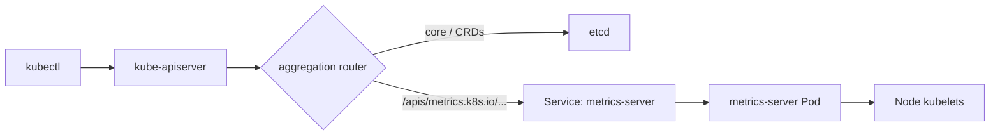
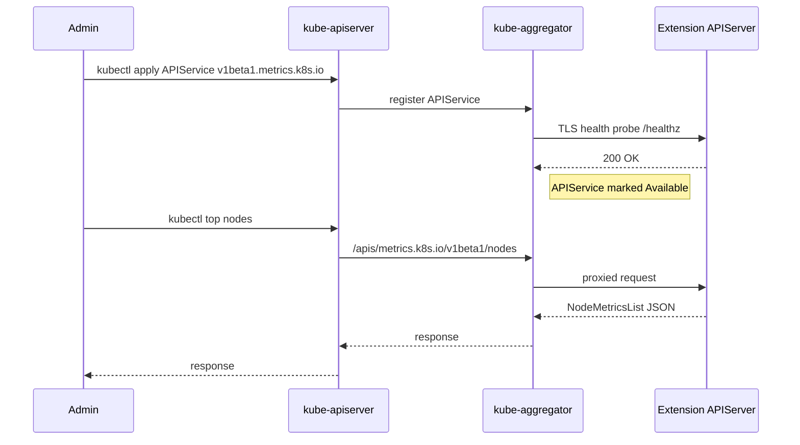

## 📘 Topic 63 — API Aggregation Layer

**Official Documentation References**
- https://kubernetes.io/docs/concepts/extend-kubernetes/api-extension/apiserver-aggregation/
- https://kubernetes.io/docs/tasks/extend-kubernetes/configure-aggregation-layer/
- https://kubernetes.io/docs/reference/generated/kubernetes-api/v1.31/#apiservice-v1-apiregistration-k8s-io

### 📘 Definition
The API Aggregation Layer lets you extend Kubernetes with additional, first-class APIs served by *your own* extension apiserver, exposed under the same `/apis/<group>/<version>` URL space as core APIs.

### 📖 About
CRDs give you extension APIs backed by etcd; the **aggregation layer** gives you extension APIs backed by *any* custom logic — including in-memory data, external systems, or specialized storage.

**CRD vs Aggregated APIServer**

| Aspect | CRD | Aggregated APIServer |
|--------|-----|----------------------|
| Storage | etcd (managed) | Your choice — etcd, memory, external DB |
| Schema | OpenAPI + CEL | Full Go types |
| Discovery | Auto via apiserver | Registered via APIService |
| Watch/List | Free | You implement |
| Best for | Declarative CRs | Live/computed data, high-scale, protocol translation |

**How it works**
1. The main kube-apiserver runs the `kube-aggregator` component.
2. You create an `APIService` object registering `v1beta1.metrics.k8s.io` (say) with a `Service` that points at your extension server.
3. Requests to `/apis/metrics.k8s.io/v1beta1/*` are transparently proxied to your Pod.
4. Your Pod runs a Go server built on the `k8s.io/apiserver` library, or any HTTP server implementing the discovery, list/watch, and CRUD verbs.

**Canonical example**: `metrics-server` — computes `PodMetrics` / `NodeMetrics` on demand rather than storing them.

**When to use aggregation**
- Serving data too volatile for etcd (metrics, live event streams).
- Wrapping an external system as Kubernetes API.
- Very high QPS / throughput.
- Needing custom auth flows or protocol adapters.

### 🔗 How It Integrates With Other Components

| Component | Integration |
|-----------|-------------|
| kube-apiserver | Runs `kube-aggregator`; proxies matching paths |
| APIService (CRD-like) | Registers the extension |
| Service + Pod | Your extension apiserver runs here |
| Auth | Delegated: main apiserver forwards user identity via headers (`--requestheader-*` flags) |
| TLS | The extension server presents a cert; main apiserver validates it |
| Discovery | Your extension answers `/apis/<group>/<version>` for kubectl to auto-discover |
| kubectl | Same UX as core APIs |

### 🏗️ Architecture Diagrams

**Diagram 1 — Request routing**



**Diagram 2 — APIService registration**



### 💻 Real-World Examples

**Example 1 — APIService for a custom extension apiserver**

```yaml
apiVersion: apiregistration.k8s.io/v1
kind: APIService
metadata:
  name: v1alpha1.wardle.example.com
spec:
  group: wardle.example.com
  version: v1alpha1
  groupPriorityMinimum: 1000
  versionPriority: 15
  service:
    name: wardle-server
    namespace: wardle
    port: 443
  caBundle: <base64-CA>
  insecureSkipTLSVerify: false
```

Supporting Service:
```yaml
apiVersion: v1
kind: Service
metadata:
  name: wardle-server
  namespace: wardle
spec:
  selector: { app: wardle-apiserver }
  ports:
    - name: https
      port: 443
      targetPort: 8443
```

**Example 2 — metrics-server APIService (from upstream)**

```yaml
apiVersion: apiregistration.k8s.io/v1
kind: APIService
metadata:
  name: v1beta1.metrics.k8s.io
  labels:
    k8s-app: metrics-server
spec:
  service:
    name: metrics-server
    namespace: kube-system
  group: metrics.k8s.io
  version: v1beta1
  insecureSkipTLSVerify: true
  groupPriorityMinimum: 100
  versionPriority: 100
```

### 💻 Related Commands

| Command | Flag | Purpose | Example |
|---------|------|---------|---------|
| `kubectl get apiservices` | – | List all APIServices | `kubectl get apiservices` |
| `kubectl get apiservices` | `-o wide` | Show Available column | `kubectl get apiservices -o wide` |
| `kubectl describe apiservice` | – | See status & conditions | `kubectl describe apiservice v1beta1.metrics.k8s.io` |
| `kubectl get --raw` | – | Hit aggregated endpoint directly | `kubectl get --raw /apis/metrics.k8s.io/v1beta1/nodes` |
| `kubectl top nodes/pods` | – | Uses metrics.k8s.io | `kubectl top pods` |
| `kubectl api-resources` | `--api-group` | Filter to a group | `kubectl api-resources --api-group=metrics.k8s.io` |
| `kubectl logs -n kube-system deploy/metrics-server` | `-f` | Debug extension apiserver | `kubectl logs -n kube-system deploy/metrics-server -f` |

### 🚨 Scenarios

**Scenario 1 — `kubectl top nodes` returns "error from server (ServiceUnavailable)"**
- **Problem**: metrics-server Pod is CrashLooping or its Service selector is wrong.
- **Resolution**:
  1. `kubectl get apiservice v1beta1.metrics.k8s.io -o yaml` → check `.status.conditions`.
  2. Check Pod logs; common causes: kubelet TLS errors (`--kubelet-insecure-tls`), CNI blocking apiserver → metrics-server.
  3. Verify `--requestheader-*` flags on apiserver.

**Scenario 2 — Aggregated APIService blocks entire discovery**
- **Problem**: When an APIService is `Unavailable`, `kubectl api-resources` returns errors and Helm/ArgoCD may fail.
- **Resolution**:
  1. Delete the broken APIService: `kubectl delete apiservice <name>`.
  2. Ensure health checks are quick; extension server must serve `/healthz`.
  3. Set `groupPriorityMinimum` and `versionPriority` correctly — misordering causes routing issues.

**Scenario 3 — TLS handshake failing between apiserver and extension**
- **Problem**: `caBundle` in APIService doesn't match cert served by extension.
- **Resolution**:
  1. Use `kubernetes.io/kube-apiserver-client` signer or cert-manager.
  2. Automate CA injection with `caBundle` from a Secret via a small controller.
  3. `openssl s_client -connect wardle-server.wardle:443 -showcerts` to inspect.

### ☁️ GCP GKE Perspective
- `metrics-server` and `metrics.k8s.io` are managed by GKE — you don't install them.
- Custom aggregated APIs work; use a **NEG-backed Service** for the extension server if you need external access.
- On Autopilot, aggregated apiservers must satisfy Autopilot pod constraints (no privileged).
- **Managed Service for Prometheus** on GKE registers `external.metrics.k8s.io` and `custom.metrics.k8s.io` via aggregation to feed HPA.

### 🟧 AWS EKS Perspective
- `metrics-server` **is not** installed by default — you install via Helm or the EKS add-on.
- On Fargate, the aggregation layer works, but the extension Pod must be on a Fargate profile.
- Use IRSA to give the extension apiserver AWS API access.
- Common aggregated APIs on EKS: `metrics-server`, `external-metrics-adapter` (Prometheus adapter for HPA).

### 🧪 Hands-On Lab Exercises

**🧪 Lab 63-A — Install metrics-server and Explore Aggregation (Beginner)**
- **Objective**: See `metrics.k8s.io` in action.
- **Prerequisites**: Kind or Minikube.
- **Steps**:
  1. `kubectl apply -f https://github.com/kubernetes-sigs/metrics-server/releases/latest/download/components.yaml`
  2. For Kind, patch to add `--kubelet-insecure-tls`.
  3. `kubectl get apiservice v1beta1.metrics.k8s.io -o wide` → wait for `Available: True`.
  4. `kubectl top nodes` and `kubectl top pods -A`.
  5. `kubectl get --raw /apis/metrics.k8s.io/v1beta1/nodes | jq`.
- **Verification**: Nodes + Pods with CPU/mem values.
- **Cleanup**: `kubectl delete -f https://github.com/kubernetes-sigs/metrics-server/releases/latest/download/components.yaml`
- **Bonus**: Inspect logs and identify the `kubelet_summary_scrapes_total` metric.

**🧪 Lab 63-B — Sample "Wardle" Aggregated APIServer (Intermediate)**
- **Objective**: Deploy the upstream sample-apiserver from https://github.com/kubernetes-sigs/apiserver-builder-alpha.
- **Steps**:
  1. Clone repo, build image.
  2. Deploy Namespace, ServiceAccount, RBAC, Deployment, Service, APIService.
  3. `kubectl api-resources --api-group=wardle.example.com`.
  4. `kubectl create -f - <<EOF ... kind: Flunder ...` and list them.
- **Verification**: Custom kind visible.
- **Cleanup**: Delete namespace + APIService.
- **Bonus**: Add TLS via cert-manager.

**🧪 Lab 63-C — Prometheus Adapter for HPA (Advanced)**
- **Objective**: Serve `custom.metrics.k8s.io` from Prometheus to drive HPA on a custom metric (`http_requests_per_second`).
- **Prerequisites**: Prometheus + prometheus-adapter Helm chart.
- **Steps**:
  1. Install kube-prometheus-stack.
  2. Install `prometheus-adapter` with rules mapping HTTP metric.
  3. Deploy sample app + Service.
  4. `kubectl get --raw "/apis/custom.metrics.k8s.io/v1beta1/namespaces/default/pods/*/http_requests_per_second"`.
  5. Create HPA `.spec.metrics.type: Pods`.
  6. Load-test with `hey`.
- **Verification**: HPA scales on custom metric.
- **Bonus**: Scale on an external metric (SQS queue length on EKS or Pub/Sub on GKE).

### 🎯 Interview Deliverable Answer (60–90s)
> "The API Aggregation Layer lets me extend Kubernetes with new APIs that aren't backed by etcd. Where CRDs give me declarative objects stored in etcd, an aggregated apiserver serves any URL under `/apis/<group>/<version>` from a Pod I control. Why: some data — live pod metrics, external system views, high-volume streams — doesn't belong in etcd. The classic example is `metrics-server`: it registers `metrics.k8s.io`, and `kubectl top nodes` transparently proxies through kube-aggregator. On EKS you install it as an add-on; on GKE it's managed. To wire it in you create an `APIService` object pointing at a Service; the apiserver validates TLS with your CA bundle and forwards requests. In an HPA project I registered `custom.metrics.k8s.io` via prometheus-adapter to scale on requests-per-second — that only works because of aggregation."

### ❓ Interview Questions

**Basic**
1. **Q**: What's the difference between CRD and aggregation?
   **A**: CRDs are stored in etcd; aggregated APIs are served by your Pod and can back onto anything.

2. **Q**: Name a well-known aggregated API.
   **A**: `metrics.k8s.io` served by metrics-server.

**Intermediate**
3. **Q**: How does the apiserver route a request to an aggregated API?
   **A**: The kube-aggregator matches path prefix against registered APIServices and proxies over HTTPS to the target Service.

4. **Q**: What does `groupPriorityMinimum` do?
   **A**: Controls ordering of API groups in discovery and resolution when clients pick a version.

**Advanced**
5. **Q**: How is user identity passed to the extension apiserver?
   **A**: Via `--requestheader-*` flags: apiserver signs headers (`X-Remote-User`, `X-Remote-Group`) using a client cert the extension trusts.

6. **Q**: Trade-offs of aggregation vs CRD?
   **A**: Aggregation: more flexible, harder to build/operate. CRD: free storage, watch, RBAC; less flexible.

**Scenario**
7. **Q**: `kubectl api-resources` is slow — diagnose.
   **A**: Likely a broken APIService returning slowly; `kubectl get apiservices | grep False` to find it.

**GKE-specific**
8. **Q**: How is `metrics-server` handled on GKE?
   **A**: Managed by Google; installed and upgraded automatically.

**EKS-specific**
9. **Q**: How do you install metrics-server on EKS?
   **A**: `kubectl apply` the upstream manifest or use the EKS add-on / Helm chart.

**Lab-based**
10. **Q**: Show me making HPA scale on a custom metric.
    **A**: (Lab 63-C) install prometheus-adapter → verify `custom.metrics.k8s.io` → HPA with `type: Pods`.

---

