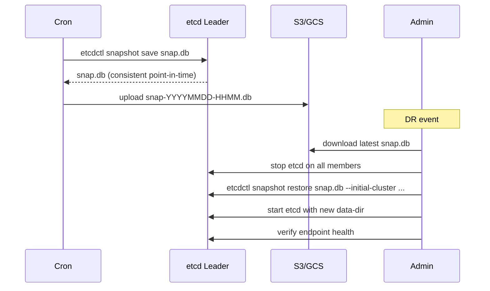

## 📘 Topic 64 — etcd Deep Dive (Backup, Restore, Disaster Recovery)

**Official Documentation References**
- https://kubernetes.io/docs/tasks/administer-cluster/configure-upgrade-etcd/
- https://etcd.io/docs/
- https://kubernetes.io/docs/setup/production-environment/tools/kubeadm/setup-ha-etcd-with-kubeadm/
- https://kubernetes.io/docs/tasks/administer-cluster/backup-cluster/

### 📘 Definition
etcd is the distributed, strongly-consistent key-value store used by Kubernetes as its sole source of truth — every object you `kubectl apply` lives here.

### 📖 About
etcd is a Raft-based CP (consistent + partition-tolerant) datastore. If etcd loses quorum or its data is corrupted, the cluster's API becomes unavailable and no scheduling decisions can be made or preserved.

**Key properties**
- **Raft consensus**: writes require majority (⌈N/2⌉+1) of members to ack.
- **Cluster sizes**: 3, 5, 7 members. 3 tolerates 1 failure; 5 tolerates 2. Even sizes give no extra fault tolerance.
- **Watch**: streaming API used heavily by kube-apiserver and controllers.
- **MVCC**: versioned key-value; historical revisions kept until compaction.
- **Compaction**: removes old revisions to reclaim space.
- **Defragmentation**: reclaims disk fragmentation, must be run periodically (per member).

**Data organization in Kubernetes etcd**
- All Kubernetes objects stored under `/registry/<resource>/<namespace>/<name>`.
- Encoded in Protobuf by default.
- Encryption-at-rest via `EncryptionConfiguration` on kube-apiserver (`aescbc`, `kms`).

**Failure modes**
- Loss of quorum → API server writes fail.
- Disk full → etcd goes read-only (alarm NOSPACE).
- Slow disk → apply latency spikes (P99 > 100ms is bad).
- Corruption → member refuses to start.

**Best-practice hardware**
- SSD/NVMe with < 10ms fsync latency.
- Dedicated disk (not shared with OS/logs).
- 8+ GB RAM.
- 4+ vCPU.
- 1 Gbps+ network, low latency between members.

**Backup strategies**
- **Snapshots** via `etcdctl snapshot save`.
- Frequency: every 15–30 min for prod; retain 24 hours + daily for 30 days.
- Store off-cluster (S3/GCS with immutability).
- Test restores routinely.

### 🔗 How It Integrates With Other Components

| Component | Integration |
|-----------|-------------|
| kube-apiserver | Sole client (all reads/writes go through it) |
| controllers / scheduler | Talk to apiserver, not etcd directly |
| kubelet | No direct etcd access |
| Cloud providers | Usually run etcd inside the control plane |
| Encryption | apiserver encrypts data before storing |
| Backup for GKE / Velero | Higher-level tools that snapshot workloads (not etcd directly on managed) |

### 🏗️ Architecture Diagrams

**Diagram 1 — Raft quorum**

```
   +---------+          +---------+          +---------+
   | etcd-1  |<-------->| etcd-2  |<-------->| etcd-3  |
   | leader  |          | follower|          | follower|
   +---------+          +---------+          +---------+
        ^                   ^                     ^
        |                   |                     |
        +----- write (requires 2/3 ack) ----------+
```

**Diagram 2 — Backup + restore flow**



**Diagram 3 — kubeadm 3-node etcd stacked topology**

```
+---------------------+   +---------------------+   +---------------------+
|  control-plane-1    |   |  control-plane-2    |   |  control-plane-3    |
| apiserver           |   | apiserver           |   | apiserver           |
| scheduler           |   | scheduler           |   | scheduler           |
| controller-mgr      |   | controller-mgr      |   | controller-mgr      |
| etcd-1  <========>  |   | etcd-2  <========>  |   | etcd-3              |
+---------------------+   +---------------------+   +---------------------+
             |____________ HAProxy / LB _______________|
                                  |
                              kubelets
```

### 💻 Real-World Examples

**Example 1 — Encryption at rest configuration**

`/etc/kubernetes/encryption-config.yaml`:
```yaml
apiVersion: apiserver.config.k8s.io/v1
kind: EncryptionConfiguration
resources:
  - resources: ["secrets", "configmaps"]
    providers:
      - aescbc:
          keys:
            - name: key1
              secret: <base64-32-bytes>
      - identity: {}
```

Add flag to kube-apiserver:
```
--encryption-provider-config=/etc/kubernetes/encryption-config.yaml
```

**Example 2 — Cron-driven snapshot to S3**

```yaml
apiVersion: batch/v1
kind: CronJob
metadata:
  name: etcd-backup
  namespace: kube-system
spec:
  schedule: "*/30 * * * *"
  successfulJobsHistoryLimit: 3
  failedJobsHistoryLimit: 3
  jobTemplate:
    spec:
      template:
        spec:
          hostNetwork: true
          nodeSelector:
            node-role.kubernetes.io/control-plane: ""
          tolerations:
            - key: node-role.kubernetes.io/control-plane
              operator: Exists
              effect: NoSchedule
          restartPolicy: OnFailure
          containers:
            - name: backup
              image: registry.k8s.io/etcd:3.5.15-0
              command:
                - /bin/sh
                - -c
                - >
                  TS=$(date +%Y%m%d-%H%M);
                  ETCDCTL_API=3 etcdctl
                  --endpoints=https://127.0.0.1:2379
                  --cacert=/etc/kubernetes/pki/etcd/ca.crt
                  --cert=/etc/kubernetes/pki/etcd/server.crt
                  --key=/etc/kubernetes/pki/etcd/server.key
                  snapshot save /backup/snap-$TS.db &&
                  aws s3 cp /backup/snap-$TS.db s3://etcd-backups/$TS.db
              volumeMounts:
                - name: etcd-pki
                  mountPath: /etc/kubernetes/pki/etcd
                  readOnly: true
                - name: backup
                  mountPath: /backup
          volumes:
            - name: etcd-pki
              hostPath: { path: /etc/kubernetes/pki/etcd }
            - name: backup
              emptyDir: {}
```

### 💻 Related Commands

| Command | Flag | Purpose | Example |
|---------|------|---------|---------|
| `etcdctl endpoint status` | `-w table` | Show leader, DB size, revision | `etcdctl --endpoints=... endpoint status -w table` |
| `etcdctl endpoint health` | `--cluster` | Cluster-wide health | `etcdctl endpoint health --cluster` |
| `etcdctl member list` | `-w table` | Cluster members | `etcdctl member list -w table` |
| `etcdctl snapshot save` | `<path>` | Take snapshot | `etcdctl snapshot save /tmp/snap.db` |
| `etcdctl snapshot restore` | `--data-dir` | Restore snapshot | `etcdctl snapshot restore snap.db --data-dir=/var/lib/etcd-new` |
| `etcdctl snapshot status` | `-w table` | Snapshot metadata | `etcdctl snapshot status snap.db -w table` |
| `etcdctl defrag` | `--command-timeout=` | Defrag DB | `etcdctl defrag --command-timeout=90s --cluster` |
| `etcdctl alarm list` | – | List alarms (NOSPACE, CORRUPT) | `etcdctl alarm list` |
| `etcdctl alarm disarm` | – | Clear alarm after fix | `etcdctl alarm disarm` |
| `etcdctl compaction` | `<rev>` | Compact old revisions | `etcdctl compaction $(etcdctl endpoint status -w json | jq -r '.[0].Status.header.revision')` |
| `etcdctl move-leader` | `<id>` | Migrate leadership | `etcdctl move-leader 12345abcd` |
| `etcdctl member add/remove` | – | Manage membership | `etcdctl member add etcd-4 --peer-urls=https://...` |
| `kubeadm certs check-expiration` | – | Check cert expiry | `kubeadm certs check-expiration` |

### 🚨 Scenarios

**Scenario 1 — etcd disk full (NOSPACE alarm)**
- **Problem**: DB exceeds `--quota-backend-bytes` (default 2 GB); writes fail.
- **Resolution**:
  1. `etcdctl alarm list` → NOSPACE.
  2. Compact: `etcdctl compaction <current-rev>`.
  3. Defrag: `etcdctl defrag --cluster`.
  4. Disarm: `etcdctl alarm disarm`.
  5. Increase quota to 8 GB via `--quota-backend-bytes=8589934592`.
  6. Ensure regular auto-compaction: `--auto-compaction-retention=1h`.

**Scenario 2 — Lost quorum (2 of 3 members down)**
- **Problem**: apiserver returns 503; cluster is read-only or fully unavailable.
- **Resolution**:
  1. Stop remaining etcd Pod on healthy control plane node.
  2. Restore from snapshot on all planned members with `--force-new-cluster` on the first.
  3. Or rebuild remaining members as a single-node cluster, then `member add` new ones.
  4. Post-recovery: verify all Deployments and Services intact.

**Scenario 3 — Corrupted DB after power outage**
- **Problem**: `etcd` crash loops with "walpb: crc mismatch".
- **Resolution**:
  1. Restore from latest snapshot; expect brief data loss window.
  2. Ensure `sync` on the storage class (SSD with power-loss protection).
  3. Improve backup cadence (every 10 min).

### ☁️ GCP GKE Perspective
- **Fully managed etcd** — you have no access.
- **Backup for GKE** (BackupPlan / RestorePlan CRDs) backs up **workloads and volumes** — it does not expose raw etcd snapshots.
- Google internally snapshots etcd for their SLA-covered restores.
- Regional clusters run etcd across 3 zones with automatic failover.
- Cost & retention: `gcloud beta container backup-restore backup-plans create` — configure schedule and retention.

### 🟧 AWS EKS Perspective
- **Fully managed etcd** — you have no access.
- EKS control plane is HA across 3 AZs by default.
- For workload-level DR: **Velero** with S3 backend.
  ```
  velero install --provider aws --bucket <bucket> \
    --backup-location-config region=us-east-1 \
    --plugins velero/velero-plugin-for-aws:v1.9.0
  velero backup create daily-$(date +%F) --include-namespaces prod
  ```
- For self-managed etcd on EC2: EBS snapshots + cross-region copy.

### 🧪 Hands-On Lab Exercises

**🧪 Lab 64-A — Snapshot & Restore on Minikube (Beginner)**
- **Objective**: Take etcd snapshot; break the cluster; restore.
- **Prerequisites**: Minikube.
- **Steps**:
  1. `minikube ssh` → `sudo ETCDCTL_API=3 etcdctl snapshot save /tmp/snap.db --endpoints=127.0.0.1:2379 --cacert=... --cert=... --key=...`.
  2. Create a Deployment `test-app`.
  3. Take another snapshot.
  4. Delete `test-app`.
  5. Restore snapshot (see docs).
  6. Verify `test-app` is back.
- **Verification**: Deployment reappears after restart.
- **Cleanup**: `minikube delete`.
- **Bonus**: Automate with a CronJob.

**🧪 Lab 64-B — kubeadm HA Cluster with External etcd (Intermediate)**
- **Objective**: Build a 3-node stacked etcd control plane.
- **Prerequisites**: 3 VMs, HAProxy VIP.
- **Steps**:
  1. Configure HAProxy for apiserver.
  2. `kubeadm init --control-plane-endpoint=<VIP>:6443 --upload-certs`.
  3. Join two more control planes.
  4. Verify `kubectl get pods -n kube-system` → 3 etcd pods.
  5. `etcdctl member list -w table`.
- **Verification**: 3 healthy etcd members.
- **Cleanup**: `kubeadm reset` on each.
- **Bonus**: Kill one control plane and confirm quorum survives.

**🧪 Lab 64-C — Velero Backup + Cross-Region Restore on EKS (Advanced)**
- **Objective**: Backup a namespace in us-east-1 EKS, restore in us-west-2 EKS.
- **Prerequisites**: 2 EKS clusters, S3 bucket, IRSA for Velero.
- **Steps**:
  1. Install Velero in each cluster with the same bucket.
  2. Deploy sample app in `us-east-1`.
  3. `velero backup create demo --include-namespaces=sample`.
  4. Wait for `Completed`.
  5. Switch context to `us-west-2` cluster.
  6. `velero restore create --from-backup demo`.
- **Verification**: App running in `us-west-2`.
- **Cleanup**: Delete both clusters.
- **Bonus**: Add schedule for daily backups with `velero schedule create`.

### 🎯 Interview Deliverable Answer (60–90s)
> "etcd is the single source of truth for Kubernetes — every object goes through the apiserver into etcd via Raft consensus. What matters operationally: it needs a majority for writes, so we run 3 or 5 members; it needs fast disks (low fsync latency), because everything Kubernetes does is a read or watch against etcd; and it needs backup discipline — regular snapshots stored off-cluster, tested restores, and monitoring for the NOSPACE alarm. On kubeadm clusters I run `etcdctl snapshot save` on a schedule and copy to S3; on GKE and EKS, Google and AWS manage etcd, so I rely on Backup for GKE or Velero for workload-level DR. The failure I've handled most is disk pressure: compact, defrag, raise the quota to 8 GB, and set `--auto-compaction-retention=1h`. Quorum loss is the scariest — you restore from a snapshot with `--force-new-cluster` and rebuild."

### ❓ Interview Questions

**Basic**
1. **Q**: What is etcd?
   **A**: A distributed, consistent key-value store used by Kubernetes for all state.

2. **Q**: Why 3 or 5 members and not even numbers?
   **A**: Raft needs a majority; even sizes don't add fault tolerance and increase quorum cost.

**Intermediate**
3. **Q**: How is etcd data encrypted at rest?
   **A**: apiserver-level `EncryptionConfiguration` with `aescbc` or KMS provider.

4. **Q**: What does compaction do?
   **A**: Discards old MVCC revisions so the DB doesn't grow unbounded.

5. **Q**: What does `--quota-backend-bytes` control?
   **A**: Max DB size before etcd raises NOSPACE alarm and rejects writes.

**Advanced**
6. **Q**: How do you restore etcd cluster-wide?
   **A**: Stop all etcd, `snapshot restore` on each with fresh `--data-dir` and matching `--initial-cluster`, restart.

7. **Q**: How would you monitor etcd health?
   **A**: Prometheus metrics — `etcd_disk_wal_fsync_duration_seconds`, `etcd_server_leader_changes_seen_total`, `etcd_mvcc_db_total_size_in_bytes`, alarms.

**Scenario**
8. **Q**: Cluster is 503-ing; apiserver logs show etcd context deadline. What now?
   **A**: Check etcd leader election, disk latency, alarms; failover to healthy member; scale etcd or upgrade disks.

**GKE-specific**
9. **Q**: How do you back up a GKE cluster?
   **A**: Backup for GKE (BackupPlan CRD) — snapshots workloads & PVs, restorable to any cluster.

**EKS-specific**
10. **Q**: How does Velero back up an EKS cluster?
    **A**: Velero calls the apiserver to snapshot object YAML to S3 and optionally EBS/EFS snapshots via CSI.

**Lab-based**
11. **Q**: Walk me through a Velero DR to another region.
    **A**: (Lab 64-C) Install Velero both sides, backup with `--include-namespaces`, switch context, `velero restore create --from-backup`.

---

