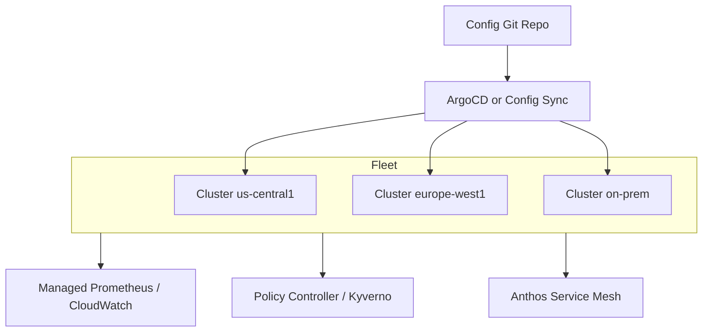

## 📘 Topic 65 — Multi-Cluster Management (GKE Fleet, EKS Anywhere)

**Official Documentation References**
- https://kubernetes.io/docs/concepts/cluster-administration/networking/
- https://cloud.google.com/kubernetes-engine/fleet-management/docs
- https://cloud.google.com/anthos/config-management/docs
- https://anywhere.eks.amazonaws.com/docs/
- https://karmada.io/docs/
- https://open-cluster-management.io/

### 📘 Definition
Multi-cluster management is the practice — and set of tools — for operating many Kubernetes clusters as a coordinated fleet, with unified identity, policy, config delivery, service discovery, and observability.

### 📖 About
Real-world environments span dozens or hundreds of clusters (per region, per BU, per environment, per compliance boundary). Managing each cluster individually doesn't scale. Multi-cluster tools solve three big problems:

1. **Config & policy delivery** — same YAML rolled out consistently.
2. **Cross-cluster service discovery & traffic** — a Service in cluster A talking to a Pod in cluster B.
3. **Observability & identity** — one pane of glass, unified auth.

**Common patterns**
- **Hub-and-spoke**: management cluster + workload clusters.
- **Federation**: KubeFed / Karmada distribute workloads across many clusters.
- **Fleet**: GKE's first-class abstraction.
- **Mesh-driven**: Istio multi-cluster or Cilium ClusterMesh.

**Standards emerging**
- **Multi-Cluster Services (MCS)** — SIG-Multicluster API (`ServiceExport`, `ServiceImport`).
- **Cluster API** — declarative cluster lifecycle.
- **KubeStellar / Karmada** — CNCF projects for scheduling across clusters.

**Products in the space**
- **GKE Fleet + Config Sync + Policy Controller + Multi-Cluster Ingress/Services**.
- **EKS Anywhere / EKS Hybrid Nodes + AWS Controllers for Kubernetes**.
- **Red Hat ACM (Advanced Cluster Management)**.
- **Rancher Fleet**.
- **Karmada, Open Cluster Management (open-source).**
- **Cilium ClusterMesh, Istio multicluster, Linkerd multicluster**.

### 🔗 How It Integrates With Other Components

| Component | Integration |
|-----------|-------------|
| kubeconfig | Multiple contexts, switchable via kubectx |
| GitOps (ArgoCD/Flux) | ApplicationSets / Kustomization matrices target many clusters |
| Service Mesh | mTLS + cross-cluster routing |
| DNS | Global DNS + ExternalDNS per cluster; MCS auto-provisions DNS |
| Identity | Fleet Workload Identity (GKE), IAM roles for SA (EKS), SPIFFE/SPIRE |
| Observability | Central Prometheus/Thanos, Managed Prometheus, CloudWatch cross-account |
| Certificate management | cert-manager per cluster; central CA |

### 🏗️ Architecture Diagrams

**Diagram 1 — Fleet + GitOps**



**Diagram 2 — Cross-cluster service discovery (MCS)**

```
Cluster A                          Cluster B
+-----------------+                +-----------------+
| Service: cart   |                | ServiceImport   |
| ServiceExport   |<-------------->| for 'cart'      |
+-----------------+                +-----------------+
        |                                  |
        +---- EndpointSlice sync ----------+
                (via MCS controller)
```

### 💻 Real-World Examples

**Example 1 — Register a cluster to a GKE Fleet**

```bash
gcloud container fleet memberships register prod-us-east \
  --gke-cluster=us-east1/prod-us-east \
  --enable-workload-identity
```

Enable Config Sync fleet-wide:
```yaml
apiVersion: configmanagement.gke.io/v1
kind: ConfigManagement
metadata:
  name: config-management
spec:
  clusterName: prod-us-east
  git:
    syncRepo: https://github.com/acme/fleet-config
    syncBranch: main
    secretType: none
    policyDir: "clusters/prod-us-east"
```

**Example 2 — MCS `ServiceExport` / `ServiceImport`**

Cluster A (exports):
```yaml
apiVersion: net.gke.io/v1
kind: ServiceExport
metadata:
  name: cart
  namespace: shop
```

Cluster B (imports automatically via MCS controller):
```yaml
apiVersion: net.gke.io/v1
kind: ServiceImport
metadata:
  name: cart
  namespace: shop
spec:
  type: ClusterSetIP
  ports:
    - port: 80
      protocol: TCP
```

Access from cluster B:
```
curl http://cart.shop.svc.clusterset.local
```

**Example 3 — ArgoCD ApplicationSet targeting all clusters**

```yaml
apiVersion: argoproj.io/v1alpha1
kind: ApplicationSet
metadata:
  name: platform-baseline
  namespace: argocd
spec:
  generators:
    - clusters: {}          # every registered cluster
  template:
    metadata:
      name: 'baseline-{{name}}'
    spec:
      project: platform
      source:
        repoURL: https://github.com/acme/platform
        targetRevision: main
        path: baseline
      destination:
        server: '{{server}}'
        namespace: platform
      syncPolicy:
        automated: { prune: true, selfHeal: true }
```

### 💻 Related Commands

**GKE Fleet**
| Command | Flag | Purpose | Example |
|---------|------|---------|---------|
| `gcloud container fleet memberships register` | `--gke-cluster` | Add cluster to fleet | See Example 1 |
| `gcloud container fleet memberships list` | – | List members | `gcloud container fleet memberships list` |
| `gcloud container fleet config-management enable` | – | Enable Config Sync | `gcloud container fleet config-management enable` |
| `gcloud container fleet policycontroller enable` | – | Enable Policy Controller | `gcloud container fleet policycontroller enable` |
| `gcloud container fleet mesh enable` | – | Enable Anthos Service Mesh | `gcloud container fleet mesh enable` |
| `gcloud container fleet ingress enable` | – | Multi-Cluster Ingress | `gcloud container fleet ingress enable --config-membership=...` |

**EKS Anywhere / General**
| Command | Flag | Purpose | Example |
|---------|------|---------|---------|
| `eksctl anywhere create cluster` | `-f` | Create EKS-A cluster | `eksctl anywhere create cluster -f cluster.yaml` |
| `eksctl anywhere upgrade cluster` | – | Upgrade | `eksctl anywhere upgrade cluster -f cluster.yaml` |
| `kubectx` | – | Switch context | `kubectx prod-us-east` |
| `kubens` | – | Switch namespace | `kubens shop` |
| `karmadactl join` | `--cluster-context` | Add cluster to Karmada | `karmadactl join member1 --cluster-context=member1` |
| `clusteradm join` | `--hub-token` | OCM registration | `clusteradm join --hub-token <t> --hub-apiserver ...` |

### 🚨 Scenarios

**Scenario 1 — Config drift across 30 clusters**
- **Problem**: Manual `kubectl` on one cluster caused drift; policy audits fail.
- **Resolution**:
  1. Enforce GitOps (Config Sync / ArgoCD) with `selfHeal`.
  2. Kyverno / Policy Controller `Generate` rules to backfill missing objects.
  3. RBAC: developers can't touch `kube-system` outside GitOps.

**Scenario 2 — Cross-region failover**
- **Problem**: us-east-1 goes down; need to shift traffic to eu-west-1.
- **Resolution**:
  1. Multi-Cluster Ingress (GKE) or Global Accelerator (EKS) with health checks.
  2. Data replication via database (Cloud SQL cross-region, Aurora Global).
  3. Practice with quarterly game-day drills.

**Scenario 3 — Cross-cluster mTLS trust**
- **Problem**: Two clusters can't mutually authenticate services.
- **Resolution**:
  1. Establish a shared root CA (SPIRE, cert-manager with a central issuer).
  2. Use Anthos Service Mesh / Istio multi-primary with shared trust root.
  3. Or Cilium ClusterMesh (WireGuard-encrypted node-to-node).

### ☁️ GCP GKE Perspective
- **Fleet** is the primary abstraction (Anthos underneath).
- **Config Sync** delivers YAML from Git to every fleet member.
- **Policy Controller** = managed Gatekeeper across fleet.
- **Anthos Service Mesh** = managed Istio with multi-cluster support.
- **Multi-Cluster Services (MCS)** + **Multi-Cluster Ingress (MCI)** = native cross-cluster networking.
- **Fleet Workload Identity** = single trust root across clusters.
- **Backup for GKE** = fleet-wide backup.

### 🟧 AWS EKS Perspective
- **EKS Anywhere** — run EKS on-prem (bare metal, vSphere, Snow).
- **EKS Hybrid Nodes** — run on-prem nodes joined to a cloud EKS control plane.
- **AWS Controllers for Kubernetes (ACK)** — manage AWS from each cluster.
- **AWS Global Accelerator** + **Route 53 latency routing** for cross-cluster traffic.
- **Karpenter** can span multiple AZs; for cross-region, use multiple clusters.
- **Amazon VPC Lattice** — service-to-service across clusters/accounts.
- **Amazon Managed Grafana** for fleet observability.

### 🧪 Hands-On Lab Exercises

**🧪 Lab 65-A — Two-Cluster GitOps with ArgoCD (Beginner)**
- **Objective**: One ArgoCD, two workload clusters, one repo.
- **Prerequisites**: Two Kind clusters (`hub` and `worker`).
- **Steps**:
  1. Install ArgoCD in `hub`.
  2. `argocd cluster add kind-worker` from hub.
  3. Create `ApplicationSet` with a list generator naming both clusters.
  4. Commit a Deployment YAML.
- **Verification**: Deployment present in both clusters.
- **Cleanup**: `kind delete cluster --name hub && kind delete cluster --name worker`.

**🧪 Lab 65-B — GKE Fleet Register + Config Sync (Intermediate)**
- **Objective**: Register two GKE clusters into a fleet and enable Config Sync.
- **Prerequisites**: Two GKE clusters (Autopilot fine), gcloud logged in.
- **Steps**:
  1. `gcloud container fleet memberships register cluster-a --gke-cluster=<region-a>/cluster-a --enable-workload-identity`
  2. Repeat for cluster-b.
  3. `gcloud container fleet config-management enable`.
  4. Apply `ConfigManagement` CR with your Git repo (Example 1).
  5. Push a Deployment to the repo.
- **Verification**: Same Deployment in both clusters within a minute.
- **Cleanup**: `gcloud container fleet memberships unregister ...` then delete clusters (very important for cost).

**🧪 Lab 65-C — Cilium ClusterMesh Cross-cluster Service (Advanced)**
- **Objective**: Two Kind clusters, Cilium CNI, cross-cluster service call.
- **Prerequisites**: Cilium CLI, Docker, Kind.
- **Steps**:
  1. Create two Kind clusters with non-overlapping Pod CIDRs.
  2. Install Cilium on both.
  3. `cilium clustermesh enable` on both.
  4. `cilium clustermesh connect --context c1 --destination-context c2`.
  5. Deploy `productcatalog` in c1, `frontend` in c2; annotate Service `io.cilium/global-service: "true"`.
  6. `frontend` calls `productcatalog.default.svc.cluster.local` — resolved to c1 endpoints.
- **Verification**: Successful cross-cluster HTTP calls.
- **Bonus**: Add a NetworkPolicy that allows only frontend → productcatalog cross-cluster.

### 🎯 Interview Deliverable Answer (60–90s)
> "Multi-cluster management is how you keep a fleet of clusters coherent — same policies, same base workloads, cross-cluster service discovery, unified identity and observability. The **why** is regulatory boundaries, blast-radius reduction, and multi-region resilience. On GKE the Fleet API pulls it all together: Config Sync ships YAML from Git, Policy Controller enforces Gatekeeper policies, Multi-Cluster Services + Multi-Cluster Ingress handle east-west and north-south traffic across regions. On EKS I lean on ArgoCD ApplicationSets to fan config out, VPC Lattice or Cilium ClusterMesh for service-to-service, and IAM Identity Center for unified auth. In one project we ran 24 clusters across 4 regions with a single ArgoCD hub and a Kyverno baseline policy pack — onboarding a new cluster was: register in fleet, add the label, the baseline appeared within minutes."

### ❓ Interview Questions

**Basic**
1. **Q**: Why not one giant cluster?
   **A**: Blast radius, per-region latency, compliance boundaries, upgrade windows, API server scale limits.

2. **Q**: What is a fleet?
   **A**: A named group of clusters managed together with shared config, identity, and policy.

**Intermediate**
3. **Q**: How do you deliver config to many clusters?
   **A**: GitOps: Config Sync, ArgoCD ApplicationSet, Flux Kustomizations.

4. **Q**: What is Multi-Cluster Services (MCS)?
   **A**: A SIG-Multicluster API (ServiceExport/ServiceImport) for cross-cluster service discovery.

**Advanced**
5. **Q**: Differences between Karmada and OCM?
   **A**: Karmada focuses on workload propagation with a scheduler; OCM is a broader hub-agent model with subscriptions and policies.

6. **Q**: How do you unify identity across clusters?
   **A**: Fleet Workload Identity (GKE), IAM Identity Center + IRSA (EKS), SPIFFE/SPIRE for open-source.

**Scenario**
7. **Q**: Cluster A can't call Service in cluster B — where do you look?
   **A**: Network reachability, CNI (ClusterMesh/MCS status), DNS resolution, mTLS trust root, NetworkPolicies.

**GKE-specific**
8. **Q**: What does `gcloud container fleet memberships register` do?
   **A**: Adds a cluster to the fleet, installs the fleet agent (`gke-connect`), and gives it a stable identity.

**EKS-specific**
9. **Q**: What's the difference between EKS Anywhere and EKS Hybrid Nodes?
   **A**: EKS-A runs a full self-managed control plane on-prem; Hybrid Nodes join on-prem nodes to an existing cloud EKS control plane.

**Lab-based**
10. **Q**: Show me spreading a workload to two clusters via ArgoCD.
    **A**: (Lab 65-A) ApplicationSet with list generator naming both clusters + `destination.server: {{server}}`.

---

