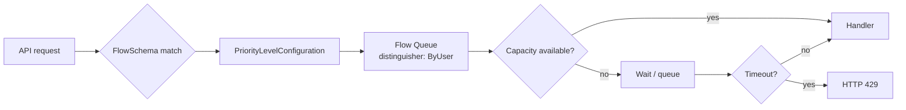

## 📘 Topic 66 — Service Catalog & API Priority and Fairness (APF)

**Official Documentation References**
- https://kubernetes.io/docs/concepts/extend-kubernetes/service-catalog/  *(archived — Service Catalog is deprecated)*
- https://kubernetes.io/docs/concepts/cluster-administration/flow-control/
- https://kubernetes.io/docs/reference/generated/kubernetes-api/v1.31/#flowschema-v1-flowcontrol-apiserver-k8s-io
- https://kubernetes.io/docs/reference/generated/kubernetes-api/v1.31/#prioritylevelconfiguration-v1-flowcontrol-apiserver-k8s-io

### 📘 Definition
- **Service Catalog** was a Kubernetes extension (now deprecated) that let apps discover and provision external managed services via the Open Service Broker API.
- **API Priority and Fairness (APF)** is the built-in mechanism that classifies inbound apiserver requests into priority levels and fairly shares each level's capacity across users so no client can starve the apiserver.

### 📖 About

#### Service Catalog (historical context)
- Introduced circa 2017 to let workloads request managed services (MySQL, Redis, S3) via `ServiceInstance` and `ServiceBinding` CRs.
- Backed by Open Service Broker (OSB) API implementations from GCP, Azure, AWS, and OpenShift.
- **Deprecated** in 2020; replaced in practice by:
  - **Crossplane** — declarative infrastructure via CRDs.
  - **Config Connector** on GKE, **ACK** on EKS.
  - **Kubernetes Service Bindings** (SIG proposal) for injecting connection details.
- You may still see it in interview questions or legacy platforms.

#### API Priority and Fairness (APF) — the modern, essential topic
APF replaces the old `--max-requests-inflight` global throttle with a fair, tenant-aware model. Every inbound API request is:

1. Matched by a **FlowSchema** (which requests are you?).
2. Assigned a **priority level** (how important are you?).
3. Placed into a **flow queue** (fair sharing within the level).
4. Executed if capacity allows; else queued (or rejected with 429).

**Why APF exists**
- A single misbehaving controller used to be able to DoS the apiserver.
- Different clients have different criticality (leader-election vs. bulk list).
- APF isolates categories: system > leader-election > workload-high > workload-low > global-default > catch-all.

**Default priority levels (v1.30+)**
| Level | Concurrency share | Use |
|-------|-------------------|-----|
| `system` | high | system:masters and control plane |
| `node-high` | medium | kubelets |
| `leader-election` | small | Lease writes |
| `workload-high` | medium | in-cluster controllers |
| `workload-low` | medium | user apps |
| `global-default` | small | default catch-all |
| `catch-all` | tiny | anything unmatched |
| `exempt` | unlimited | truly critical (e.g. system:masters via FS) |

**FlowSchema matches** by:
- Subject (user, group, ServiceAccount).
- Resource / non-resource rules.
- Namespace.

Distinguishing "flows" within a level: `distinguisherMethod: ByUser` or `ByNamespace`.

**Metrics you monitor**
- `apiserver_flowcontrol_dispatched_requests_total`
- `apiserver_flowcontrol_current_inqueue_requests`
- `apiserver_flowcontrol_rejected_requests_total`

### 🔗 How It Integrates With Other Components

| Component | Integration |
|-----------|-------------|
| kube-apiserver | Runs the APF filter; exposes flow-control metrics |
| Controllers | Get isolated priority — one bad controller can't starve others |
| Leader-election Leases | Own priority level to guarantee stability |
| Prometheus | Scrapes APF metrics for capacity & rejection tracking |
| Custom admission | Doesn't participate in APF (admission runs later) |

### 🏗️ Architecture Diagrams

**Diagram 1 — Request path through APF**



**Diagram 2 — Priority level isolation**

```
apiserver total inflight = 400
  |
  +--> system (25%)           = 100
  +--> leader-election (10%)  = 40
  +--> workload-high (30%)    = 120
  +--> workload-low (20%)     = 80
  +--> global-default (10%)   = 40
  +--> catch-all (5%)         = 20
```

### 💻 Real-World Examples

**Example 1 — Custom FlowSchema for your controller**

```yaml
apiVersion: flowcontrol.apiserver.k8s.io/v1
kind: FlowSchema
metadata:
  name: my-important-controller
spec:
  priorityLevelConfiguration:
    name: workload-high
  matchingPrecedence: 900
  distinguisherMethod:
    type: ByUser
  rules:
    - subjects:
        - kind: ServiceAccount
          serviceAccount:
            name: my-controller
            namespace: platform
      resourceRules:
        - verbs: ["*"]
          apiGroups: ["*"]
          resources: ["*"]
          namespaces: ["*"]
```

**Example 2 — Custom PriorityLevelConfiguration**

```yaml
apiVersion: flowcontrol.apiserver.k8s.io/v1
kind: PriorityLevelConfiguration
metadata:
  name: bulk-jobs
spec:
  type: Limited
  limited:
    nominalConcurrencyShares: 10
    lendablePercent: 50
    borrowingLimitPercent: 100
    limitResponse:
      type: Queue
      queuing:
        queues: 32
        handSize: 6
        queueLengthLimit: 50
```

Then a FlowSchema pointing at `bulk-jobs` matches Job controllers doing large list operations.

**Example 3 — Legacy Service Catalog `ServiceInstance` (illustrative only)**

```yaml
apiVersion: servicecatalog.k8s.io/v1beta1
kind: ServiceInstance
metadata:
  name: mydb
spec:
  clusterServiceClassExternalName: gcp-cloud-sql
  clusterServicePlanExternalName: mysql-8-basic
  parameters:
    region: us-east1
    tier: db-n1-standard-1
```

Modern equivalent with **Crossplane** or **Config Connector**:
```yaml
apiVersion: sql.cnrm.cloud.google.com/v1beta1
kind: SQLInstance
metadata: { name: mydb }
spec:
  databaseVersion: MYSQL_8_0
  region: us-east1
  settings:
    tier: db-n1-standard-1
```

### 💻 Related Commands

| Command | Flag | Purpose | Example |
|---------|------|---------|---------|
| `kubectl get flowschemas` | – | List FlowSchemas | `kubectl get flowschemas` |
| `kubectl get prioritylevelconfigurations` | – | List priority levels | `kubectl get prioritylevelconfigurations` |
| `kubectl describe flowschema <name>` | – | Inspect a schema | `kubectl describe flowschema my-important-controller` |
| `kubectl get --raw /debug/api_priority_and_fairness/dump_priority_levels` | – | Live state | – |
| `kubectl get --raw /debug/api_priority_and_fairness/dump_queues` | – | Queue details | – |
| `kubectl get --raw /metrics` | `\| grep flowcontrol` | Metrics | – |
| `kubectl top` | – | Ensure metrics-server not in `catch-all` | – |
| `kubectl get --raw /readyz?verbose` | – | Confirms APF healthy | – |

### 🚨 Scenarios

**Scenario 1 — 429s spiking on the apiserver**
- **Problem**: A custom operator is being throttled (429 "TooManyRequests"); reconciliation slows.
- **Resolution**:
  1. Identify the priority level: `apiserver_flowcontrol_rejected_requests_total{priority_level="global-default"}`.
  2. Create a FlowSchema mapping your controller's SA to `workload-high`.
  3. Also fix the controller: add caching (client-go informers), avoid unbounded lists.

**Scenario 2 — Leader-election flapping under load**
- **Problem**: `Lease` renewals miss deadlines; controllers keep re-electing.
- **Resolution**:
  1. Ensure the built-in FlowSchema `system-leader-election` is not modified.
  2. Increase Lease renewal deadline in controller configuration.
  3. Scale apiserver replicas / raise `--max-requests-inflight`.

**Scenario 3 — Legacy Service Catalog broker unavailable**
- **Problem**: `ServiceInstance` stuck `ProvisionCallFailed`.
- **Resolution**:
  1. Migrate off Service Catalog (deprecated) to Crossplane / Config Connector / ACK.
  2. In the interim, restart the broker; check credentials + network.

### ☁️ GCP GKE Perspective
- Modern replacement for Service Catalog on GKE: **Config Connector** — GCP resources as CRDs.
- APF is enabled on GKE; you can add custom FlowSchemas.
- **Autopilot** users can create FlowSchemas & PriorityLevels (they're cluster-scoped API objects), just like Standard.
- Monitor with **Cloud Monitoring** → `apiserver_flowcontrol_*` metrics via managed Prometheus.

### 🟧 AWS EKS Perspective
- Modern Service Catalog replacement on EKS: **AWS Controllers for Kubernetes (ACK)** or **Crossplane**.
- APF works identically. EKS control plane scales its apiserver replicas horizontally; APF still prevents noisy-neighbor problems.
- Monitor via **CloudWatch Container Insights** or a Prometheus scrape of `/metrics`.

### 🧪 Hands-On Lab Exercises

**🧪 Lab 66-A — Explore Default APF (Beginner)**
- **Objective**: See default FlowSchemas + PriorityLevels; observe metrics.
- **Prerequisites**: Any cluster ≥ v1.29.
- **Steps**:
  1. `kubectl get flowschemas -o wide`
  2. `kubectl get prioritylevelconfigurations -o wide`
  3. `kubectl describe flowschema system-leader-election`
  4. Port-forward apiserver metrics if accessible; otherwise `kubectl get --raw /metrics | grep flowcontrol_dispatched`.
- **Verification**: Metrics visible.
- **Bonus**: Draw the mapping between top 5 FlowSchemas and priority levels.

**🧪 Lab 66-B — Prioritize a Custom Controller (Intermediate)**
- **Objective**: Move your controller from `global-default` to `workload-high`.
- **Steps**:
  1. Create a Deployment + SA representing your controller doing `list pods` in a loop.
  2. Observe `apiserver_flowcontrol_dispatched_requests_total{flow_schema="global-default"}` climb.
  3. Apply the FlowSchema from Example 1 pointing at your SA.
  4. Watch metric shift to `workload-high`.
- **Verification**: Priority level changes; no 429s under load.
- **Bonus**: Add a custom PriorityLevel `bulk-lists` and route your controller there.

**🧪 Lab 66-C — Provision Cloud Resource with Crossplane (Advanced)**
- **Objective**: Replace legacy Service Catalog with Crossplane provisioning an S3 bucket / GCS bucket.
- **Prerequisites**: Kind, Crossplane installed, cloud creds.
- **Steps**:
  1. `helm install crossplane crossplane-stable/crossplane -n crossplane-system --create-namespace`
  2. Install provider (`provider-aws` or `provider-gcp`).
  3. Create `ProviderConfig` with credentials.
  4. Apply a `Bucket` CR.
- **Verification**: Bucket exists in cloud console.
- **Cleanup**: Delete CR; provider deletes bucket. Uninstall Crossplane.
- **Bonus**: Compose a `XPostgresCluster` CompositeResource that creates DB + user + secret.

### 🎯 Interview Deliverable Answer (60–90s)
> "Two topics that often get lumped together. **Service Catalog** was the older way to provision managed services from Kubernetes via the Open Service Broker API — `ServiceInstance`/`ServiceBinding` CRs. It's deprecated; the modern replacements are Crossplane, Config Connector on GKE, and ACK on EKS, all of which model cloud resources as CRDs. **API Priority and Fairness** is the essential one: APF classifies every API request into a FlowSchema, assigns it a PriorityLevel, and fair-queues it so a noisy controller can't starve the apiserver or preempt leader-election. Why it matters: pre-APF, one runaway controller could 429 the whole cluster. On GKE and EKS both, I've added FlowSchemas moving critical operators from `global-default` to `workload-high` and watched 429 rejections drop. When I see rising `apiserver_flowcontrol_rejected_requests_total`, that's my signal to look at both the workload behavior and its priority mapping."

### ❓ Interview Questions

**Basic**
1. **Q**: What is Service Catalog and what replaced it?
   **A**: Legacy CRD-based provisioning of managed services via OSB; replaced by Crossplane, Config Connector, ACK.

2. **Q**: What problem does APF solve?
   **A**: Fairly shares apiserver capacity so no client can DoS others.

**Intermediate**
3. **Q**: What's a FlowSchema?
   **A**: A CR matching requests (by subject + resource) and routing them to a PriorityLevelConfiguration.

4. **Q**: What's the difference between `Queue` and `Reject` limit responses?
   **A**: `Queue` waits with configured queue length; `Reject` returns 429 immediately.

5. **Q**: What's the `exempt` priority level?
   **A**: Unlimited concurrency — used for truly critical requests like health probes or system:masters.

**Advanced**
6. **Q**: What is `matchingPrecedence`?
   **A**: FlowSchemas evaluated lowest-precedence-first; first match wins. Use lower numbers for more specific schemas.

7. **Q**: What does `nominalConcurrencyShares` do?
   **A**: Sets this level's share of total apiserver concurrency proportional to the sum of all shares.

**Scenario**
8. **Q**: 429 storm from a controller — what steps do you take?
   **A**: Check `apiserver_flowcontrol_rejected_requests_total` by FlowSchema, add or adjust FlowSchema for that SA, and fix the controller to use informers.

**GKE-specific**
9. **Q**: What's the modern equivalent of Service Catalog on GKE?
   **A**: Config Connector (GCP resources as CRDs) and/or Crossplane.

**EKS-specific**
10. **Q**: How to provision an RDS instance from an EKS cluster?
    **A**: ACK RDS controller — apply a `DBInstance` CR; ACK creates it via AWS APIs (SA authenticated via IRSA).

**Lab-based**
11. **Q**: Show me raising the priority of my custom operator.
    **A**: (Lab 66-B) Create FlowSchema referencing the operator's SA and pointing to `workload-high`, verify with metrics.

---

