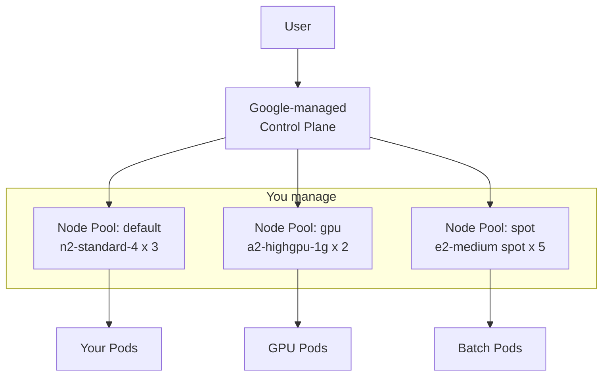
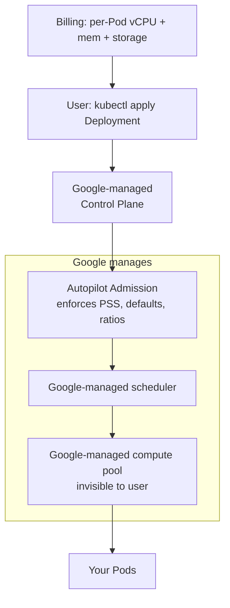

## 📘 Topic 67 — GKE Standard vs GKE Autopilot — Full Comparison

**Official Documentation References**
- https://cloud.google.com/kubernetes-engine/docs/concepts/choose-cluster-mode
- https://cloud.google.com/kubernetes-engine/docs/concepts/autopilot-overview
- https://cloud.google.com/kubernetes-engine/docs/concepts/cluster-architecture
- https://cloud.google.com/kubernetes-engine/pricing

### 📘 Definition
GKE Standard is Google's traditional Kubernetes offering where you manage node pools; GKE Autopilot is a fully managed mode where Google runs and bills you per Pod for compute, while enforcing security and reliability best practices at admission.

### 📖 About

**GKE Standard** — you configure everything below the API surface: node pools, machine types, autoscaling, node images, DaemonSets, and pay for VMs whether idle or not (plus a control-plane fee outside the free tier). You get maximum flexibility: privileged Pods, `hostNetwork`, custom DaemonSets, GPU node pools, TPU nodes, sole-tenant nodes, Windows nodes, spot VMs.

**GKE Autopilot** — Google manages the nodes; you never see them (no `kubectl get nodes -o wide` view of machine types you selected). You define workloads, Google right-sizes and provisions the underlying compute. You're billed **per Pod vCPU/memory/ephemeral-storage**, not per VM. Autopilot enforces a strict security baseline via admission: no privileged containers, no `hostPath` (with narrow exceptions), no `hostNetwork`, no `hostPID`. DaemonSets are allowed but restricted; system-level tools that need node access must use the supported extension mechanisms.

**Why Autopilot exists**
- Eliminate node-ops toil.
- Guarantee upgrade/security posture.
- Bill only for workload consumption.
- Give a "just deploy Pods" experience.

**Key trade-offs**
| Aspect | GKE Standard | GKE Autopilot |
|--------|--------------|---------------|
| Node management | You (node pools, upgrades opt-in) | Google |
| Billing model | Per-VM (node) + control plane | Per-Pod resources + control plane |
| Minimum Pod cost | Any (share node) | Enforced minimum requests (e.g., 250m CPU / 512 Mi mem for general workloads) |
| Privileged containers | Allowed | Blocked at admission |
| `hostNetwork` / `hostPath` | Allowed | Blocked (with narrow exceptions) |
| DaemonSets | Any | Only workloads that satisfy Autopilot constraints |
| Custom kernel modules | Yes | No |
| GPU support | Yes | Yes (from 1.24.2-gke.400) |
| Spot VMs / Preemptible | Yes | Spot Pods (feature) |
| Windows | Yes | No |
| SSH to node | Yes | No |
| SLA | 99.5%–99.95% | 99.9% Pod SLA + 99.95% control plane in regional |
| Best for | Custom infra, kernel tweaks, cost tuning | Product teams, high compliance, low ops burden |

**Autopilot resource classes**
Autopilot supports specialized compute classes: `general-purpose` (default), `balanced`, `scale-out`, `performance`, `accelerator` (GPUs), and `spot` — selectable via `nodeSelector` `cloud.google.com/compute-class`.

**Autopilot minimums (v1.30+)**
- CPU: 50m minimum per container, 250m per Pod.
- Memory: 52 Mi per container, 512 Mi per Pod (varies by compute class).
- CPU:Memory ratios enforced (1 vCPU : 1–6.5 GiB for general-purpose).

**Pricing note**: Pricing changes; always verify at https://cloud.google.com/kubernetes-engine/pricing.

### 🔗 How It Integrates With Other Components

| Component | Standard | Autopilot |
|-----------|----------|-----------|
| Node pools | You create/scale | Managed; invisible |
| Cluster Autoscaler | Optional add-on | Always on |
| Node Auto-Provisioning (NAP) | Optional | Always on |
| Workload Identity | Optional | Always on (mandatory) |
| Shielded Nodes | Optional | Always on |
| GKE Sandbox (gVisor) | Optional | Optional per Pod |
| VPC-native (alias IP) | Optional (recommended) | Always |
| Private cluster | Optional | Optional |
| GKE Dataplane V2 (Cilium) | Optional | Always |
| Logging & Monitoring | Optional | Always on |

### 🏗️ Architecture Diagrams

**Diagram 1 — GKE Standard**



**Diagram 2 — GKE Autopilot**



**Diagram 3 — Decision tree**

```
Need privileged / hostNetwork / kernel tweaks?
   yes ---> GKE Standard
   no
   |
Need Windows nodes?
   yes ---> GKE Standard
   no
   |
Highly variable/burst workload?
   yes ---> Autopilot (pay per Pod)
   no
   |
Predictable, high-utilization cluster?
   yes ---> Standard (reserved VMs may be cheaper)
   |
Team lacks node-ops expertise?
   yes ---> Autopilot
```

### 💻 Real-World Examples

**Example 1 — Create Standard cluster**

```bash
gcloud container clusters create shop-std \
  --region=us-central1 \
  --release-channel=regular \
  --enable-ip-alias \
  --enable-dataplane-v2 \
  --enable-shielded-nodes \
  --workload-pool=my-project.svc.id.goog \
  --num-nodes=1 \
  --machine-type=n2-standard-4 \
  --enable-autoscaling --min-nodes=1 --max-nodes=10 \
  --enable-autoupgrade --enable-autorepair
```

Add a spot node pool:

```bash
gcloud container node-pools create spot-pool \
  --cluster=shop-std --region=us-central1 \
  --spot --machine-type=e2-standard-4 \
  --num-nodes=0 --enable-autoscaling --min-nodes=0 --max-nodes=20 \
  --node-taints=cloud.google.com/gke-spot=true:NoSchedule
```

**Example 2 — Create Autopilot cluster**

```bash
gcloud container clusters create-auto shop-auto \
  --region=us-central1 \
  --release-channel=regular \
  --workload-pool=my-project.svc.id.goog
```

Deploy a Pod requesting the `performance` compute class:

```yaml
apiVersion: apps/v1
kind: Deployment
metadata: { name: api }
spec:
  replicas: 3
  selector: { matchLabels: { app: api } }
  template:
    metadata: { labels: { app: api } }
    spec:
      nodeSelector:
        cloud.google.com/compute-class: Performance
        cloud.google.com/machine-family: c3
      containers:
        - name: api
          image: gcr.io/my-project/api:1.2.3
          resources:
            requests: { cpu: "2", memory: "4Gi" }
            limits:   { cpu: "2", memory: "4Gi" }
```

**Example 3 — Spot Pod on Autopilot**

```yaml
apiVersion: apps/v1
kind: Deployment
metadata: { name: batch-worker }
spec:
  replicas: 10
  selector: { matchLabels: { app: worker } }
  template:
    metadata: { labels: { app: worker } }
    spec:
      terminationGracePeriodSeconds: 25
      nodeSelector:
        cloud.google.com/gke-spot: "true"
      tolerations:
        - key: cloud.google.com/gke-spot
          operator: Equal
          value: "true"
          effect: NoSchedule
      containers:
        - name: worker
          image: my-repo/worker:2.0
          resources:
            requests: { cpu: "500m", memory: "1Gi" }
```

### 💻 Related Commands

| Command | Flag | Purpose | Example |
|---------|------|---------|---------|
| `gcloud container clusters create` | `--region --num-nodes` | Standard cluster | See Ex. 1 |
| `gcloud container clusters create-auto` | `--region --release-channel` | Autopilot cluster | See Ex. 2 |
| `gcloud container clusters list` | – | List clusters | `gcloud container clusters list` |
| `gcloud container clusters describe` | `--region` | Detailed info | `gcloud container clusters describe shop-std --region=us-central1` |
| `gcloud container clusters get-credentials` | `--region` | Configure kubectl | `gcloud container clusters get-credentials shop-std --region=us-central1` |
| `gcloud container node-pools create` | `--spot --enable-autoscaling` | Add pool | See Ex. 1 |
| `gcloud container node-pools list` | `--cluster` | List pools | `gcloud container node-pools list --cluster=shop-std --region=us-central1` |
| `gcloud container clusters update` | `--enable-autoscaling` | Modify options | `gcloud container clusters update shop-std --enable-vertical-pod-autoscaling` |
| `gcloud container clusters upgrade` | `--cluster-version` | Upgrade | `gcloud container clusters upgrade shop-std --master --cluster-version=1.31.1-gke.1846000` |
| `gcloud container operations list` | – | Track long-running ops | `gcloud container operations list --region=us-central1` |
| `gcloud container clusters delete` | `--quiet` | Delete | `gcloud container clusters delete shop-std --region=us-central1 --quiet` |

### 🚨 Scenarios

**Scenario 1 — Pod stuck Pending on Autopilot with "no compute available"**
- **Problem**: Pod requests violate compute-class rules or exceed max sizes.
- **Resolution**:
  1. `kubectl describe pod` shows Autopilot admission message ("resource request exceeds…").
  2. Adjust requests to fit ratios (1 vCPU : 1–6.5 GiB general).
  3. If need >30 vCPU per Pod, use `Performance` class.
  4. Split into smaller Pods where possible.

**Scenario 2 — Bill on Autopilot larger than expected**
- **Problem**: Team over-requested resources; Autopilot bills the requests.
- **Resolution**:
  1. Right-size with VPA (`updateMode: "Off"` for recommendations).
  2. Use Spot Pods for stateless batch.
  3. Consider Standard with committed use discount for predictable, high-utilization workloads.

**Scenario 3 — Custom DaemonSet rejected on Autopilot**
- **Problem**: Trying to install a monitoring agent that uses `hostPath`.
- **Resolution**:
  1. Use Google-managed alternative (Managed Prometheus, Cloud Ops Agent) — installed as DaemonSets by Google.
  2. Convert agent to a sidecar model.
  3. Or move to Standard.

### ☁️ GCP GKE — Deep dive specifics
- **Release channels**: `rapid`, `regular`, `stable`. Autopilot requires channel enrollment; Standard can opt out.
- **Autopilot Extended Support**: pay-per-hour to stay on an older minor version.
- **Cost note**: Both modes charge $0.10/hour per cluster after the free tier (one zonal cluster free). Autopilot compute is priced per Pod resource-hour.
- **Node auto-provisioning (NAP)** in Standard grows/shrinks node pools automatically; in Autopilot it's the whole scheduling model.

### 🟧 AWS EKS — Comparison Perspective
- Autopilot's closest EKS analogue is **Fargate**, but Fargate has stricter limitations (no DaemonSets, no privileged, one Pod per micro-VM). See Topic 68 for the full comparison.
- EKS with Managed Node Groups + Karpenter approximates Standard + NAP.
- IRSA (EKS) is the analogue of Workload Identity (Autopilot mandates it; Standard can enable it).

### 🧪 Hands-On Lab Exercises

**🧪 Lab 67-A — Provision Autopilot + Standard Side-by-Side (Beginner)**
- **Objective**: Compare experience.
- **Prerequisites**: GCP project with billing, `gcloud`.
- **Steps**:
  1. Create Autopilot: Example 2.
  2. Create Standard: Example 1.
  3. `kubectl get nodes` on both (Autopilot shows nodes but they're Google-managed).
  4. Deploy an nginx Deployment (3 replicas) to each.
  5. Compare `kubectl top pods`, cost after 1 hour.
- **Verification**: Both serving traffic.
- **Cleanup**: `gcloud container clusters delete shop-std shop-auto --region=us-central1 --quiet`.
- **Troubleshooting**: If quotas denied, request more in IAM & Admin > Quotas.
- **Bonus**: Deploy the same workload to both, port-forward, and note the DNS/service parity.

**🧪 Lab 67-B — Autopilot Compute Classes (Intermediate)**
- **Objective**: Schedule workloads on `Performance` + `Spot`.
- **Steps**:
  1. Create Autopilot cluster.
  2. Deploy an app with `nodeSelector: cloud.google.com/compute-class: Performance`.
  3. Deploy a batch app with the spot nodeSelector (Example 3).
  4. Watch the Pods land on separate underlying node types.
- **Verification**: `kubectl get pod -o wide` shows different node names.
- **Bonus**: Add a PDB for the spot workload.

**🧪 Lab 67-C — Migrate a Workload from Standard → Autopilot (Advanced)**
- **Objective**: Move an existing 3-tier app.
- **Steps**:
  1. Export objects from Standard: `kubectl get -A -o yaml > backup.yaml`.
  2. Clean up: remove privileged, hostPath, hostNetwork.
  3. Add resource requests to every container.
  4. Apply on Autopilot cluster.
  5. Check `kubectl get events` for admission rejections; fix and re-apply.
- **Verification**: All Pods Running.
- **Cleanup**: Delete both clusters.
- **Bonus**: Run the same workload for 24 h in each; compare billing.

### 🎯 Interview Deliverable Answer (60–90s)
> "GKE gives you two flavors. **Standard** is the classic — I own node pools, machine types, upgrade cadence, and I can run anything: privileged Pods, GPUs, spot VMs, Windows nodes. **Autopilot** is fully managed — Google runs the nodes, enforces PSS at admission (no privileged, no hostPath, no hostNetwork), and bills per Pod's vCPU and memory requests. Why: Autopilot eliminates node-ops and drives a strict security baseline, so it's my default for product teams and regulated workloads. Standard is my choice for platform layers that need low-level access, cost tuning with committed use discounts, or custom DaemonSets. Both share the same Kubernetes API, so migration is mostly about scrubbing privileged assumptions and setting resource requests. In practice I run a Standard 'platform' cluster for shared infra like ingress and Prometheus, and Autopilot 'workload' clusters for application teams."

### ❓ Interview Questions

**Basic**
1. **Q**: What's the biggest difference between GKE Standard and Autopilot?
   **A**: Standard: you manage nodes and pay per VM. Autopilot: Google manages nodes and you pay per Pod resources.

2. **Q**: Can you run privileged Pods on Autopilot?
   **A**: No — admission rejects them.

**Intermediate**
3. **Q**: What does Autopilot enforce out of the box that you'd have to opt into on Standard?
   **A**: Workload Identity, Shielded Nodes, Dataplane V2, Cluster Autoscaler, Node Auto-Provisioning, PSS admission, encrypted etcd, logging & monitoring.

4. **Q**: How is billing different?
   **A**: Standard bills VMs regardless of utilization. Autopilot bills only per Pod resource requests (plus cluster fee).

5. **Q**: What are Autopilot compute classes?
   **A**: Named profiles (general-purpose, balanced, scale-out, performance, accelerator, spot) selected via nodeSelector.

**Advanced**
6. **Q**: When would you *not* pick Autopilot?
   **A**: Windows nodes, custom kernel modules, low-cost long-running workloads with committed use discounts, workloads that require hostNetwork/hostPath.

7. **Q**: How does Autopilot enforce security?
   **A**: Via admission controllers that mutate/reject Pods violating Autopilot policy; the platform runs a hardened node OS with restricted node privileges.

**Scenario**
8. **Q**: Migrating an on-prem workload to Autopilot fails admission — walk me through debugging.
    **A**: `kubectl describe` the Pod for admission messages; remove privileged, hostPath (or use CSI), hostNetwork; add resource requests; adjust CPU:memory ratios.

**GKE-specific**
9. **Q**: What are release channels?
    **A**: `rapid`, `regular`, `stable` — pin the cluster's upgrade cadence.

**EKS-specific**
10. **Q**: EKS analogue of Autopilot?
    **A**: Fargate is closest but stricter (no DaemonSets, one Pod per micro-VM); many teams use EKS + Karpenter as an alternative "elastic" model.

**Lab-based**
11. **Q**: Show me creating an Autopilot cluster and deploying a Spot workload.
    **A**: (Lab 67-B) `gcloud container clusters create-auto ...`, then Deployment with `cloud.google.com/gke-spot: "true"` nodeSelector + toleration.

---

