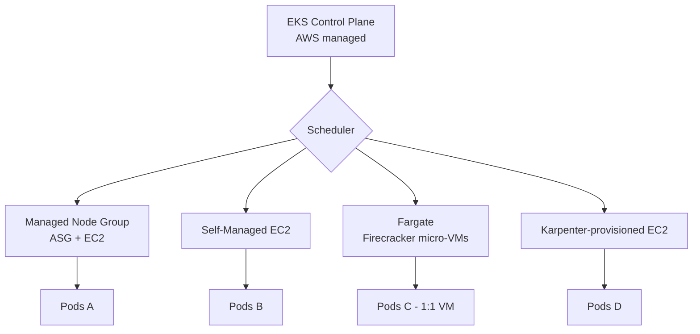
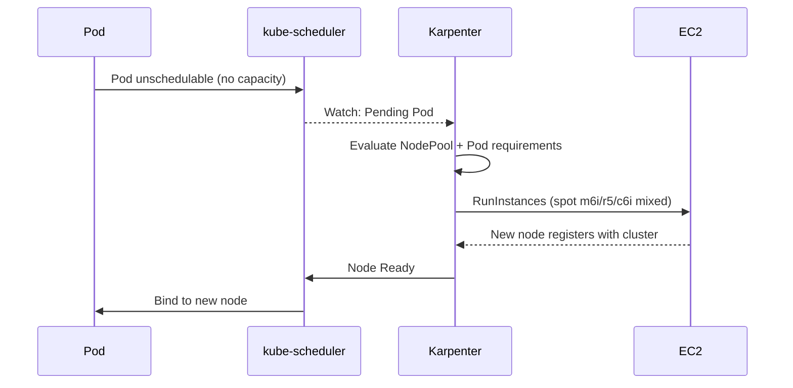

## 📘 Topic 68 — EKS Managed Node Groups vs Self-Managed Nodes vs Fargate

**Official Documentation References**
- https://docs.aws.amazon.com/eks/latest/userguide/eks-compute.html
- https://docs.aws.amazon.com/eks/latest/userguide/managed-node-groups.html
- https://docs.aws.amazon.com/eks/latest/userguide/fargate.html
- https://karpenter.sh/docs/
- https://docs.aws.amazon.com/eks/latest/userguide/what-is-eks.html

### 📘 Definition
EKS offers three compute models for running Pods:
1. **Managed Node Groups (MNG)** — AWS-managed EC2 node groups with lifecycle automation.
2. **Self-Managed Nodes** — EC2 you build with the EKS-optimized AMI and register yourself (bring-your-own automation).
3. **Fargate** — serverless per-Pod micro-VMs; you don't see EC2 at all.

A modern fourth option is **Karpenter** — an open-source scheduler that provisions raw EC2 (not a node group) on demand; it replaces or augments MNG for many teams.

### 📖 About

**Managed Node Groups**
- AWS creates an Auto Scaling Group and EC2 instances using the EKS-optimized AMI (AL2/Bottlerocket/Windows).
- Handles rolling updates, cordon+drain, upgrade to a new AMI or K8s version with a single API call.
- Supports Spot Instances, GPU AMIs, and custom launch templates.
- IAM role attached; nodes register via bootstrap script.

**Self-Managed Nodes**
- You author launch templates or use Terraform/eksctl.
- Freedom to run custom AMIs, exotic instance types, or federated on-prem nodes (via EKS Hybrid Nodes).
- You own upgrades, drain, and AMI rotation.

**Fargate**
- No nodes visible to you. Each Pod runs in a dedicated Firecracker micro-VM.
- Billed per Pod vCPU/memory/second (with a minimum billing time).
- Restrictions:
  - No DaemonSets (workaround: sidecars).
  - No privileged containers.
  - No `hostPort`, `hostNetwork`, `hostPath` (only projected volumes, ConfigMaps, Secrets, EmptyDir up to 20 GiB, EFS).
  - Only one Pod per micro-VM.
  - Some CNI features restricted; uses **Fargate Pod networking** with pre-allocated ENIs.
- Selected per Pod via **Fargate Profile** matching `namespace` + `labels`.

**Karpenter** (open source, now graduated for EKS)
- Watches unschedulable Pods and provisions raw EC2 within seconds using diverse instance types.
- Consolidates and terminates underutilized nodes automatically.
- Requires **NodePool** and **EC2NodeClass** CRDs.
- Often replaces Cluster Autoscaler + MNG for elasticity-heavy workloads.

**Comparison table**

| Aspect | MNG | Self-Managed | Fargate | Karpenter |
|--------|-----|--------------|---------|-----------|
| Who owns EC2 | AWS | You | N/A | Karpenter |
| Upgrade rolling | AWS managed | You | N/A | Drift-triggered replace |
| Spot support | Yes | Yes | No (Fargate Spot exists separately) | Yes (built-in diversity) |
| GPU | Yes | Yes | No | Yes |
| DaemonSets | Yes | Yes | ❌ | Yes |
| Windows | Yes | Yes | ❌ | Yes |
| Privileged Pods | Yes | Yes | ❌ | Yes |
| Bin-packing | ASG-limited | Manual | Per-Pod | Excellent |
| Node startup | 1–3 min | 1–3 min | 30–60 s (Pod-level) | 40–60 s |
| Cost model | EC2 + EKS fee | EC2 + EKS fee | Per Pod (higher $/vCPU) | EC2 + EKS fee |
| Best for | Standard workloads | Special AMIs / hybrid | Bursty, low-density | Bursty, dense, mixed |

### 🔗 How It Integrates With Other Components

| Component | Integration |
|-----------|-------------|
| EKS control plane | Consumes all three via the same API server |
| VPC CNI (aws-node) | DaemonSet on MNG/self-managed; not on Fargate (uses per-Pod ENI) |
| kube-proxy | DaemonSet on MNG/self-managed; not on Fargate |
| CoreDNS | Runs anywhere; on Fargate-only clusters requires a Fargate Profile matching `kube-system` |
| CoreDNS/aws-load-balancer-controller | Works with all three |
| Karpenter | Watches unscheduled Pods; ignores MNG scale events |
| IRSA / EKS Pod Identity | Works on all three |
| CSI drivers (EBS/EFS) | EBS DaemonSet only on nodes; Fargate supports EFS via CSI |

### 🏗️ Architecture Diagrams

**Diagram 1 — Three compute models coexisting**



**Diagram 2 — Fargate Pod networking**

```
EKS control plane
     |
     v
Pod schedule -> Fargate Profile match (ns=serverless, label=tier=front)
     |
     v
Fargate provisions Firecracker micro-VM
     |
     +-- ENI in private subnet (Pod IP = ENI IP)
     +-- kubelet + containerd inside micro-VM
     +-- No host access (no DaemonSets)
     +-- Metrics via CloudWatch Container Insights (side-agent injected)
```

**Diagram 3 — Karpenter provisioning loop**



### 💻 Real-World Examples

**Example 1 — Create EKS cluster + MNG with eksctl**

```yaml
# cluster.yaml
apiVersion: eksctl.io/v1alpha5
kind: ClusterConfig
metadata:
  name: shop
  region: us-east-1
  version: "1.31"
iam:
  withOIDC: true
managedNodeGroups:
  - name: mng-general
    instanceTypes: ["m6i.large", "m6a.large", "m5.large"]
    minSize: 2
    maxSize: 10
    desiredCapacity: 3
    volumeSize: 60
    labels: { role: general }
    tags: { team: platform }
    iam:
      withAddonPolicies:
        externalDNS: true
        certManager: true
  - name: mng-gpu
    instanceType: g4dn.xlarge
    minSize: 0
    maxSize: 5
    desiredCapacity: 0
    labels: { workload: ml }
    taints:
      - key: nvidia.com/gpu
        value: "true"
        effect: NoSchedule
```

```bash
eksctl create cluster -f cluster.yaml
```

**Example 2 — Fargate Profile**

```yaml
apiVersion: eksctl.io/v1alpha5
kind: ClusterConfig
metadata:
  name: shop
  region: us-east-1
fargateProfiles:
  - name: fp-serverless
    selectors:
      - namespace: serverless
      - namespace: kube-system
        labels: { k8s-app: kube-dns }
```

```bash
eksctl create fargateprofile -f cluster.yaml
```

Deploy a Pod:
```yaml
apiVersion: apps/v1
kind: Deployment
metadata:
  name: api
  namespace: serverless
spec:
  replicas: 2
  selector: { matchLabels: { app: api } }
  template:
    metadata: { labels: { app: api } }
    spec:
      containers:
        - name: api
          image: 123456789012.dkr.ecr.us-east-1.amazonaws.com/api:1.0
          resources:
            requests: { cpu: "500m", memory: "1Gi" }
            limits:   { cpu: "500m", memory: "1Gi" }
```

**Example 3 — Karpenter NodePool + EC2NodeClass**

```yaml
apiVersion: karpenter.sh/v1
kind: NodePool
metadata: { name: default }
spec:
  template:
    spec:
      requirements:
        - key: kubernetes.io/arch
          operator: In
          values: ["amd64"]
        - key: karpenter.sh/capacity-type
          operator: In
          values: ["spot", "on-demand"]
        - key: karpenter.k8s.aws/instance-family
          operator: In
          values: ["m6i", "m6a", "m5", "c6i", "r6i"]
      nodeClassRef:
        group: karpenter.k8s.aws
        kind: EC2NodeClass
        name: default
      expireAfter: 720h
  disruption:
    consolidationPolicy: WhenUnderutilized
    expireAfter: 720h
---
apiVersion: karpenter.k8s.aws/v1
kind: EC2NodeClass
metadata: { name: default }
spec:
  amiFamily: Bottlerocket
  subnetSelectorTerms:
    - tags: { karpenter.sh/discovery: shop }
  securityGroupSelectorTerms:
    - tags: { karpenter.sh/discovery: shop }
  role: KarpenterNodeRole-shop
  tags:
    team: platform
```

### 💻 Related Commands

**eksctl**

| Command | Flag | Purpose | Example |
|---------|------|---------|---------|
| `eksctl create cluster` | `-f` | Cluster from config | `eksctl create cluster -f cluster.yaml` |
| `eksctl create nodegroup` | `--managed` | Add MNG | `eksctl create nodegroup --cluster=shop --managed --node-type=m6i.large` |
| `eksctl create fargateprofile` | `-f` | Add Fargate profile | See Ex. 2 |
| `eksctl upgrade nodegroup` | `--kubernetes-version` | Upgrade MNG | `eksctl upgrade nodegroup --name=mng-general --cluster=shop --kubernetes-version=1.31` |
| `eksctl delete nodegroup` | `--wait` | Remove | `eksctl delete nodegroup --cluster=shop --name=mng-gpu --wait` |
| `eksctl utils update-cluster-vpc-config` | – | Toggle private endpoint | – |

**aws / kubectl**

| Command | Flag | Purpose | Example |
|---------|------|---------|---------|
| `aws eks list-clusters` | `--region` | List clusters | `aws eks list-clusters --region us-east-1` |
| `aws eks describe-cluster` | `--name` | Cluster info | `aws eks describe-cluster --name shop` |
| `aws eks update-kubeconfig` | `--name` | Configure kubectl | `aws eks update-kubeconfig --name shop` |
| `aws eks list-fargate-profiles` | `--cluster-name` | List profiles | `aws eks list-fargate-profiles --cluster-name shop` |
| `aws eks list-nodegroups` | `--cluster-name` | List MNGs | – |
| `aws eks describe-addon-versions` | – | Available addons | – |
| `kubectl get nodes -L eks.amazonaws.com/compute-type` | – | Distinguish Fargate/EC2 | – |
| `karpenter/kubectl get nodepools` | – | List Karpenter pools | – |

### 🚨 Scenarios

**Scenario 1 — Pod stuck Pending on Fargate**
- **Problem**: Namespace/label doesn't match any Fargate Profile.
- **Resolution**:
  1. `kubectl describe pod` → "no Fargate profile matches".
  2. Add/adjust Fargate Profile selector.
  3. Ensure resource requests fit Fargate sizing (0.25 vCPU / 0.5 GB → 4 vCPU / 30 GB).

**Scenario 2 — MNG upgrade fails mid-rolling**
- **Problem**: New AMI missing a required kernel module for a DaemonSet.
- **Resolution**:
  1. Force rollback: `aws eks update-nodegroup-version --nodegroup-name mng --force`.
  2. Pin AMI in launch template.
  3. Use custom AMI or Bottlerocket for consistency.

**Scenario 3 — Karpenter consolidates node with critical Pod**
- **Problem**: Pod evicted mid-request due to consolidation.
- **Resolution**:
  1. Add PDB (`minAvailable: 1`).
  2. Set `karpenter.sh/do-not-disrupt: "true"` annotation for long-running jobs.
  3. Use `consolidationPolicy: WhenEmpty` if drift is too aggressive.

### ☁️ GCP GKE Perspective
- MNG ≈ GKE managed node pools.
- Fargate ≈ GKE Autopilot (but Autopilot supports DaemonSets, wider Pod variety).
- Karpenter ≈ GKE Node Auto-Provisioning.
- No direct hybrid analogue on GCP; GKE clusters can join a fleet with EKS Anywhere via Anthos on AWS.

### 🟧 AWS EKS — Deep dive
- **Fargate Spot** — separate product (via AWS Batch); not a Fargate Profile flag.
- **EKS Pod Identity** — newer alternative to IRSA (association at the ServiceAccount level, no OIDC dependency in the pod).
- **Bottlerocket** — AWS's minimal, container-optimized OS. Recommended for Karpenter and MNG.

### 🧪 Hands-On Lab Exercises

**🧪 Lab 68-A — EKS Cluster with MNG + Fargate + Karpenter (Beginner–Intermediate)**
- **Objective**: Cluster with all three compute options.
- **Prerequisites**: aws CLI, eksctl, kubectl, helm, AWS account.
- **Steps**:
  1. `eksctl create cluster -f cluster.yaml` (Example 1 with `iam.withOIDC: true`).
  2. `eksctl create fargateprofile -f cluster.yaml` (Example 2).
  3. Install Karpenter via Helm (follow https://karpenter.sh/docs/getting-started/getting-started-with-karpenter/).
  4. Apply NodePool + EC2NodeClass (Example 3).
  5. Deploy 3 workloads: one to `serverless` ns (Fargate), one on `general` label (MNG), one large ScaleUp burst (Karpenter).
- **Verification**:
  ```
  kubectl get nodes -L eks.amazonaws.com/compute-type,karpenter.sh/nodepool
  ```
- **Cleanup**: `eksctl delete cluster --name shop` (deletes NGs, profiles, VPC).
- **Troubleshooting**: Karpenter requires proper IAM role + SQS interruption queue.
- **Bonus**: Add `topologySpreadConstraints` on Karpenter Pods across 3 AZs.

**🧪 Lab 68-B — Spot Diversification with Karpenter (Intermediate)**
- **Objective**: Run 100 batch Pods across 6 spot instance families.
- **Steps**:
  1. Add a Karpenter NodePool restricted to spot with `instance-family: [m6i, m5, m6a, r6i, r5, c6i]`.
  2. Deploy 100 Pods with `resources.requests.cpu: 250m`.
  3. Karpenter picks the cheapest diverse pool.
- **Verification**: `kubectl get nodes -L node.kubernetes.io/instance-type,karpenter.sh/capacity-type`.
- **Bonus**: Simulate a spot interruption using the AWS FIS service.

**🧪 Lab 68-C — Fargate-only Cluster (Advanced)**
- **Objective**: Run everything on Fargate including CoreDNS.
- **Steps**:
  1. Create EKS cluster with no node group.
  2. Create Fargate Profile matching `default` and `kube-system` (with `k8s-app: kube-dns` selector).
  3. Patch CoreDNS to remove EC2 restriction annotations.
  4. Deploy an app.
- **Verification**: All Pods running on Fargate; `kubectl get nodes` shows `fargate-*` names.
- **Bonus**: Add an ALB Ingress and note that AWS Load Balancer Controller also runs on Fargate.

### 🎯 Interview Deliverable Answer (60–90s)
> "EKS gives me three compute models plus an increasingly popular fourth. **Managed Node Groups** are AWS-managed EC2 with rolling upgrades built in — my default for steady workloads. **Self-Managed** is EC2 I bootstrap myself when I need custom AMIs, exotic instance types, or hybrid nodes. **Fargate** is per-Pod Firecracker micro-VMs — no nodes, priced per Pod-second, but with strict limits: no DaemonSets, no privileged, no hostPath. It's my choice for bursty, low-density, security-sensitive workloads. **Karpenter** — the modern option — watches unschedulable Pods and provisions raw EC2 in ~40 seconds across a diverse spot pool, then consolidates. In one migration we replaced Cluster Autoscaler + MNG with Karpenter and cut compute cost about 40% by running 80% spot with instance-family diversity. Rule of thumb: MNG for stable baseline, Karpenter for elasticity, Fargate for compliance/burst, self-managed only when you truly need it."

### ❓ Interview Questions

**Basic**
1. **Q**: Three EKS compute models?
   **A**: Managed Node Groups, Self-Managed nodes, Fargate.

2. **Q**: What is Fargate?
   **A**: Per-Pod serverless compute using Firecracker micro-VMs; no EC2 visibility.

**Intermediate**
3. **Q**: What can't you do on Fargate?
   **A**: DaemonSets, privileged Pods, hostPath, hostNetwork, hostPort, Windows.

4. **Q**: How does Karpenter differ from Cluster Autoscaler + MNG?
   **A**: Provisions raw EC2 (not an ASG), faster scale-up, better instance diversity, built-in consolidation.

5. **Q**: What's Bottlerocket?
   **A**: AWS's minimal, container-optimized OS designed for K8s and Karpenter.

**Advanced**
6. **Q**: How is IAM for nodes managed?
   **A**: MNG uses a per-nodegroup IAM role; Karpenter uses a launch template role; Fargate uses a Pod execution role.

7. **Q**: What is EKS Pod Identity?
   **A**: A newer alternative to IRSA; SA↔IAM association without OIDC-in-pod. Simpler for cross-account and multi-cluster.

**Scenario**
8. **Q**: Migrating from CA+MNG to Karpenter — steps?
   **A**: Install Karpenter, add NodePool+EC2NodeClass, drain and cordon MNG nodes gradually, verify no scale-critical DaemonSet dependencies, delete MNG.

**GKE-specific**
9. **Q**: What's the GKE analogue of Karpenter?
   **A**: Node Auto-Provisioning (Standard) or Autopilot end-to-end.

**EKS-specific**
10. **Q**: How do you get spot on Fargate?
    **A**: Fargate Spot via AWS Batch — not a Fargate Profile flag; regular Fargate is on-demand only.

**Lab-based**
11. **Q**: Walk me through deploying a workload only on Fargate.
    **A**: (Lab 68-C) Create Fargate Profile matching namespace + labels; deploy; verify `kubectl get nodes` shows `fargate-*`.

---

