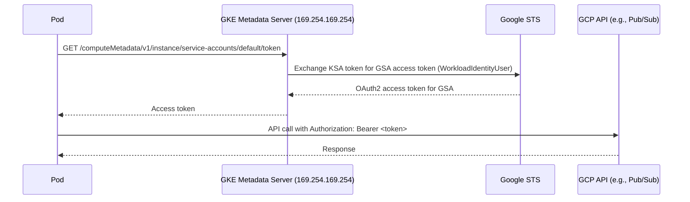
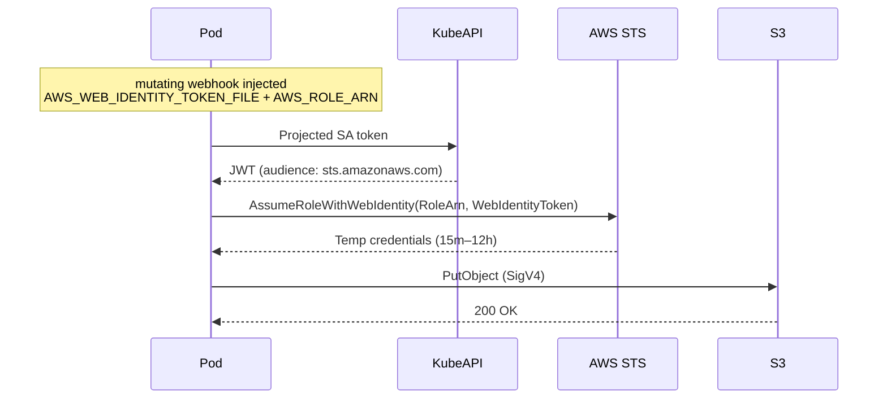
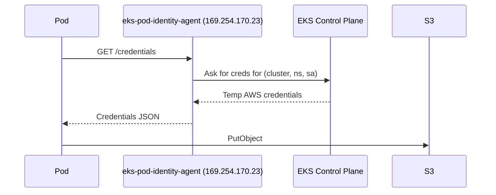

## 📘 Topic 69 — GKE Workload Identity vs EKS IRSA (& EKS Pod Identity)

**Official Documentation References**
- https://cloud.google.com/kubernetes-engine/docs/how-to/workload-identity
- https://cloud.google.com/kubernetes-engine/fleet-management/docs/use-workload-identity
- https://docs.aws.amazon.com/eks/latest/userguide/iam-roles-for-service-accounts.html
- https://docs.aws.amazon.com/eks/latest/userguide/pod-identities.html

### 📘 Definition
**GKE Workload Identity** and **EKS IRSA (IAM Roles for Service Accounts)** let Kubernetes ServiceAccounts assume cloud IAM identities so Pods can call cloud APIs without long-lived credentials.
**EKS Pod Identity** is AWS's newer, simpler mechanism that replaces IRSA's OIDC dance with an EKS-side association.

### 📖 About

**The problem**
- Pods need cloud API access (write to S3/GCS, publish to Pub/Sub/SQS, read Secret Manager).
- Storing long-lived access keys in Secrets is risky and hard to rotate.
- Instance-role fallback (node IAM role) gives *all* Pods on a node the same permissions — violates least privilege.

**The solution — per-workload cloud identity**
- Kubernetes ServiceAccount ↔ Cloud IAM identity.
- Pods automatically get short-lived credentials scoped to that SA.

**GKE Workload Identity (WLI)**
- Enable at cluster level: `--workload-pool=<project>.svc.id.goog`.
- Kubernetes SA is annotated with a GCP Service Account email:
  `iam.gke.io/gcp-service-account: my-gsa@my-project.iam.gserviceaccount.com`.
- The GCP SA gets IAM binding `roles/iam.workloadIdentityUser` for the Kubernetes SA identity:
  `serviceAccount:<project>.svc.id.goog[<ns>/<ksa>]`.
- Pods use the SA; the GKE metadata server intercepts calls to metadata IP `169.254.169.254`, returns short-lived tokens tied to the GCP SA.
- On Autopilot, mandatory.

**Fleet Workload Identity** — extension for multi-cluster where all clusters in a fleet share a trust boundary.

**EKS IRSA**
- Cluster must have an OIDC provider registered in IAM.
- Kubernetes SA annotated: `eks.amazonaws.com/role-arn: arn:aws:iam::123456789012:role/my-role`.
- IAM role's trust policy trusts the cluster's OIDC provider with a `sub` condition matching `system:serviceaccount:<ns>:<sa>`.
- The **mutating webhook** (deployed on control plane) projects a signed JWT into the Pod at `/var/run/secrets/eks.amazonaws.com/serviceaccount/token`.
- AWS SDKs (`AWS_WEB_IDENTITY_TOKEN_FILE` env) call `sts:AssumeRoleWithWebIdentity` to get temporary creds.

**EKS Pod Identity (newer, 2023+)**
- No OIDC needed in Pod path.
- You create an **EKS Pod Identity Association** linking a cluster + namespace + SA → IAM role.
- An `eks-pod-identity-agent` DaemonSet (or Fargate injection) issues credentials via a local endpoint.
- Simpler cross-account and multi-cluster (single trust policy per role, not one-per-cluster-OIDC).

**Comparison**

| Aspect | GKE WLI | EKS IRSA | EKS Pod Identity |
|--------|---------|----------|------------------|
| Setup | Enable workload-pool + SA annotation + IAM binding | Register OIDC + create IAM role with trust policy + SA annotation | Install agent + create Pod Identity Association |
| Trust mechanism | Kubernetes SA identity via GKE metadata server | OIDC JWT → `AssumeRoleWithWebIdentity` | EKS-signed credentials via agent |
| Cross-account | Yes via impersonation | Yes | Yes (simplest) |
| Multi-cluster | Fleet WLI | Per-cluster OIDC | Single role trust policy per cluster set |
| SDK requirement | None (metadata IP) | AWS SDK v1/v2 with WebIdentity support | Standard SDK (env-based) |
| Fargate | Yes (WLI on Autopilot) | Yes | Yes |

### 🔗 How It Integrates With Other Components

| Component | Integration |
|-----------|-------------|
| Kubernetes SA | Anchor of identity |
| Cloud IAM | Backing role / GCP SA |
| kube-apiserver | Issues projected SA tokens |
| Cloud metadata server | (GKE) proxies token requests |
| Mutating webhook | (EKS IRSA) injects env + volume |
| eks-pod-identity-agent | (EKS PI) local credential provider |
| Cloud SDKs | Consumers of the credentials |
| Audit logs | Cloud IAM logs show which SA identity called |

### 🏗️ Architecture Diagrams

**Diagram 1 — GKE Workload Identity flow**



**Diagram 2 — EKS IRSA flow**



**Diagram 3 — EKS Pod Identity flow**



### 💻 Real-World Examples

**Example 1 — GKE Workload Identity setup**

```bash
# Enable on cluster
gcloud container clusters update shop-std \
  --workload-pool=my-project.svc.id.goog --region=us-central1

# Enable on node pool (Standard only)
gcloud container node-pools update default-pool --cluster=shop-std \
  --region=us-central1 --workload-metadata=GKE_METADATA

# Create GCP SA
gcloud iam service-accounts create shop-writer \
  --display-name="Shop writer"

# Grant GCP permissions
gcloud projects add-iam-policy-binding my-project \
  --member="serviceAccount:shop-writer@my-project.iam.gserviceaccount.com" \
  --role="roles/pubsub.publisher"

# Bind KSA to GSA
gcloud iam service-accounts add-iam-policy-binding \
  shop-writer@my-project.iam.gserviceaccount.com \
  --role=roles/iam.workloadIdentityUser \
  --member="serviceAccount:my-project.svc.id.goog[shop/shop-ksa]"

# Kubernetes SA
kubectl create ns shop
kubectl create serviceaccount shop-ksa -n shop
kubectl annotate serviceaccount shop-ksa -n shop \
  iam.gke.io/gcp-service-account=shop-writer@my-project.iam.gserviceaccount.com
```

Pod uses it:
```yaml
apiVersion: v1
kind: Pod
metadata:
  name: publisher
  namespace: shop
spec:
  serviceAccountName: shop-ksa
  containers:
    - name: app
      image: gcr.io/google.com/cloudsdktool/cloud-sdk:slim
      command: ["gcloud", "pubsub", "topics", "publish", "orders", "--message=hi"]
```

**Example 2 — EKS IRSA with eksctl**

```bash
# Create IAM Role + SA in one command
eksctl create iamserviceaccount \
  --cluster=shop \
  --namespace=shop \
  --name=shop-ksa \
  --attach-policy-arn=arn:aws:iam::aws:policy/AmazonS3ReadOnlyAccess \
  --approve
```

Under the hood: creates IAM role, trust policy for OIDC, SA in cluster with annotation `eks.amazonaws.com/role-arn`.

Pod:
```yaml
apiVersion: v1
kind: Pod
metadata:
  name: reader
  namespace: shop
spec:
  serviceAccountName: shop-ksa
  containers:
    - name: aws
      image: amazon/aws-cli
      command: ["aws", "s3", "ls"]
```

**Example 3 — EKS Pod Identity Association**

```bash
# Install add-on
aws eks create-addon --cluster-name shop --addon-name eks-pod-identity-agent

# Trust policy: pods.eks.amazonaws.com
cat > trust.json <<EOF
{
  "Version": "2012-10-17",
  "Statement": [
    {
      "Effect": "Allow",
      "Principal": { "Service": "pods.eks.amazonaws.com" },
      "Action": ["sts:AssumeRole","sts:TagSession"]
    }
  ]
}
EOF
aws iam create-role --role-name shop-role --assume-role-policy-document file://trust.json
aws iam attach-role-policy --role-name shop-role \
  --policy-arn arn:aws:iam::aws:policy/AmazonS3ReadOnlyAccess

# Associate
aws eks create-pod-identity-association \
  --cluster-name shop --namespace shop --service-account shop-ksa \
  --role-arn arn:aws:iam::123456789012:role/shop-role
```

### 💻 Related Commands

**GKE WLI**

| Command | Flag | Purpose | Example |
|---------|------|---------|---------|
| `gcloud container clusters update` | `--workload-pool` | Enable WLI | See Ex.1 |
| `gcloud container node-pools update` | `--workload-metadata=GKE_METADATA` | Enable on pool | See Ex.1 |
| `gcloud iam service-accounts add-iam-policy-binding` | `--role=roles/iam.workloadIdentityUser` | Bind KSA↔GSA | See Ex.1 |
| `kubectl annotate sa` | `iam.gke.io/gcp-service-account=...` | KSA annotation | See Ex.1 |
| `gcloud container fleet workload-identity update` | – | Fleet WLI | – |

**EKS IRSA**

| Command | Flag | Purpose | Example |
|---------|------|---------|---------|
| `eksctl utils associate-iam-oidc-provider` | `--approve` | Register OIDC | `eksctl utils associate-iam-oidc-provider --cluster=shop --approve` |
| `eksctl create iamserviceaccount` | `--attach-policy-arn` | IAM SA in one shot | See Ex.2 |
| `aws iam create-role` | `--assume-role-policy-document` | Manual IAM role | – |
| `aws eks describe-cluster` | `--query 'cluster.identity.oidc.issuer'` | Find OIDC URL | – |

**EKS Pod Identity**

| Command | Flag | Purpose | Example |
|---------|------|---------|---------|
| `aws eks create-addon` | `--addon-name eks-pod-identity-agent` | Install agent | See Ex.3 |
| `aws eks create-pod-identity-association` | `--namespace --service-account --role-arn` | Bind | See Ex.3 |
| `aws eks list-pod-identity-associations` | `--cluster-name` | Audit | – |

### 🚨 Scenarios

**Scenario 1 — Pod gets 403 calling cloud API despite annotations**
- **GKE**: `--workload-pool` not enabled cluster-wide, or pool doesn't have `GKE_METADATA`.
- **EKS IRSA**: Trust policy `sub` doesn't match `system:serviceaccount:<ns>:<sa>`, or Pod doesn't use the SA (`serviceAccountName:` missing).
- **EKS PI**: Association missing; check `aws eks list-pod-identity-associations`.

**Scenario 2 — Cross-account access to a bucket**
- **EKS IRSA**: Add trust between IAM role in account B and IAM role in account A; Pod SA assumes A's role, which then assumes B's role (or a bucket policy in B trusts A's role).
- **GKE WLI**: Cross-project — grant GCP SA in project A `roles/storage.objectViewer` on bucket in project B (bucket-level IAM).

**Scenario 3 — Rotating an IAM role/policy**
- Change policy, wait ~15 min for STS credential expiry, or force Pod restart. IRSA credentials cache for up to 1 hour by default.

### ☁️ GCP GKE — deep-dive notes
- **Autopilot** clusters have WLI mandatory.
- **Fleet Workload Identity** allows one GCP SA binding to serve many clusters in a fleet using `<fleet-project>.svc.id.goog[<ns>/<ksa>]`.
- Impersonate a GCP SA from a KSA using `gcloud auth application-default print-access-token` inside the Pod for CLI-based access.

### 🟧 AWS EKS — deep-dive notes
- IRSA works on both MNG and Fargate.
- **EKS Pod Identity** is preferred for new setups (simpler, no OIDC in Pod), but IRSA remains widely used.
- **Session tags** via `sts:TagSession` allow cross-account attribute-based access control (ABAC).

### 🧪 Hands-On Lab Exercises

**🧪 Lab 69-A — GKE WLI Publishing to Pub/Sub (Beginner)**
- **Objective**: Pod publishes messages using WLI.
- **Prerequisites**: GKE Standard cluster with `--workload-pool`.
- **Steps**: Follow Example 1 end-to-end.
- **Verification**: `gcloud pubsub subscriptions pull` sees the message.
- **Cleanup**: Delete cluster + GSA + IAM binding.
- **Bonus**: Deny node metadata for other Pods to prove per-SA isolation.

**🧪 Lab 69-B — EKS IRSA Reading S3 (Intermediate)**
- **Objective**: Pod lists an S3 bucket without keys.
- **Steps**: Follow Example 2.
- **Verification**: Pod's `aws s3 ls` succeeds.
- **Cleanup**: `eksctl delete iamserviceaccount --cluster=shop --name=shop-ksa --namespace=shop`.
- **Bonus**: Change SA and observe access denied.

**🧪 Lab 69-C — Migrate from IRSA to EKS Pod Identity (Advanced)**
- **Objective**: Zero-downtime migration.
- **Steps**:
  1. Existing IRSA config.
  2. Install eks-pod-identity-agent add-on.
  3. Create new IAM role with `pods.eks.amazonaws.com` trust.
  4. Add Pod Identity Association for same ns/sa.
  5. Rollout restart; SDK now uses agent (Pod Identity precedence over IRSA env if agent creds present).
  6. Remove IRSA annotation and OIDC-trust IAM role.
- **Verification**: Pods still function; CloudTrail shows role assumed via `pods.eks.amazonaws.com`.
- **Bonus**: Do a cross-account variant.

### 🎯 Interview Deliverable Answer (60–90s)
> "Both clouds solve the same problem: Pods need cloud API access without long-lived keys. **GKE Workload Identity** binds a Kubernetes ServiceAccount to a GCP Service Account — the GKE metadata server intercepts token requests and hands back short-lived GCP credentials scoped to that SA. **EKS IRSA** uses OIDC: the cluster is registered as an OIDC provider in IAM, a mutating webhook injects a projected JWT into Pods, and the AWS SDK calls `AssumeRoleWithWebIdentity` to swap it for temp creds. **EKS Pod Identity** is the newer, simpler alternative — you just create an association via the EKS API, and an agent DaemonSet serves creds locally. Why it matters: no keys in Secrets, per-workload least privilege, and clean audit trails in Cloud IAM / CloudTrail. Whenever I stand up a new cluster, WLI is on from day one on GKE — mandatory on Autopilot — and on EKS I default to Pod Identity for new services and IRSA for legacy."

### ❓ Interview Questions

**Basic**
1. **Q**: Why not store AWS/GCP keys in a Secret?
   **A**: Long-lived, hard to rotate, blast-radius on leak; violates least privilege because everyone in ns can read.

2. **Q**: What does IRSA stand for?
   **A**: IAM Roles for Service Accounts.

**Intermediate**
3. **Q**: How does the Pod get creds under IRSA?
   **A**: Mutating webhook injects a projected token file + env var; SDK exchanges via `AssumeRoleWithWebIdentity`.

4. **Q**: How does WLI hand out creds?
   **A**: GKE metadata server on the node exchanges the KSA identity for a GCP SA token via Workload Identity Federation.

5. **Q**: Trade-offs of Pod Identity vs IRSA?
   **A**: PI: simpler trust policies, no OIDC-in-pod, easier cross-account. IRSA: broader tooling maturity.

**Advanced**
6. **Q**: How would you audit which SA called `s3:PutObject`?
   **A**: CloudTrail `userIdentity.sessionContext.sessionIssuer` shows the assumed role; `sub` in the token maps to the K8s SA.

7. **Q**: How would you rotate the OIDC signing key?
   **A**: EKS rotates it automatically; keep the OIDC thumbprint updated in IAM provider.

**Scenario**
8. **Q**: SDK reports "no credentials" — debug on EKS.
   **A**: Check SA annotation, `eks.amazonaws.com/role-arn`, projected token file exists, AWS SDK version supports WebIdentity, trust policy `sub` matches.

**GKE-specific**
9. **Q**: What is Fleet Workload Identity?
   **A**: A single trust boundary across a fleet so KSA→GSA bindings use a fleet-scoped principal, avoiding per-cluster wiring.

**EKS-specific**
10. **Q**: How does EKS Pod Identity work on Fargate?
    **A**: Fargate injects the agent-equivalent; SDK still reads creds via the local endpoint URL.

**Lab-based**
11. **Q**: Show me giving a Pod S3 read-only access on EKS.
    **A**: (Lab 69-B) `eksctl create iamserviceaccount` with `AmazonS3ReadOnlyAccess`, reference SA in Pod, aws s3 ls.

---

