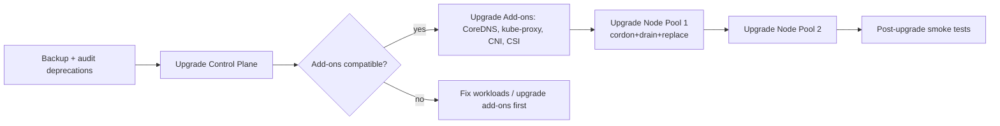
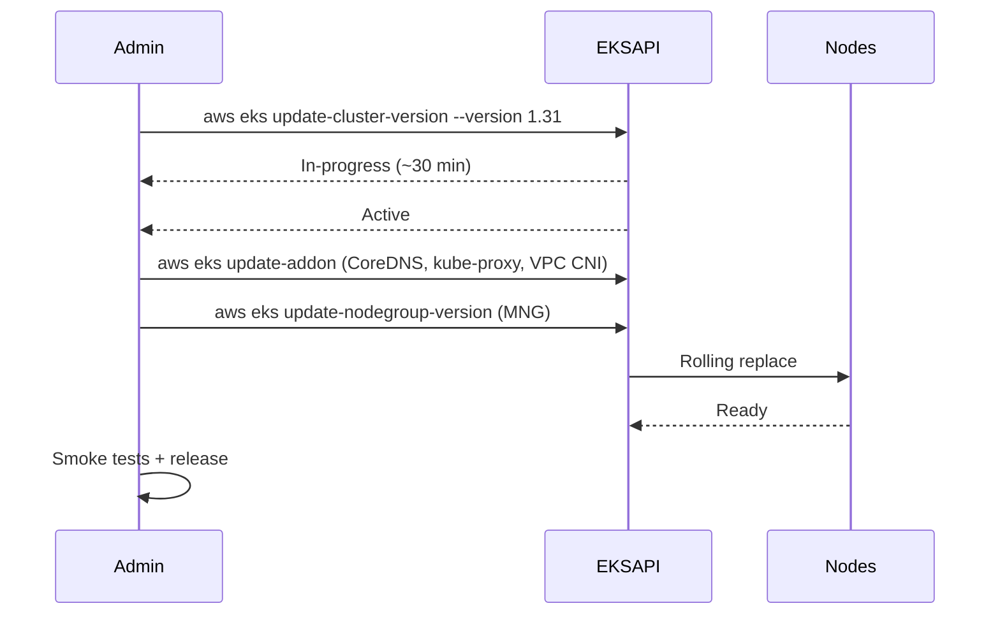

## 📘 Topic 70 — Upgrades and Version Lifecycle on GKE and EKS

**Official Documentation References**
- https://kubernetes.io/releases/version-skew-policy/
- https://cloud.google.com/kubernetes-engine/versioning
- https://cloud.google.com/kubernetes-engine/docs/concepts/release-channels
- https://docs.aws.amazon.com/eks/latest/userguide/kubernetes-versions.html
- https://docs.aws.amazon.com/eks/latest/userguide/update-cluster.html

### 📘 Definition
Upgrade lifecycle management is the practice of moving a Kubernetes cluster through minor versions (1.30 → 1.31 → 1.32) while respecting version-skew rules and keeping workloads available. Both GKE and EKS offer managed control-plane upgrades and node-fleet upgrade tooling.

### 📖 About

**Kubernetes upstream cadence**
- Minor releases: every ~4 months.
- Support: ~14 months of patch support per minor version (as of 2024+; historically 12).
- Version skew: `kubelet` ≤ 3 minors behind apiserver (v1.28+); `kube-proxy` same node; managed add-ons per docs.

**Order of operations for a cluster upgrade**
1. Control plane (apiserver, scheduler, controller-manager) — must go first.
2. Nodes (rolling with drain).
3. Add-ons (CoreDNS, kube-proxy, CNI, CSI, metrics-server).

**Pre-upgrade checklist**
- Check deprecated API usage (`kubectl deprecations` plugin, `pluto`, `kubent`, GKE Insights).
- Test in a staging cluster with your workloads and CI.
- Verify PDBs so drain doesn't starve availability.
- Take a snapshot / backup.
- Note any add-on compatibility (Karpenter, Istio, cert-manager).
- Bump CRDs bundled with the version.
- Ensure `PriorityClass` and Cluster Autoscaler / Karpenter aren't set to disruption-block windows.

**GKE-specific**
- **Release channels**: `rapid` (early), `regular` (default), `stable` (latest patch of an older minor). Enrolling a cluster ties both control plane and nodes to that channel's cadence.
- **Auto-upgrades**: on by default in channels; Google chooses maintenance windows.
- **Maintenance windows & exclusions**: define allowed upgrade times and blackout dates (up to 30 days).
- **Surge upgrades**: node upgrades use configurable `max-surge` and `max-unavailable`.
- **Blue-green upgrades** (Standard): create a new node pool at the target version, migrate workloads, decommission old — safer than in-place surges.
- **Extended Support**: pay-per-hour to remain on a minor after standard support ends.

**EKS-specific**
- **Cluster upgrade** is initiated per minor step (no skipping): `1.29 → 1.30 → 1.31`.
- **Add-ons upgrade** via EKS Add-on API (VPC CNI, CoreDNS, kube-proxy, EBS CSI, EFS CSI, ADOT, Pod Identity Agent).
- **Managed Node Group upgrades** — AWS handles cordon/drain/replace across ASG.
- **Karpenter/self-managed** — you drift-terminate nodes; Karpenter honors `NodePool.disruption.expireAfter`.
- **Extended Support** — pay-per-cluster-hour surcharge; caps at ~12 months of extended support.
- **Version deprecation calendar** — AWS publishes end-of-standard-support and end-of-extended-support dates.

**Comparison**

| Aspect | GKE | EKS |
|--------|-----|-----|
| Auto-upgrade | Yes (channels) | Manual (per minor step) |
| Skip versions | No | No |
| Maintenance windows | Native | Use blueprints / Karpenter drift |
| Node upgrade | Surge or blue-green | MNG rolling; self-managed via ASG |
| Extended Support | Paid hourly | Paid hourly per cluster |
| CRD-based upgrade config | ReleaseChannel via API | UpdateClusterVersion API |

### 🔗 How It Integrates With Other Components

| Component | Integration |
|-----------|-------------|
| API deprecations | Blocked by version bump; test with `kubent` |
| PDBs | Prevent excessive disruption during drain |
| Cluster Autoscaler / Karpenter | Must be at compatible version |
| Ingress controllers | Deployed as workloads; may pin K8s API dependencies |
| Service Mesh (Istio) | Coupled to Kubernetes minor windows |
| Cloud CNI (VPC CNI, GKE Dataplane V2) | Version-tied add-ons |
| Storage CSI | Bug-fixes shipped per K8s version |
| Observability (metrics-server) | Version-tied |

### 🏗️ Architecture Diagrams

**Diagram 1 — Upgrade order**



**Diagram 2 — GKE surge vs blue-green**

```
Surge (in-place):
+---------------+   +---------------+
|  Old pool     |   |  Old pool     |
|  4 nodes v1.30|-->|  3 nodes v1.30| ---> ...
|               |   |  1 node v1.31 |
+---------------+   +---------------+

Blue-green:
[ Old pool v1.30  Running workloads ]
        +
[ New pool v1.31  Empty  ]  --> shift workloads --> [ Old pool empty ] --> delete
```

**Diagram 3 — EKS upgrade sequence**



### 💻 Real-World Examples

**Example 1 — GKE Standard upgrade with maintenance window**

```bash
# Set release channel + maintenance window
gcloud container clusters update shop \
  --release-channel=regular \
  --maintenance-window-start=2026-01-01T09:00:00Z \
  --maintenance-window-end=2026-01-01T14:00:00Z \
  --maintenance-window-recurrence=FREQ=WEEKLY;BYDAY=SA \
  --region=us-central1

# Trigger control-plane upgrade (or wait for auto)
gcloud container clusters upgrade shop --master \
  --cluster-version=1.31.1-gke.1846000 --region=us-central1

# Upgrade node pool (blue-green style)
gcloud container node-pools update default-pool \
  --cluster=shop --region=us-central1 \
  --enable-blue-green-upgrade \
  --standard-rollout-policy=batch-node-count=3,batch-soak-duration=60s \
  --node-pool-soak-duration=1800s

gcloud container clusters upgrade shop \
  --node-pool=default-pool --cluster-version=1.31.1-gke.1846000 \
  --region=us-central1
```

**Example 2 — EKS upgrade with eksctl**

```bash
# Check current
eksctl get cluster --name shop

# Upgrade control plane
eksctl upgrade cluster --name shop --version 1.31 --approve

# Upgrade add-ons
for addon in vpc-cni coredns kube-proxy aws-ebs-csi-driver; do
  aws eks update-addon --cluster-name shop --addon-name $addon \
    --resolve-conflicts PRESERVE
done

# Upgrade MNGs
eksctl upgrade nodegroup --cluster=shop --name=mng-general --kubernetes-version=1.31
```

**Example 3 — Audit deprecated APIs before upgrading**

```bash
# Using kubent
kubent --context shop-prod

# Using pluto
pluto detect-helm --output json > deprecations.json

# Using kubectl deprecations plugin
kubectl deprecations
```

### 💻 Related Commands

**GKE**

| Command | Flag | Purpose | Example |
|---------|------|---------|---------|
| `gcloud container get-server-config` | `--region` | Available versions | `gcloud container get-server-config --region us-central1` |
| `gcloud container clusters update` | `--release-channel` | Enroll channel | See Ex.1 |
| `gcloud container clusters update` | `--maintenance-window-*` | Windows/exclusions | See Ex.1 |
| `gcloud container clusters upgrade` | `--master` | Control plane | See Ex.1 |
| `gcloud container clusters upgrade` | `--node-pool` | Node pool | See Ex.1 |
| `gcloud container node-pools update` | `--enable-blue-green-upgrade` | Blue-green | See Ex.1 |

**EKS**

| Command | Flag | Purpose | Example |
|---------|------|---------|---------|
| `aws eks describe-cluster` | `--query 'cluster.version'` | Current version | – |
| `aws eks update-cluster-version` | `--version` | Control plane | `aws eks update-cluster-version --name shop --version 1.31` |
| `aws eks list-updates` | `--name` | Track updates | `aws eks list-updates --name shop` |
| `aws eks describe-update` | `--name --update-id` | Progress | – |
| `aws eks update-addon` | `--resolve-conflicts PRESERVE` | Add-on upgrade | See Ex.2 |
| `eksctl upgrade cluster` | `--version --approve` | eksctl wrapper | See Ex.2 |
| `eksctl upgrade nodegroup` | `--kubernetes-version` | MNG upgrade | See Ex.2 |

**Common audit tools**

| Command | Purpose | Example |
|---------|---------|---------|
| `kubent` | Deprecated API scan | `kubent` |
| `pluto` | Chart deprecation | `pluto detect-helm` |
| `kubectl deprecations` | Plugin scanner | `kubectl deprecations` |
| `kubectl api-versions` | Available versions | – |
| `kubectl api-resources` | – | – |

### 🚨 Scenarios

**Scenario 1 — Ingress broken after upgrade due to removed API**
- **Problem**: `networking.k8s.io/v1beta1 Ingress` removed in 1.22; upgrade fails or Ingress objects don't work.
- **Resolution**:
  1. Pre-scan with kubent.
  2. Migrate manifests to `networking.k8s.io/v1`.
  3. Update Helm charts and re-render.
  4. GKE/EKS may proactively block the upgrade with warnings.

**Scenario 2 — PDB starves drain**
- **Problem**: `minAvailable: 100%` PDB blocks node drain forever.
- **Resolution**:
  1. Loosen to `maxUnavailable: 25%`.
  2. On GKE, `--pdb-timeout-seconds` on the node pool (blue-green) will eventually force-drain.
  3. On EKS MNG, `--force` on `update-nodegroup-version`.

**Scenario 3 — Karpenter nodes stuck at old version during upgrade**
- **Problem**: Karpenter's `EC2NodeClass.amiSelectorTerms` pinned to old AMI.
- **Resolution**:
  1. Update `amiSelectorTerms` to `alias: bottlerocket@latest` or a newer AMI ID.
  2. Karpenter drifts nodes and replaces them.
  3. Add `disruption.expireAfter: 720h` so nodes rotate at least monthly.

### ☁️ GCP GKE Perspective (deep dive)
- **Insights** in Cloud Console proactively flags deprecated APIs.
- **Extended Support** billed hourly; use only during migration windows.
- **Node Auto-Upgrade** aligns with channel; disable during freeze weeks via maintenance exclusions.
- **Ingress-GCE + NEGs** — controller upgrades handled by GKE; no user action.

### 🟧 AWS EKS Perspective (deep dive)
- **Version support**: each minor supported for 14 months of standard, then extended.
- **Add-on version pinning** via `configurationValues` block for each add-on.
- **Karpenter drift** is the recommended way to roll node AMIs post-upgrade.
- **CloudTrail** records `UpdateClusterVersion` and `UpdateNodegroupVersion`.

### 🧪 Hands-On Lab Exercises

**🧪 Lab 70-A — Deprecated API Audit + GKE Channel Upgrade (Beginner)**
- **Objective**: Detect deprecations and upgrade a Standard cluster.
- **Steps**:
  1. Create GKE Standard cluster at `1.30`.
  2. Deploy sample workload with an intentionally old API version (e.g., `autoscaling/v2beta2`).
  3. Run `kubent` → note detections.
  4. Migrate manifests.
  5. Trigger `gcloud container clusters upgrade`.
- **Verification**: `gcloud container clusters describe` shows new version.
- **Cleanup**: Delete cluster.
- **Bonus**: Set a maintenance exclusion for the next weekend.

**🧪 Lab 70-B — EKS Blue/Green Node Upgrade with Karpenter (Intermediate)**
- **Objective**: Upgrade control plane and rotate all Karpenter nodes.
- **Steps**:
  1. Cluster at 1.30; deploy Karpenter with `EC2NodeClass` pinned to Bottlerocket 1.30.
  2. `aws eks update-cluster-version --version 1.31`.
  3. Wait for `ACTIVE`.
  4. `aws eks update-addon` for CoreDNS, VPC CNI, kube-proxy.
  5. Update EC2NodeClass to Bottlerocket 1.31 AMI alias.
  6. Watch Karpenter drift nodes.
- **Verification**: `kubectl get nodes` shows `v1.31.x`.
- **Bonus**: Add a PDB and observe safe rollout.

**🧪 Lab 70-C — Two-step upgrade (1.29 → 1.30 → 1.31) with rollback plan (Advanced)**
- **Objective**: Practice multi-minor upgrade with staging validation.
- **Steps**:
  1. Two EKS clusters (staging + prod) at 1.29.
  2. Upgrade staging first; run full smoke suite (`hey`, Postman).
  3. Repeat on prod with maintenance window.
  4. Prepare rollback plan: not possible in-place — use Velero restore to a 1.29 cluster.
- **Verification**: Prod on 1.31; DR plan documented.
- **Bonus**: Automate with GitHub Actions or Argo Workflows.

### 🎯 Interview Deliverable Answer (60–90s)
> "Kubernetes ships a new minor every ~4 months and supports each for 14 months, so upgrade discipline is a continuous job, not a project. My process: **audit** for deprecated APIs with kubent, **test** in staging, **backup**, then upgrade in order — control plane first, then add-ons (CoreDNS, kube-proxy, CNI, CSI), then nodes with drain-respecting PDBs. On GKE I enroll the cluster in the `regular` release channel and set maintenance windows and exclusions; for risky rolls I use blue-green node pool upgrades so I can pause and validate. On EKS I upgrade one minor at a time via `aws eks update-cluster-version`, then update add-ons with `--resolve-conflicts PRESERVE`, then MNGs or Karpenter drift. The two things that bite people: PDBs blocking drain and deprecated APIs breaking Helm charts. Both are solved by pre-flight scans and a proper staging cluster."

### ❓ Interview Questions

**Basic**
1. **Q**: Upstream Kubernetes release cadence?
   **A**: ~4 months per minor; ~14 months support.

2. **Q**: Order of upgrade?
   **A**: Control plane → add-ons → nodes.

**Intermediate**
3. **Q**: What are GKE release channels?
   **A**: `rapid`, `regular`, `stable` — pin cadence and version selection.

4. **Q**: Can you skip minors on EKS?
   **A**: No — one minor at a time.

5. **Q**: How do you find deprecated APIs before upgrading?
   **A**: `kubent`, `pluto`, GKE Insights, EKS Upgrade Insights.

**Advanced**
6. **Q**: What is blue-green node pool upgrade on GKE?
   **A**: Create a new node pool at target version, migrate workloads, then delete old pool.

7. **Q**: How does Karpenter handle version upgrades?
   **A**: Update the EC2NodeClass AMI reference; Karpenter drifts and replaces nodes based on disruption policy.

**Scenario**
8. **Q**: PDB set to 100% blocks upgrade — options?
   **A**: Loosen PDB, use `--force` (EKS MNG), blue-green (GKE), or manually adjust replicas.

**GKE-specific**
9. **Q**: How to avoid weekend upgrades?
   **A**: Maintenance exclusion for that date range in cluster config.

**EKS-specific**
10. **Q**: What does `--resolve-conflicts PRESERVE` do on add-on update?
    **A**: Keeps your custom values while applying the new add-on version.

**Lab-based**
11. **Q**: Walk me through a safe 1.30 → 1.31 upgrade on EKS.
    **A**: (Lab 70-B) audit APIs → upgrade CP → upgrade add-ons → rotate nodes via Karpenter drift → validate with smoke tests.

---

