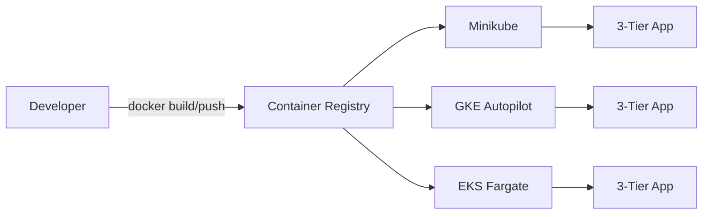

## 🏆 Capstone 1 — Deploy a 3-Tier Web Application (Frontend + Backend + MySQL) on Minikube → GKE Autopilot → EKS Fargate

**Difficulty**: Beginner–Intermediate
**Estimated time**: 3 hours (all three targets)

### Objective
Build and deploy a canonical 3-tier app: React frontend → Node/Python backend → MySQL StatefulSet. Repeat the exact same manifests on Minikube, GKE Autopilot, and EKS Fargate to observe portability and platform-specific tweaks.

### Prerequisites
- Docker, kubectl, git.
- Minikube v1.33+.
- gcloud SDK + a GCP project with billing.
- aws CLI + eksctl + an AWS account.
- A container registry (Docker Hub / ECR / GAR).

### Workflow Diagram


### Environment Setup

**Sample app source layout**
```
capstone1/
├── frontend/   (React, port 3000)
├── backend/    (Node.js Express, port 8080)
├── db/         (MySQL 8 via official image)
├── manifests/
│   ├── namespace.yaml
│   ├── mysql-statefulset.yaml
│   ├── backend-deployment.yaml
│   ├── frontend-deployment.yaml
│   ├── services.yaml
│   └── ingress.yaml
```

### Step-by-Step

**1. Build and push images**
```bash
docker build -t myrepo/shop-frontend:1.0 frontend/
docker build -t myrepo/shop-backend:1.0 backend/
docker push myrepo/shop-frontend:1.0
docker push myrepo/shop-backend:1.0
```

**2. Manifests**

`namespace.yaml`
```yaml
apiVersion: v1
kind: Namespace
metadata: { name: shop, labels: { pod-security.kubernetes.io/enforce: baseline } }
```

`mysql-statefulset.yaml`
```yaml
apiVersion: v1
kind: Service
metadata: { name: mysql, namespace: shop }
spec:
  clusterIP: None
  selector: { app: mysql }
  ports: [{ port: 3306, name: mysql }]
---
apiVersion: v1
kind: Secret
metadata: { name: mysql-secret, namespace: shop }
stringData:
  MYSQL_ROOT_PASSWORD: changeme
  MYSQL_DATABASE: shopdb
  MYSQL_USER: shop
  MYSQL_PASSWORD: shoppass
---
apiVersion: apps/v1
kind: StatefulSet
metadata: { name: mysql, namespace: shop }
spec:
  serviceName: mysql
  replicas: 1
  selector: { matchLabels: { app: mysql } }
  template:
    metadata: { labels: { app: mysql } }
    spec:
      containers:
        - name: mysql
          image: mysql:8.0
          envFrom: [{ secretRef: { name: mysql-secret } }]
          ports: [{ containerPort: 3306 }]
          resources:
            requests: { cpu: "250m", memory: "512Mi" }
            limits:   { cpu: "1",   memory: "1Gi" }
          readinessProbe:
            exec: { command: ["sh","-c","mysqladmin -uroot -p$MYSQL_ROOT_PASSWORD ping"] }
            initialDelaySeconds: 20
            periodSeconds: 10
          volumeMounts:
            - name: data
              mountPath: /var/lib/mysql
  volumeClaimTemplates:
    - metadata: { name: data }
      spec:
        accessModes: ["ReadWriteOnce"]
        resources: { requests: { storage: 10Gi } }
```

`backend-deployment.yaml`
```yaml
apiVersion: apps/v1
kind: Deployment
metadata: { name: backend, namespace: shop }
spec:
  replicas: 2
  selector: { matchLabels: { app: backend } }
  template:
    metadata: { labels: { app: backend } }
    spec:
      containers:
        - name: backend
          image: myrepo/shop-backend:1.0
          ports: [{ containerPort: 8080 }]
          env:
            - name: DB_HOST
              value: mysql.shop.svc.cluster.local
            - { name: DB_USER, valueFrom: { secretKeyRef: { name: mysql-secret, key: MYSQL_USER } } }
            - { name: DB_PASS, valueFrom: { secretKeyRef: { name: mysql-secret, key: MYSQL_PASSWORD } } }
            - { name: DB_NAME, valueFrom: { secretKeyRef: { name: mysql-secret, key: MYSQL_DATABASE } } }
          resources:
            requests: { cpu: "250m", memory: "512Mi" }
            limits:   { cpu: "500m", memory: "512Mi" }
          readinessProbe:
            httpGet: { path: /healthz, port: 8080 }
            initialDelaySeconds: 5
```

`frontend-deployment.yaml`
```yaml
apiVersion: apps/v1
kind: Deployment
metadata: { name: frontend, namespace: shop }
spec:
  replicas: 2
  selector: { matchLabels: { app: frontend } }
  template:
    metadata: { labels: { app: frontend } }
    spec:
      containers:
        - name: frontend
          image: myrepo/shop-frontend:1.0
          ports: [{ containerPort: 3000 }]
          env:
            - name: BACKEND_URL
              value: http://backend.shop.svc.cluster.local:8080
          resources:
            requests: { cpu: "250m", memory: "512Mi" }
            limits:   { cpu: "500m", memory: "512Mi" }
```

`services.yaml`
```yaml
apiVersion: v1
kind: Service
metadata: { name: backend, namespace: shop }
spec:
  selector: { app: backend }
  ports: [{ port: 8080, targetPort: 8080 }]
---
apiVersion: v1
kind: Service
metadata: { name: frontend, namespace: shop }
spec:
  type: LoadBalancer
  selector: { app: frontend }
  ports: [{ port: 80, targetPort: 3000 }]
```

**3. Deploy to Minikube**
```bash
minikube start --cpus=4 --memory=8g --kubernetes-version=v1.31.0
minikube addons enable ingress
kubectl apply -f manifests/
kubectl -n shop rollout status statefulset/mysql
kubectl -n shop rollout status deploy/backend deploy/frontend
minikube service frontend -n shop
```

**4. Deploy to GKE Autopilot**
```bash
gcloud container clusters create-auto capstone1 --region=us-central1
gcloud container clusters get-credentials capstone1 --region=us-central1
kubectl apply -f manifests/
kubectl -n shop get svc frontend -w   # wait for EXTERNAL-IP
```

**5. Deploy to EKS Fargate**
```yaml
# fargate-cluster.yaml
apiVersion: eksctl.io/v1alpha5
kind: ClusterConfig
metadata: { name: capstone1, region: us-east-1, version: "1.31" }
iam: { withOIDC: true }
fargateProfiles:
  - name: fp-shop
    selectors:
      - namespace: shop
      - namespace: kube-system
        labels: { k8s-app: kube-dns }
```
```bash
eksctl create cluster -f fargate-cluster.yaml
kubectl apply -f manifests/
# NOTE: MySQL StatefulSet on Fargate needs a supported storage class
# For Fargate: switch to EFS via aws-efs-csi-driver or Amazon RDS as an external DB.
```

### Verification
```bash
kubectl -n shop get pods -o wide
kubectl -n shop get svc,pvc,statefulset
curl http://<frontend-external-ip>/
kubectl -n shop exec -it mysql-0 -- mysql -uroot -p$MYSQL_ROOT_PASSWORD -e "SHOW DATABASES;"
```

Expected: `shopdb` present, frontend renders items fetched via backend.

### Cleanup
```bash
# Minikube
minikube delete

# GKE
gcloud container clusters delete capstone1 --region=us-central1 --quiet

# EKS
eksctl delete cluster --name capstone1 --region=us-east-1
```

### Troubleshooting
- **Frontend can't reach backend** — check Service DNS: `kubectl exec pod -- nslookup backend.shop`.
- **MySQL Pending on Fargate** — Fargate doesn't support EBS; switch StatefulSet PVC to `efs-sc` (EFS CSI) or use RDS externally.
- **LoadBalancer stuck `<pending>`** — cloud LB quota exceeded or IAM missing.

### Bonus Challenges
1. Replace MySQL StatefulSet with RDS (EKS) / Cloud SQL (GKE) using Config Connector / ACK.
2. Add horizontal scaling with HPA on backend CPU 60%.
3. Store secrets in Secret Manager / Secrets Manager via External Secrets Operator.

---

