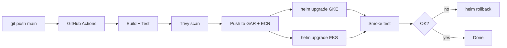

## 🏆 Capstone 2 — CI/CD Pipeline: GitHub Actions → Docker → GKE and EKS with Rolling Updates + Rollback

**Difficulty**: Intermediate
**Estimated time**: 2.5 hours

### Objective
Every push to `main` builds a new image, pushes to GAR/ECR, and rolls out to GKE and EKS with automatic rollback on failure.

### Prerequisites
- GitHub repo (fork of capstone1).
- GKE + EKS clusters from previous capstones (or fresh).
- WLI on GKE, IRSA on EKS for keyless registry auth.
- `helm` v3.14+.

### Workflow Diagram


### Environment Setup

**GitHub OIDC federation**
- GKE: create a GCP Workload Identity Pool that trusts GitHub OIDC.
- EKS: create IAM Role with GitHub OIDC trust policy.

**Helm chart**: put the manifests from Capstone 1 into `charts/shop/`.

### Step-by-Step

**1. Helm chart values** (`charts/shop/values.yaml`)
```yaml
image:
  registry: gcr.io/my-project/shop
  tag: latest
replicas:
  frontend: 3
  backend: 3
mysql:
  storage: 10Gi
```

**2. GitHub Actions workflow** (`.github/workflows/deploy.yaml`)
```yaml
name: build-and-deploy
on:
  push: { branches: [main] }
permissions:
  id-token: write
  contents: read
jobs:
  build:
    runs-on: ubuntu-latest
    outputs: { tag: ${{ steps.meta.outputs.tag }} }
    steps:
      - uses: actions/checkout@v4
      - id: meta
        run: echo "tag=$(git rev-parse --short HEAD)" >> $GITHUB_OUTPUT
      - uses: docker/setup-buildx-action@v3
      - name: Auth GCP
        uses: google-github-actions/auth@v2
        with:
          workload_identity_provider: projects/123/locations/global/workloadIdentityPools/gh/providers/gh
          service_account: ci@my-project.iam.gserviceaccount.com
      - name: Auth ECR
        uses: aws-actions/configure-aws-credentials@v4
        with:
          role-to-assume: arn:aws:iam::111111111111:role/gha-oidc
          aws-region: us-east-1
      - run: gcloud auth configure-docker us-central1-docker.pkg.dev -q
      - run: aws ecr get-login-password | docker login --username AWS --password-stdin 111111111111.dkr.ecr.us-east-1.amazonaws.com
      - name: Build & push frontend
        run: |
          docker buildx build --push -t us-central1-docker.pkg.dev/my-project/shop/frontend:${{ steps.meta.outputs.tag }} \
              -t 111111111111.dkr.ecr.us-east-1.amazonaws.com/shop/frontend:${{ steps.meta.outputs.tag }} frontend/
      - name: Trivy scan
        uses: aquasecurity/trivy-action@0.20.0
        with: { image-ref: 'us-central1-docker.pkg.dev/my-project/shop/frontend:${{ steps.meta.outputs.tag }}', exit-code: '1', severity: 'CRITICAL,HIGH' }
  deploy-gke:
    needs: build
    runs-on: ubuntu-latest
    steps:
      - uses: actions/checkout@v4
      - uses: google-github-actions/auth@v2
        with: { workload_identity_provider: ..., service_account: ci@... }
      - uses: google-github-actions/get-gke-credentials@v2
        with: { cluster_name: capstone1, location: us-central1 }
      - name: Helm upgrade
        run: |
          helm upgrade --install shop charts/shop \
            --namespace shop --create-namespace \
            --set image.tag=${{ needs.build.outputs.tag }} \
            --atomic --timeout 5m --wait
      - name: Smoke test
        run: kubectl -n shop rollout status deploy/frontend
  deploy-eks:
    needs: build
    runs-on: ubuntu-latest
    steps:
      - uses: actions/checkout@v4
      - uses: aws-actions/configure-aws-credentials@v4
        with: { role-to-assume: arn:aws:iam::111111111111:role/gha-oidc, aws-region: us-east-1 }
      - run: aws eks update-kubeconfig --name capstone1
      - name: Helm upgrade
        run: |
          helm upgrade --install shop charts/shop \
            --namespace shop --create-namespace \
            --set image.tag=${{ needs.build.outputs.tag }} \
            --set image.registry=111111111111.dkr.ecr.us-east-1.amazonaws.com/shop \
            --atomic --timeout 5m --wait
```

**3. Rollback**
- `--atomic` auto-rolls-back on failure.
- Manual: `helm rollback shop <REV> -n shop`.

### Verification
- Push a change; watch Actions succeed; observe rolling update:
```bash
kubectl -n shop rollout history deploy/frontend
kubectl -n shop get pods -w
helm history shop -n shop
```

### Cleanup
```bash
helm uninstall shop -n shop
# Delete clusters as in Capstone 1
```

### Troubleshooting
- **OIDC federation fails** — recheck audience `sts.amazonaws.com` (AWS) / provider mapping (GCP).
- **Trivy fails** — patch base image or add ignore file.
- **`--atomic` rollback but pods stuck** — check readinessProbe path.

### Bonus Challenges
- Add a `manual approval` gate for prod.
- Add SBOM (`syft`) upload as workflow artifact.
- Add `cosign` image signing + Kyverno verification policy.

---

