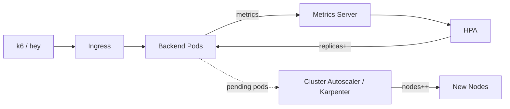

## 🏆 Capstone 3 — HPA + Cluster Autoscaler on GKE and Karpenter on EKS Under Load Testing (hey / k6)

**Difficulty**: Intermediate
**Estimated time**: 2 hours

### Objective
Load-test the shop backend, observe HPA scaling Pods and CA/Karpenter scaling nodes; produce a load-vs-latency plot.

### Prerequisites
- GKE Standard (for CA) + EKS with Karpenter installed.
- `hey` or `k6`, `kubectl`, `helm`.

### Workflow


### Setup

**GKE Standard cluster with CA**
```bash
gcloud container clusters create loadtest --region=us-central1 \
  --enable-autoscaling --min-nodes=1 --max-nodes=10 \
  --machine-type=e2-standard-4 --release-channel=regular \
  --enable-ip-alias --enable-dataplane-v2
```

**EKS + Karpenter** — follow https://karpenter.sh/docs/getting-started/

### Backend Deployment + HPA
```yaml
apiVersion: apps/v1
kind: Deployment
metadata: { name: backend, namespace: shop }
spec:
  replicas: 2
  selector: { matchLabels: { app: backend } }
  template:
    metadata: { labels: { app: backend } }
    spec:
      containers:
        - name: backend
          image: myrepo/shop-backend:1.0
          resources:
            requests: { cpu: "250m", memory: "256Mi" }
            limits:   { cpu: "500m", memory: "512Mi" }
---
apiVersion: autoscaling/v2
kind: HorizontalPodAutoscaler
metadata: { name: backend-hpa, namespace: shop }
spec:
  scaleTargetRef: { apiVersion: apps/v1, kind: Deployment, name: backend }
  minReplicas: 2
  maxReplicas: 50
  metrics:
    - type: Resource
      resource: { name: cpu, target: { type: Utilization, averageUtilization: 60 } }
  behavior:
    scaleUp:
      stabilizationWindowSeconds: 30
      policies: [{ type: Percent, value: 100, periodSeconds: 30 }]
    scaleDown:
      stabilizationWindowSeconds: 300
```

### Load Test
```bash
kubectl -n shop port-forward svc/backend 8080:8080 &
hey -z 5m -c 200 -q 50 http://localhost:8080/api/items

# k6 alternative
cat > script.js <<EOF
import http from 'k6/http';
export const options = { vus: 200, duration: '5m' };
export default () => http.get('http://backend.shop:8080/api/items');
EOF
k6 run script.js
```

Watch:
```bash
watch 'kubectl top pods -n shop; echo; kubectl get hpa -n shop; echo; kubectl get nodes'
```

### Verification
- HPA `TARGETS` climbs, replicas grow.
- Nodes scale from 1 → many.
- Latency P95 stays within target after stabilization.

### Cleanup
```bash
kubectl delete deploy backend -n shop
gcloud container clusters delete loadtest --region=us-central1 --quiet
eksctl delete cluster --name karp-lab
```

### Troubleshooting
- **HPA `<unknown>` targets** — metrics-server not installed / no requests set.
- **CA logs "no matching NG"** — instance-family mismatch.
- **Karpenter picks huge nodes** — restrict `instance-family` and `instance-size`.

### Bonus
- Add HPA on custom metric `http_requests_per_second` via Prometheus Adapter.
- Compare cost of CA vs Karpenter for the same load (use `kubectl-cost` or CloudZero/Kubecost).

---

