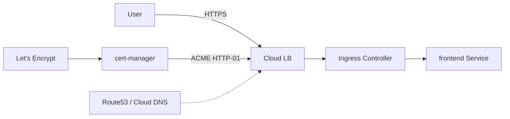

## 🏆 Capstone 4 — Ingress with TLS: cert-manager + Let's Encrypt on GKE (GCE Ingress) and EKS (ALB Ingress)

**Difficulty**: Intermediate
**Estimated time**: 2 hours

### Objective
Expose the shop app on `shop.example.com` with automatic TLS certificates.

### Prerequisites
- Owned domain with DNS access.
- GKE + EKS clusters.
- Helm.

### Workflow


### Setup

**Install cert-manager (both clusters)**
```bash
helm repo add jetstack https://charts.jetstack.io
helm install cert-manager jetstack/cert-manager -n cert-manager --create-namespace \
  --version v1.15.0 --set installCRDs=true
```

**ClusterIssuer**
```yaml
apiVersion: cert-manager.io/v1
kind: ClusterIssuer
metadata: { name: letsencrypt-prod }
spec:
  acme:
    server: https://acme-v02.api.letsencrypt.org/directory
    email: you@example.com
    privateKeySecretRef: { name: letsencrypt-prod }
    solvers:
      - http01:
          ingress:
            class: gce         # for GKE; use "alb" for EKS
```

**GKE Ingress** (`ingress-gke.yaml`)
```yaml
apiVersion: networking.k8s.io/v1
kind: Ingress
metadata:
  name: shop
  namespace: shop
  annotations:
    kubernetes.io/ingress.class: "gce"
    cert-manager.io/cluster-issuer: "letsencrypt-prod"
    kubernetes.io/ingress.global-static-ip-name: "shop-ip"
spec:
  tls:
    - hosts: [shop.example.com]
      secretName: shop-tls
  rules:
    - host: shop.example.com
      http:
        paths:
          - path: /*
            pathType: ImplementationSpecific
            backend: { service: { name: frontend, port: { number: 80 } } }
```
Reserve static IP:
```bash
gcloud compute addresses create shop-ip --global
gcloud compute addresses describe shop-ip --global
# Update Cloud DNS: A record for shop.example.com → returned IP
```

**EKS ALB Ingress**
```bash
# Install AWS Load Balancer Controller with IRSA (see Capstone 7 for IRSA pattern)
helm repo add eks https://aws.github.io/eks-charts
helm install aws-load-balancer-controller eks/aws-load-balancer-controller \
  -n kube-system --set clusterName=capstone1 --set serviceAccount.create=false \
  --set serviceAccount.name=aws-load-balancer-controller
```

```yaml
apiVersion: networking.k8s.io/v1
kind: Ingress
metadata:
  name: shop
  namespace: shop
  annotations:
    kubernetes.io/ingress.class: alb
    alb.ingress.kubernetes.io/scheme: internet-facing
    alb.ingress.kubernetes.io/target-type: ip
    alb.ingress.kubernetes.io/listen-ports: '[{"HTTP":80},{"HTTPS":443}]'
    alb.ingress.kubernetes.io/ssl-redirect: '443'
    cert-manager.io/cluster-issuer: letsencrypt-prod
spec:
  tls:
    - hosts: [shop.example.com]
      secretName: shop-tls
  rules:
    - host: shop.example.com
      http:
        paths:
          - path: /
            pathType: Prefix
            backend: { service: { name: frontend, port: { number: 80 } } }
```

### Verification
```bash
kubectl -n shop describe ingress shop
kubectl -n shop get certificate,order,challenge
curl -v https://shop.example.com/
```

### Cleanup
```bash
kubectl delete -f ingress-*.yaml
helm uninstall cert-manager -n cert-manager
gcloud compute addresses delete shop-ip --global --quiet
```

### Troubleshooting
- **Challenge stuck `Pending`** — DNS hasn't propagated; ensure record is public and correct.
- **`ACME connection issue`** — LB not routing; check `--cluster-issuer` events.
- **Rate limits from Let's Encrypt** — use staging issuer while testing.

### Bonus
- Migrate to **DNS-01 challenge** (needed for wildcard certs) via Cloud DNS / Route53 provider.
- Add HTTP → HTTPS redirect.
- Add WAF (Cloud Armor / AWS WAFv2) via Ingress annotations.

---

