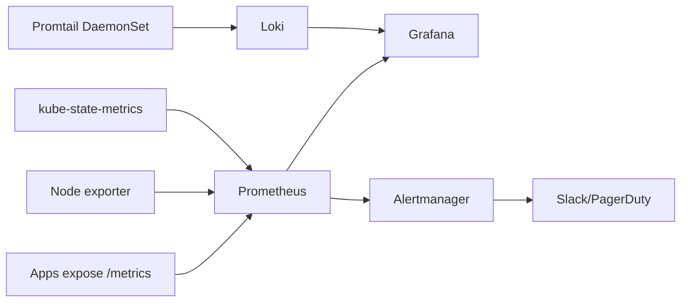

## 🏆 Capstone 5 — Full Observability Stack: Prometheus + Grafana + Loki + Alertmanager on GKE and EKS

**Difficulty**: Intermediate–Advanced
**Estimated time**: 3 hours

### Objective
Deploy kube-prometheus-stack + Loki + Promtail + Alertmanager; build a dashboard for shop app SLIs; fire an alert on P95 latency breach.

### Prerequisites
- GKE or EKS cluster with ≥3 nodes.
- Helm.
- (Optional) Slack webhook for Alertmanager.

### Workflow


### Setup

```bash
helm repo add prometheus-community https://prometheus-community.github.io/helm-charts
helm repo add grafana https://grafana.github.io/helm-charts
helm repo update

kubectl create ns monitoring

# Prometheus + Grafana + AM
helm install kube-prom prometheus-community/kube-prometheus-stack -n monitoring \
  --set grafana.adminPassword=admin123 \
  --set prometheus.prometheusSpec.retention=15d \
  --set prometheus.prometheusSpec.resources.requests.memory=1Gi

# Loki
helm install loki grafana/loki-stack -n monitoring \
  --set grafana.enabled=false --set promtail.enabled=true
```

### Instrument the backend
Add `/metrics` endpoint (Prometheus format) or use an SDK; add a `ServiceMonitor`:
```yaml
apiVersion: monitoring.coreos.com/v1
kind: ServiceMonitor
metadata:
  name: backend
  namespace: monitoring
  labels: { release: kube-prom }
spec:
  selector: { matchLabels: { app: backend } }
  namespaceSelector: { matchNames: [shop] }
  endpoints:
    - port: http
      path: /metrics
      interval: 15s
```

### Alert Rule
```yaml
apiVersion: monitoring.coreos.com/v1
kind: PrometheusRule
metadata:
  name: shop-slo
  namespace: monitoring
  labels: { release: kube-prom }
spec:
  groups:
    - name: shop.rules
      rules:
        - alert: BackendHighLatency
          expr: |
            histogram_quantile(0.95,
              sum by (le) (rate(http_request_duration_seconds_bucket{job="backend"}[5m]))
            ) > 0.5
          for: 5m
          labels: { severity: warning }
          annotations:
            summary: "Backend P95 latency > 500ms"
```

### Grafana Dashboard
- Port-forward: `kubectl -n monitoring port-forward svc/kube-prom-grafana 3000:80`
- Login (admin/admin123).
- Import dashboard IDs: `315` (K8s), `13639` (Loki logs), and build custom shop SLI panels: request rate, error rate, P95.

### Verification
- Prometheus targets: `kubectl -n monitoring port-forward svc/kube-prom-kube-prometheus 9090:9090` → `/targets` shows backend UP.
- Loki logs visible in Grafana Explore.
- Trigger a load spike; alert fires in Alertmanager UI.

### Cleanup
```bash
helm uninstall kube-prom loki -n monitoring
kubectl delete ns monitoring
```

### Troubleshooting
- **ServiceMonitor not scraped** — label mismatch with the release; add `release: kube-prom`.
- **Loki OOM** — raise memory, or use SingleBinary mode for demos.
- **Alertmanager silent** — verify receiver config; test with `amtool`.

### Bonus
- Send traces via OpenTelemetry Collector → Tempo.
- Add SLO burn-rate alerts (multi-window multi-burn).
- Use **GKE Managed Prometheus** and **CloudWatch Container Insights** as managed alternatives; compare cost.

---

