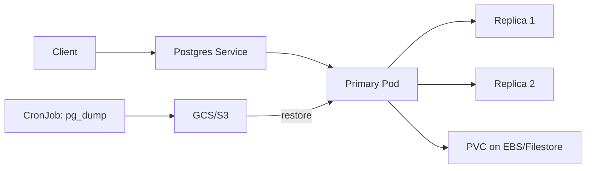

## 🏆 Capstone 6 — StatefulSet PostgreSQL with PVC on GKE Filestore + EKS EBS/EFS, Including Backup and Restore

**Difficulty**: Intermediate–Advanced
**Estimated time**: 3 hours

### Objective
Run a 3-replica PostgreSQL StatefulSet with proper storage; take a logical backup to object storage; restore it.

### Prerequisites
- GKE cluster with Filestore CSI driver enabled OR EKS with EBS CSI + EFS CSI.
- `pg_dump` client locally.
- Object bucket (GCS / S3).

### Workflow


### Storage class

**GKE Filestore**
```yaml
apiVersion: storage.k8s.io/v1
kind: StorageClass
metadata: { name: filestore-sc }
provisioner: filestore.csi.storage.gke.io
parameters: { tier: BASIC_HDD, network: default }
allowVolumeExpansion: true
```

**EKS EBS**
```yaml
apiVersion: storage.k8s.io/v1
kind: StorageClass
metadata: { name: gp3-sc }
provisioner: ebs.csi.aws.com
parameters: { type: gp3, iops: "3000", throughput: "125" }
allowVolumeExpansion: true
volumeBindingMode: WaitForFirstConsumer
```

### PostgreSQL via Bitnami Helm

```bash
helm repo add bitnami https://charts.bitnami.com/bitnami
helm install pg bitnami/postgresql -n db --create-namespace \
  --set architecture=replication \
  --set primary.persistence.storageClass=gp3-sc \
  --set primary.persistence.size=20Gi \
  --set readReplicas.replicaCount=2 \
  --set readReplicas.persistence.storageClass=gp3-sc \
  --set readReplicas.persistence.size=20Gi \
  --set auth.postgresPassword=changeme \
  --set auth.database=shopdb
```

### Backup CronJob to S3

```yaml
apiVersion: batch/v1
kind: CronJob
metadata: { name: pg-backup, namespace: db }
spec:
  schedule: "0 * * * *"
  jobTemplate:
    spec:
      template:
        spec:
          serviceAccountName: pg-backup-sa   # IRSA / WLI SA
          restartPolicy: OnFailure
          containers:
            - name: dump
              image: postgres:16
              env:
                - name: PGPASSWORD
                  valueFrom: { secretKeyRef: { name: pg-postgresql, key: postgres-password } }
              command:
                - /bin/sh
                - -c
                - |
                  TS=$(date +%Y%m%d-%H%M)
                  pg_dump -h pg-postgresql -U postgres shopdb | gzip > /tmp/backup-$TS.sql.gz
                  aws s3 cp /tmp/backup-$TS.sql.gz s3://acme-pg-backups/shopdb/backup-$TS.sql.gz
```

### Restore
```bash
aws s3 cp s3://acme-pg-backups/shopdb/backup-20260927-1200.sql.gz .
gunzip -c backup-20260927-1200.sql.gz | \
  kubectl exec -it -n db pg-postgresql-0 -- psql -U postgres shopdb
```

### Verification
```bash
kubectl -n db get statefulset,pvc
kubectl -n db exec -it pg-postgresql-0 -- psql -U postgres -c "SELECT * FROM pg_stat_replication;"
kubectl -n db get cronjob,job
aws s3 ls s3://acme-pg-backups/shopdb/
```

### Cleanup
```bash
helm uninstall pg -n db
kubectl -n db delete pvc --all
aws s3 rm s3://acme-pg-backups --recursive
```

### Troubleshooting
- **PVC Pending** — CSI driver not installed; `kubectl get pods -n kube-system | grep csi`.
- **`multi-attach error`** — RWO on Filestore: use RWX Filestore tier.
- **Replication lag** — check `pg_stat_replication`, network throughput.

### Bonus
- Replace with **Zalando Postgres Operator** (Capstone 9 preview).
- Add PITR via WAL archiving to S3 (`wal-g`).
- Multi-region: run standby cluster + `pg_basebackup` bootstrap.

---

