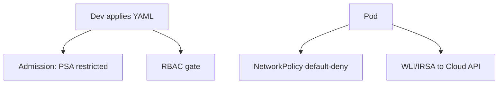

## 🏆 Capstone 7 — Enforce Security: RBAC + NetworkPolicy + Pod Security Admission + WLI (GKE) + IRSA (EKS)

**Difficulty**: Advanced
**Estimated time**: 3 hours

### Objective
Layer security controls on the shop app: least-privilege RBAC, default-deny NetworkPolicy, enforce `restricted` PSA, and use cloud identities for backend to reach a bucket.

### Workflow


### Prerequisites
- Cluster from prior capstones.
- Kyverno or built-in PSA.

### Step 1 — Enforce PSA `restricted`

```bash
kubectl label ns shop \
  pod-security.kubernetes.io/enforce=restricted \
  pod-security.kubernetes.io/warn=restricted \
  pod-security.kubernetes.io/audit=restricted --overwrite
```
Then update Pods to comply:
```yaml
securityContext:
  runAsNonRoot: true
  seccompProfile: { type: RuntimeDefault }
containers:
  - name: backend
    securityContext:
      allowPrivilegeEscalation: false
      capabilities: { drop: ["ALL"] }
      readOnlyRootFilesystem: true
```

### Step 2 — RBAC

```yaml
apiVersion: v1
kind: ServiceAccount
metadata: { name: shop-dev, namespace: shop }
---
apiVersion: rbac.authorization.k8s.io/v1
kind: Role
metadata: { name: shop-dev, namespace: shop }
rules:
  - apiGroups: ["", "apps"]
    resources: ["pods", "deployments", "services", "configmaps"]
    verbs: ["get","list","watch","create","update","patch","delete"]
---
apiVersion: rbac.authorization.k8s.io/v1
kind: RoleBinding
metadata: { name: shop-dev, namespace: shop }
subjects: [{ kind: User, name: dev@acme.io, apiGroup: rbac.authorization.k8s.io }]
roleRef: { kind: Role, name: shop-dev, apiGroup: rbac.authorization.k8s.io }
```

Test: `kubectl auth can-i delete nodes --as=dev@acme.io` → no.

### Step 3 — NetworkPolicy default-deny + allow

```yaml
apiVersion: networking.k8s.io/v1
kind: NetworkPolicy
metadata: { name: default-deny, namespace: shop }
spec:
  podSelector: {}
  policyTypes: [Ingress, Egress]
---
apiVersion: networking.k8s.io/v1
kind: NetworkPolicy
metadata: { name: allow-dns, namespace: shop }
spec:
  podSelector: {}
  policyTypes: [Egress]
  egress:
    - to: [{ namespaceSelector: { matchLabels: { kubernetes.io/metadata.name: kube-system } } }]
      ports: [{ protocol: UDP, port: 53 }, { protocol: TCP, port: 53 }]
---
apiVersion: networking.k8s.io/v1
kind: NetworkPolicy
metadata: { name: frontend-to-backend, namespace: shop }
spec:
  podSelector: { matchLabels: { app: backend } }
  policyTypes: [Ingress]
  ingress:
    - from: [{ podSelector: { matchLabels: { app: frontend } } }]
      ports: [{ port: 8080 }]
```

### Step 4 — Cloud identity

**GKE WLI** — see Topic 69 Example 1: bind `shop-ksa` to a GCP SA with `roles/storage.objectViewer`.

**EKS IRSA** —
```bash
eksctl create iamserviceaccount --cluster=capstone1 --namespace=shop --name=shop-ksa \
  --attach-policy-arn=arn:aws:iam::aws:policy/AmazonS3ReadOnlyAccess --approve
```

Reference the SA in the backend Deployment:
```yaml
spec:
  serviceAccountName: shop-ksa
```

### Verification
```bash
# PSA
kubectl -n shop run bad --image=nginx --dry-run=server -o yaml    # should be rejected
# RBAC
kubectl auth can-i delete pod --as=dev@acme.io -n shop            # yes
kubectl auth can-i delete pod --as=dev@acme.io -n kube-system     # no
# NetworkPolicy
kubectl -n shop exec -it deploy/frontend -- curl backend:8080/healthz   # 200
kubectl -n shop exec -it deploy/frontend -- curl google.com             # blocked
```

### Cleanup
Revert labels and delete policies; delete IAM roles/GSAs.

### Troubleshooting
- **PSA blocks legitimate Pod** — audit first (`warn` + `audit`), then fix.
- **NetworkPolicy has no effect** — CNI must support them (Cilium, Calico, GKE DPv2, AWS VPC CNI with policy add-on).

### Bonus
- Add Kyverno policy requiring `runAsNonRoot: true`.
- Add Falco DaemonSet for runtime detection.
- Add image signature verification (cosign + Kyverno).

---

