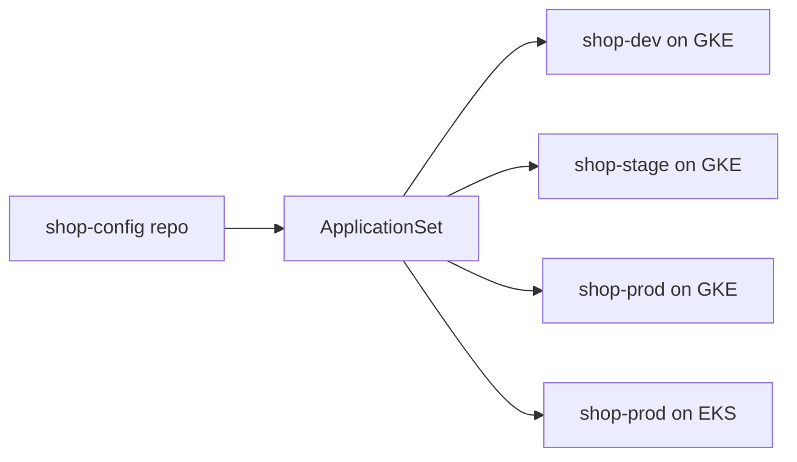

## 🏆 Capstone 8 — GitOps Deployment Using ArgoCD on GKE and EKS with Multi-Environment (dev/stage/prod) Sync

**Difficulty**: Advanced
**Estimated time**: 3 hours

### Objective
One config repo, three environments (dev/stage/prod), two clusters (GKE + EKS), one ArgoCD hub managing everything.

### Prerequisites
- GKE + EKS clusters.
- GitHub repo `shop-config`.
- ArgoCD.

### Workflow


### Repo layout
```
shop-config/
├── charts/shop/                # from Capstone 2
├── envs/
│   ├── dev/values.yaml
│   ├── stage/values.yaml
│   └── prod/values.yaml
└── argocd/
    └── applicationset.yaml
```

### Install ArgoCD (hub cluster = GKE)
```bash
kubectl create ns argocd
kubectl apply -n argocd -f https://raw.githubusercontent.com/argoproj/argo-cd/stable/manifests/install.yaml
kubectl -n argocd rollout status deploy/argocd-server
kubectl -n argocd get secret argocd-initial-admin-secret -o jsonpath='{.data.password}' | base64 -d
```

### Register EKS as a target
```bash
kubectl config use-context arn:aws:eks:us-east-1:111111111111:cluster/capstone1
argocd cluster add arn:aws:eks:us-east-1:111111111111:cluster/capstone1
```

### ApplicationSet
```yaml
apiVersion: argoproj.io/v1alpha1
kind: ApplicationSet
metadata: { name: shop, namespace: argocd }
spec:
  generators:
    - list:
        elements:
          - env: dev
            cluster: https://kubernetes.default.svc      # GKE hub
            valuesFile: envs/dev/values.yaml
          - env: stage
            cluster: https://kubernetes.default.svc
            valuesFile: envs/stage/values.yaml
          - env: prod-gke
            cluster: https://kubernetes.default.svc
            valuesFile: envs/prod/values.yaml
          - env: prod-eks
            cluster: https://<eks-endpoint>              # from argocd cluster list
            valuesFile: envs/prod/values.yaml
  template:
    metadata: { name: 'shop-{{env}}' }
    spec:
      project: default
      source:
        repoURL: https://github.com/acme/shop-config
        targetRevision: main
        path: charts/shop
        helm:
          valueFiles: ['../../{{valuesFile}}']
      destination:
        server: '{{cluster}}'
        namespace: 'shop-{{env}}'
      syncPolicy:
        automated: { prune: true, selfHeal: true }
        syncOptions: [CreateNamespace=true, ServerSideApply=true]
```

### Verification
- ArgoCD UI shows 4 Applications, all `Synced/Healthy`.
- `kubectl -n shop-dev get pods` on GKE and `kubectl -n shop-prod get pods` on both clusters.

### Cleanup
```bash
kubectl delete applicationset shop -n argocd
kubectl delete ns argocd
```

### Troubleshooting
- **Application `OutOfSync`** — inspect diff in UI.
- **EKS cluster registration fails** — ensure argocd SA on hub has kubeconfig access.
- **Auto-sync causes drift war** — someone editing manually; add RBAC to lock out.

### Bonus
- Add **Argo Rollouts** for canary in prod.
- Add **Sealed Secrets** for encrypted values.
- Add **ApplicationSet PR generator** for per-PR ephemeral envs.

---

