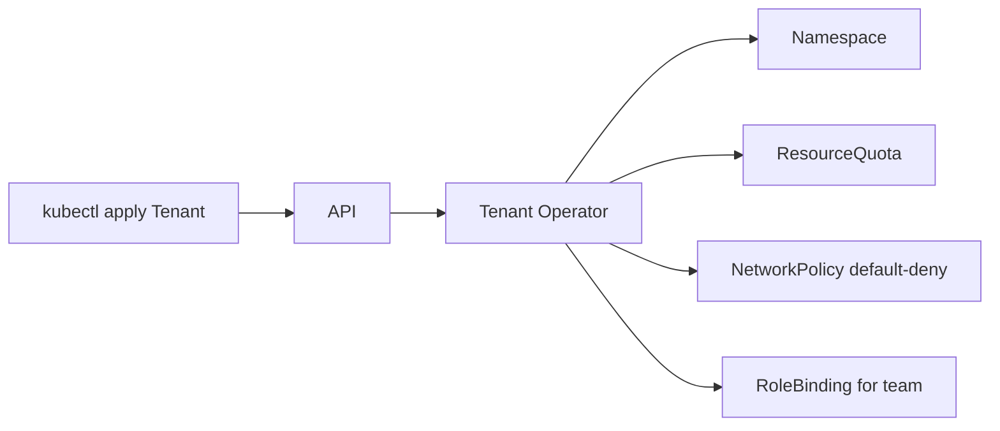

## 🏆 Capstone 9 — Build and Deploy a Custom Operator Using Kubebuilder on GKE and EKS

**Difficulty**: Advanced
**Estimated time**: 4 hours

### Objective
Create a `Tenant` CRD + controller that, when a `Tenant` object is applied, creates a Namespace + ResourceQuota + NetworkPolicy + baseline RoleBinding.

### Prerequisites
- Go 1.22+, kubebuilder v3.14+, Docker, kubectl, kind (for local test), GKE + EKS clusters, container registry.

### Workflow


### Scaffold
```bash
mkdir tenant-op && cd tenant-op
kubebuilder init --domain acme.io --repo github.com/acme/tenant-op
kubebuilder create api --group platform --version v1 --kind Tenant --resource --controller
```

### CRD types (`api/v1/tenant_types.go`)
```go
type TenantSpec struct {
    Team    string `json:"team"`
    CPU     string `json:"cpu"`
    Memory  string `json:"memory"`
    Admins  []string `json:"admins"`
}
type TenantStatus struct {
    Namespace string `json:"namespace,omitempty"`
    Ready     bool   `json:"ready,omitempty"`
}
```

### Reconciler sketch (`internal/controller/tenant_controller.go`)
```go
func (r *TenantReconciler) Reconcile(ctx context.Context, req ctrl.Request) (ctrl.Result, error) {
    var t platformv1.Tenant
    if err := r.Get(ctx, req.NamespacedName, &t); err != nil {
        return ctrl.Result{}, client.IgnoreNotFound(err)
    }
    nsName := "team-" + t.Spec.Team

    // 1. Namespace
    ns := &corev1.Namespace{ObjectMeta: metav1.ObjectMeta{Name: nsName, Labels: map[string]string{"tenant": t.Name}}}
    _ = ctrl.SetControllerReference(&t, ns, r.Scheme)
    if err := r.Client.Patch(ctx, ns, client.Apply, client.ForceOwnership, client.FieldOwner("tenant-op")); err != nil { return ctrl.Result{}, err }

    // 2. ResourceQuota
    rq := &corev1.ResourceQuota{
        ObjectMeta: metav1.ObjectMeta{Name: "default", Namespace: nsName},
        Spec: corev1.ResourceQuotaSpec{ Hard: corev1.ResourceList{
            corev1.ResourceRequestsCPU:    resource.MustParse(t.Spec.CPU),
            corev1.ResourceRequestsMemory: resource.MustParse(t.Spec.Memory),
        }},
    }
    _ = ctrl.SetControllerReference(&t, rq, r.Scheme)
    if err := r.Client.Patch(ctx, rq, client.Apply, client.ForceOwnership, client.FieldOwner("tenant-op")); err != nil { return ctrl.Result{}, err }

    // 3. NetworkPolicy default-deny
    np := &netv1.NetworkPolicy{
        ObjectMeta: metav1.ObjectMeta{Name: "default-deny", Namespace: nsName},
        Spec: netv1.NetworkPolicySpec{
            PodSelector: metav1.LabelSelector{},
            PolicyTypes: []netv1.PolicyType{netv1.PolicyTypeIngress, netv1.PolicyTypeEgress},
        },
    }
    _ = ctrl.SetControllerReference(&t, np, r.Scheme)
    _ = r.Client.Patch(ctx, np, client.Apply, client.ForceOwnership, client.FieldOwner("tenant-op"))

    // 4. RoleBinding for admins
    if len(t.Spec.Admins) > 0 {
        rb := &rbacv1.RoleBinding{
            ObjectMeta: metav1.ObjectMeta{Name: "team-admin", Namespace: nsName},
            RoleRef: rbacv1.RoleRef{Kind: "ClusterRole", Name: "admin", APIGroup: "rbac.authorization.k8s.io"},
        }
        for _, u := range t.Spec.Admins {
            rb.Subjects = append(rb.Subjects, rbacv1.Subject{Kind: "User", Name: u, APIGroup: "rbac.authorization.k8s.io"})
        }
        _ = ctrl.SetControllerReference(&t, rb, r.Scheme)
        _ = r.Client.Patch(ctx, rb, client.Apply, client.ForceOwnership, client.FieldOwner("tenant-op"))
    }

    t.Status.Namespace = nsName
    t.Status.Ready = true
    return ctrl.Result{}, r.Status().Update(ctx, &t)
}
```

### Build and deploy
```bash
make manifests generate fmt vet
make docker-build docker-push IMG=myrepo/tenant-op:0.1
make deploy IMG=myrepo/tenant-op:0.1
```

### Sample Tenant
```yaml
apiVersion: platform.acme.io/v1
kind: Tenant
metadata: { name: shop }
spec:
  team: shop
  cpu: "10"
  memory: 20Gi
  admins: [alice@acme.io, bob@acme.io]
```
```bash
kubectl apply -f tenant-shop.yaml
kubectl get ns team-shop
kubectl -n team-shop get quota,networkpolicy,rolebinding
```

### Verification
- Namespace, quota, netpol, rolebinding all owned by the Tenant CR.
- Deleting the Tenant garbage-collects children.

### Cleanup
```bash
kubectl delete tenant shop
make undeploy
```

### Troubleshooting
- **Reconcile errors** — `kubectl -n tenant-op-system logs deploy/tenant-op-controller-manager`.
- **PSA blocks** — mark op namespace `enforce=privileged` if the SA needs it (usually not).
- **RBAC missing** — regenerate via `make manifests` after adding `//+kubebuilder:rbac` markers.

### Bonus
- Add a validating webhook that rejects Tenants with too-large quotas.
- Publish as an OLM bundle.
- Ship a metric `tenant_ready_total` for observability.

---

