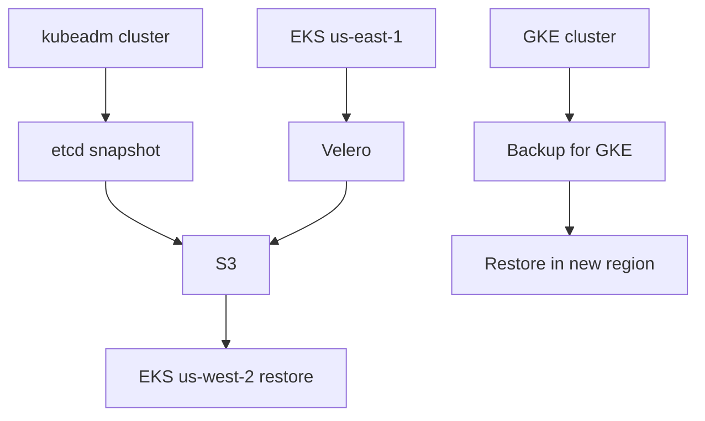

## 🏆 Capstone 10 — Disaster Recovery: etcd Backup/Restore on kubeadm + Backup for GKE + Velero Cross-Region on EKS

**Difficulty**: Advanced
**Estimated time**: 4 hours

### Objective
Practice three DR flows: raw etcd snapshot/restore, GKE workload backup and cross-region restore, EKS Velero cross-region restore.

### Workflow


### Part A — kubeadm etcd DR
Prerequisites: kubeadm HA cluster (or single-node lab).

**Snapshot**
```bash
ETCDCTL_API=3 etcdctl snapshot save /tmp/snap.db \
  --endpoints=https://127.0.0.1:2379 \
  --cacert=/etc/kubernetes/pki/etcd/ca.crt \
  --cert=/etc/kubernetes/pki/etcd/server.crt \
  --key=/etc/kubernetes/pki/etcd/server.key
aws s3 cp /tmp/snap.db s3://etcd-dr/snap-$(date +%F-%H%M).db
```

**Break** — delete a namespace as chaos.

**Restore**
```bash
# Stop kubelet + move existing data
systemctl stop kubelet
mv /var/lib/etcd /var/lib/etcd.old

ETCDCTL_API=3 etcdctl snapshot restore /tmp/snap.db \
  --name=<node-name> \
  --initial-cluster=<node-name>=https://<node-ip>:2380 \
  --initial-advertise-peer-urls=https://<node-ip>:2380 \
  --data-dir=/var/lib/etcd

systemctl start kubelet
```
Verify namespace back.

### Part B — Backup for GKE

**Enable**
```bash
gcloud services enable gkebackup.googleapis.com
gcloud beta container backup-restore backup-plans create shop-plan \
  --project=my-project --location=us-central1 \
  --cluster=projects/my-project/locations/us-central1/clusters/shop \
  --include-volume-data --include-secrets \
  --cron-schedule="0 */6 * * *" --backup-retain-days=30 \
  --all-namespaces
```

**Take a backup manually**
```bash
gcloud beta container backup-restore backups create shop-b1 \
  --location=us-central1 --backup-plan=shop-plan --wait-for-completion
```

**Restore in another region**
```bash
gcloud beta container backup-restore restore-plans create shop-restore \
  --location=us-west1 \
  --backup-plan=projects/my-project/locations/us-central1/backupPlans/shop-plan \
  --cluster=projects/my-project/locations/us-west1/clusters/shop-dr \
  --all-namespaces --namespaced-resource-restore-mode=DELETE_AND_RESTORE \
  --volume-data-restore-policy=RESTORE_VOLUME_DATA_FROM_BACKUP

gcloud beta container backup-restore restores create shop-r1 \
  --location=us-west1 --restore-plan=shop-restore \
  --backup=projects/my-project/locations/us-central1/backupPlans/shop-plan/backups/shop-b1
```

### Part C — Velero on EKS Cross-Region

**Install (in both clusters, same S3 bucket)**
```bash
velero install \
  --provider aws --plugins velero/velero-plugin-for-aws:v1.9.0 \
  --bucket velero-dr --backup-location-config region=us-east-1 \
  --snapshot-location-config region=us-east-1 \
  --secret-file ./credentials-velero
```
(Prefer IRSA over static credentials.)

**Backup**
```bash
velero backup create shop-daily --include-namespaces=shop,db --wait
```

**Restore in us-west-2 cluster**
```bash
aws eks update-kubeconfig --name shop-dr --region us-west-2
velero restore create --from-backup shop-daily --wait
```

### Verification
- kubeadm: deleted objects reappear post-restore.
- GKE: new region cluster has shop workloads + PV data.
- EKS: shop namespace up in us-west-2 with S3-backed PVs.

### Cleanup
```bash
# kubeadm — keep or reset per your lab
gcloud beta container backup-restore backup-plans delete shop-plan --location=us-central1 --quiet
velero uninstall
```

### Troubleshooting
- **Restore fails on immutable PVs** — use `--restore-volume-data-from-backup` and matching StorageClass in target.
- **CSI snapshots missing** — install VolumeSnapshot CRDs + external snapshotter.
- **Cross-region latency** — expect longer restore times; measure and document RTO.

### Bonus
- Automate weekly restore game-days.
- Add Alertmanager alert on failed backups.
- Use **immutable S3 bucket** (Object Lock) to protect from ransomware.

---

